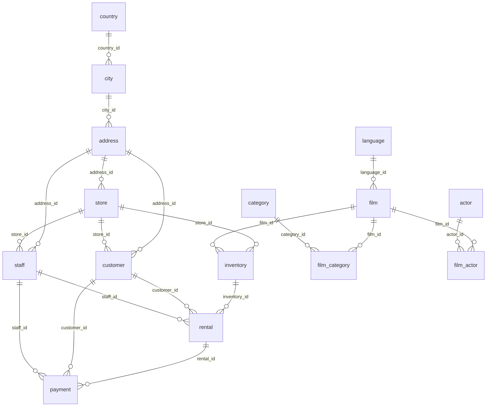

# Inventario de la base de datos fuente

> Tarea 4 del enunciado: *Identificar fuentes de datos, analizar la base de datos proporcionada e identificar las tablas, campos y estructuras que serán utilizadas para alimentar el DW.*
> Jira: DWI-24 · Responsable: Kristel Ramírez 

## 1. Fuente analizada

| Dato | Valor |
|---|---|
| Base de datos | `pagila_dvd_rental` (PostgreSQL, esquema `public`) |
| Archivo de respaldo | `ProyectoBackup` (formato *custom* de `pg_dump`, comprimido con gzip) |
| Versión del servidor de origen | PostgreSQL 15.19 |
| Versión de `pg_dump` | 18.6 |
| Fecha del respaldo | 29/10/2026 10:42 |
| Contenido | 15 tablas (una de ellas particionada en 6 tablas hijas), 7 vistas, 10 funciones y 15 disparadores |

> **Nota de restauración.** El respaldo se generó con `pg_dump` 18, así que el `pg_restore` de PostgreSQL 15 no lo puede leer (error *unsupported version 1.16*). Para restaurarlo en PostgreSQL 15 se convirtió a SQL plano (`ProyectoBackup.sql`) y se cargó con `psql`. La carga terminó sin errores.

## 2. Resumen de tablas

| # | Tabla | Tipo de entidad | Filas | Columnas | Llave primaria | Uso propuesto en el DW |
|---|---|---|---:|---:|---|---|
| 1 | `rental` | Transacción | 32.088 | 7 | `rental_id` | **Fuente de `fact_alquiler`** (grano: 1 alquiler) |
| 2 | `payment` | Transacción (particionada por mes) | 32.093 | 6 | `payment_date`, `payment_id` | Medida de ingreso de `fact_alquiler` (se agrupa por `rental_id`) |
| 3 | `inventory` | Puente película–tienda | 4.581 | 4 | `inventory_id` | Une alquiler con película y tienda; **fuente de `fact_inventario`** |
| 4 | `film` | Catálogo | 1.000 | 14 | `film_id` | `dim_pelicula` |
| 5 | `category` | Catálogo | 16 | 3 | `category_id` | Atributo de `dim_pelicula` |
| 6 | `film_category` | Puente película–categoría | 1.000 | 3 | `film_id`, `category_id` | Asigna la categoría a `dim_pelicula` (1 categoría por película) |
| 7 | `language` | Catálogo | 6 | 3 | `language_id` | Atributo de `dim_pelicula` |
| 8 | `actor` | Catálogo | 200 | 4 | `actor_id` | `dim_actor` |
| 9 | `film_actor` | Puente película–actor (N:M) | 5.462 | 3 | `actor_id`, `film_id` | Tabla puente `bridge_pelicula_actor` |
| 10 | `customer` | Maestro | 599 | 10 | `customer_id` | `dim_cliente` |
| 11 | `address` | Geografía | 603 | 8 | `address_id` | Desnormaliza ciudad y país en `dim_cliente` y `dim_tienda` |
| 12 | `city` | Geografía | 600 | 4 | `city_id` | Atributo de `dim_cliente` / `dim_tienda` |
| 13 | `country` | Geografía | 109 | 3 | `country_id` | Atributo de `dim_cliente` / `dim_tienda` |
| 14 | `store` | Maestro | 2 | 4 | `store_id` | `dim_tienda` |
| 15 | `staff` | Maestro | 5 | 11 | `staff_id` | No se usa en las 10 preguntas; solo el nombre del gerente como atributo opcional de `dim_tienda` |

`payment` es una tabla particionada. Sus datos físicos están en 6 particiones mensuales, de `payment_p2017_01` a `payment_p2017_06` (rango del 01/01/2017 al 30/06/2017). Para el ETL se lee siempre la tabla madre `payment`, nunca las particiones por separado.

## 3. Relaciones

Todas las relaciones son 1:N y están declaradas como llaves foráneas, salvo `store.manager_staff_id`, que no tiene restricción.

| Tabla hija | Columna | Tabla padre | Cardinalidad | Regla |
|---|---|---|---|---|
| `rental` | `inventory_id` | `inventory` | N:1 | ON UPDATE CASCADE, ON DELETE RESTRICT |
| `rental` | `customer_id` | `customer` | N:1 | ON UPDATE CASCADE, ON DELETE RESTRICT |
| `rental` | `staff_id` | `staff` | N:1 | ON UPDATE CASCADE, ON DELETE RESTRICT |
| `payment` | `rental_id` | `rental` | N:1 | Declarada en cada partición |
| `payment` | `customer_id` | `customer` | N:1 | Declarada en cada partición |
| `payment` | `staff_id` | `staff` | N:1 | Declarada en cada partición |
| `inventory` | `film_id` | `film` | N:1 | ON UPDATE CASCADE, ON DELETE RESTRICT |
| `inventory` | `store_id` | `store` | N:1 | ON UPDATE CASCADE, ON DELETE RESTRICT |
| `film` | `language_id` | `language` | N:1 | ON UPDATE CASCADE, ON DELETE RESTRICT |
| `film` | `original_language_id` | `language` | N:1 (opcional) | ON UPDATE CASCADE, ON DELETE RESTRICT |
| `film_category` | `film_id` / `category_id` | `film` / `category` | N:M resuelta | ON UPDATE CASCADE, ON DELETE RESTRICT |
| `film_actor` | `film_id` / `actor_id` | `film` / `actor` | N:M resuelta | ON UPDATE CASCADE, ON DELETE RESTRICT |
| `customer` | `store_id` | `store` | N:1 | ON UPDATE CASCADE, ON DELETE RESTRICT |
| `customer` | `address_id` | `address` | N:1 | ON UPDATE CASCADE, ON DELETE RESTRICT |
| `staff` | `store_id` | `store` | N:1 | Sin reglas en cascada |
| `staff` | `address_id` | `address` | N:1 | ON UPDATE CASCADE, ON DELETE RESTRICT |
| `store` | `address_id` | `address` | N:1 | ON UPDATE CASCADE, ON DELETE RESTRICT |
| `store` | `manager_staff_id` | `staff` | 1:1 | **Sin llave foránea declarada** |
| `address` | `city_id` | `city` | N:1 | ON UPDATE CASCADE, ON DELETE RESTRICT |
| `city` | `country_id` | `country` | N:1 | ON UPDATE CASCADE, ON DELETE RESTRICT |

### Diagrama entidad-relación de la fuente

### Rutas de unión que usará el ETL

- **Alquiler → tienda de negocio:** `rental.inventory_id → inventory.store_id`. La tienda que se usa en el negocio es la dueña de la copia, no la del cliente ni la del empleado (ver `docs/modelo/06-decisiones-de-diseno.md`).
- **Alquiler → película → categoría:** `rental → inventory → film → film_category → category`.
- **Alquiler → actores:** `rental → inventory → film → film_actor → actor` (N:M, se modela con una tabla puente).
- **Alquiler → ubicación del cliente:** `rental → customer → address → city → country`.
- **Alquiler → ingreso:** `payment.rental_id → rental.rental_id` (un alquiler puede tener más de un pago).

## 4. Campos por tabla

#### `actor`

| Columna | Tipo | Nulo | Llave | Observación |
|---|---|---|---|---|
| actor_id | integer | no | PK | autoincremental |
| first_name | text | no |  |  |
| last_name | text | no |  |  |
| last_update | timestamptz | no |  | Auditoría; no se carga |

#### `address`

| Columna | Tipo | Nulo | Llave | Observación |
|---|---|---|---|---|
| address_id | integer | no | PK | autoincremental |
| address | text | no |  | No se carga (no aporta al análisis) |
| address2 | text | sí |  | No se carga |
| district | text | no |  |  |
| city_id | smallint | no | FK → city.city_id |  |
| postal_code | text | sí |  | No se carga |
| phone | text | no |  | No se carga (dato sensible) |
| last_update | timestamptz | no |  | Auditoría; no se carga |

#### `category`

| Columna | Tipo | Nulo | Llave | Observación |
|---|---|---|---|---|
| category_id | integer | no | PK | autoincremental |
| name | text | no |  |  |
| last_update | timestamptz | no |  | Auditoría; no se carga |

#### `city`

| Columna | Tipo | Nulo | Llave | Observación |
|---|---|---|---|---|
| city_id | integer | no | PK | autoincremental |
| city | text | no |  |  |
| country_id | smallint | no | FK → country.country_id |  |
| last_update | timestamptz | no |  | Auditoría; no se carga |

#### `country`

| Columna | Tipo | Nulo | Llave | Observación |
|---|---|---|---|---|
| country_id | integer | no | PK | autoincremental |
| country | text | no |  |  |
| last_update | timestamptz | no |  | Auditoría; no se carga |

#### `customer`

| Columna | Tipo | Nulo | Llave | Observación |
|---|---|---|---|---|
| customer_id | integer | no | PK | autoincremental |
| store_id | smallint | no | FK → store.store_id | Tienda del cliente (no es la tienda de negocio) |
| first_name | text | no |  |  |
| last_name | text | no |  |  |
| email | text | sí |  | No se carga (dato sensible) |
| address_id | smallint | no | FK → address.address_id |  |
| activebool | boolean | no |  | Duplica a `active`; usar solo uno |
| create_date | date | no |  |  |
| last_update | timestamptz | sí |  | Auditoría; no se carga |
| active | integer | sí |  | Entero 0/1; redundante con `activebool` |

#### `film`

| Columna | Tipo | Nulo | Llave | Observación |
|---|---|---|---|---|
| film_id | integer | no | PK | autoincremental |
| title | text | no |  |  |
| description | text | sí |  | No se carga |
| release_year | integer | sí |  | Dominio `year` (1901–2155) |
| language_id | smallint | no | FK → language.language_id |  |
| original_language_id | smallint | sí | FK → language.language_id | FK opcional |
| rental_duration | smallint | no |  | Días permitidos; base para la devolución tardía |
| rental_rate | numeric(4,2) | no |  |  |
| length | smallint | sí |  |  |
| replacement_cost | numeric(5,2) | no |  |  |
| rating | mpaa_rating | sí |  | Tipo enumerado: G, PG, PG-13, R, NC-17 |
| last_update | timestamptz | no |  | Auditoría; no se carga |
| special_features | _text | sí |  | Arreglo; requiere transformación si se usa |
| fulltext | tsvector | no |  | No se carga (índice de búsqueda) |

#### `film_actor`

| Columna | Tipo | Nulo | Llave | Observación |
|---|---|---|---|---|
| actor_id | smallint | no | PK, FK → actor.actor_id |  |
| film_id | smallint | no | PK, FK → film.film_id |  |
| last_update | timestamptz | no |  | Auditoría; no se carga |

#### `film_category`

| Columna | Tipo | Nulo | Llave | Observación |
|---|---|---|---|---|
| film_id | smallint | no | PK, FK → film.film_id |  |
| category_id | smallint | no | PK, FK → category.category_id |  |
| last_update | timestamptz | no |  | Auditoría; no se carga |

#### `inventory`

| Columna | Tipo | Nulo | Llave | Observación |
|---|---|---|---|---|
| inventory_id | integer | no | PK | autoincremental |
| film_id | smallint | no | FK → film.film_id |  |
| store_id | smallint | no | FK → store.store_id |  |
| last_update | timestamptz | no |  | Auditoría; no se carga |

#### `language`

| Columna | Tipo | Nulo | Llave | Observación |
|---|---|---|---|---|
| language_id | integer | no | PK | autoincremental |
| name | character(20) | no |  | char(20) con espacios a la derecha; aplicar TRIM |
| last_update | timestamptz | no |  | Auditoría; no se carga |

#### `payment`

| Columna | Tipo | Nulo | Llave | Observación |
|---|---|---|---|---|
| payment_id | integer | no | PK | autoincremental |
| customer_id | smallint | no | FK → customer.customer_id |  |
| staff_id | smallint | no | FK → staff.staff_id |  |
| rental_id | integer | no | FK → rental.rental_id |  |
| amount | numeric(5,2) | no |  | Medida principal de ingreso |
| payment_date | timestamptz | no | PK | Llave de partición (por mes, 2017) |

#### `rental`

| Columna | Tipo | Nulo | Llave | Observación |
|---|---|---|---|---|
| rental_id | integer | no | PK | autoincremental |
| rental_date | timestamptz | no |  | Fecha de referencia del negocio |
| inventory_id | integer | no | FK → inventory.inventory_id |  |
| customer_id | smallint | no | FK → customer.customer_id |  |
| return_date | timestamptz | sí |  | Nulo = alquiler no devuelto |
| staff_id | smallint | no | FK → staff.staff_id |  |
| last_update | timestamptz | no |  | Auditoría; no se carga |

#### `staff`

| Columna | Tipo | Nulo | Llave | Observación |
|---|---|---|---|---|
| staff_id | integer | no | PK | autoincremental |
| first_name | text | no |  |  |
| last_name | text | no |  |  |
| address_id | smallint | no | FK → address.address_id |  |
| email | text | sí |  | No se carga (dato sensible) |
| store_id | smallint | no | FK → store.store_id |  |
| active | boolean | no |  |  |
| username | text | no |  | No se carga (dato sensible) |
| password | text | sí |  | No se carga (dato sensible) |
| last_update | timestamptz | no |  | Auditoría; no se carga |
| picture | bytea | sí |  | No se carga (imagen) |

#### `store`

| Columna | Tipo | Nulo | Llave | Observación |
|---|---|---|---|---|
| store_id | integer | no | PK | autoincremental |
| manager_staff_id | smallint | no |  | FK → staff.staff_id (implícita, sin restricción) |
| address_id | smallint | no | FK → address.address_id |  |
| last_update | timestamptz | no |  | Auditoría; no se carga |
## 5. Otros objetos de la base

| Tipo | Objetos | Uso en el DW |
|---|---|---|
| Tipo enumerado | `mpaa_rating` (G, PG, PG-13, R, NC-17) | Se convierte a texto en `dim_pelicula.clasificacion` |
| Dominio | `year` (entero entre 1901 y 2155) | Se carga como entero |
| Vistas | `actor_info`, `customer_list`, `film_list`, `nicer_but_slower_film_list`, `sales_by_film_category`, `sales_by_store`, `staff_list` | No se usan como fuente. `sales_by_film_category` y `sales_by_store` sirven para validar los totales del DW |
| Funciones | `film_in_stock`, `film_not_in_stock`, `get_customer_balance`, `inventory_held_by_customer`, `inventory_in_stock`, `last_day`, `rewards_report`, `last_updated`, `_group_concat`, `group_concat` | No se usan en el ETL |
| Disparadores | `last_updated` (en 14 tablas) y `film_fulltext_trigger` (en `film`) | Mantienen `last_update` y `fulltext`; no afectan la extracción |

## 6. Campos seleccionados para el DW

| Destino en el DW | Tablas fuente | Campos que se extraen |
|---|---|---|
| `fact_alquiler` | `rental`, `inventory`, `payment`, `film` | `rental_id`, `rental_date`, `return_date`, `customer_id`, `inventory.film_id`, `inventory.store_id`, `film.rental_duration`, `SUM(payment.amount)` por `rental_id` |
| `fact_inventario` | `inventory` | `film_id`, `store_id`, `COUNT(inventory_id)` |
| `dim_fecha` | `rental` | Se genera desde `rental_date` (año, trimestre, mes, día, día de la semana) |
| `dim_tienda` | `store`, `address`, `city`, `country`, `staff` | `store_id`, `city`, `country` y, opcionalmente, el nombre del gerente |
| `dim_pelicula` | `film`, `film_category`, `category`, `language` | `film_id`, `title`, `release_year`, `rating`, `length`, `rental_duration`, `rental_rate`, `replacement_cost`, `category.name`, `TRIM(language.name)` |
| `dim_cliente` | `customer`, `address`, `city`, `country` | `customer_id`, `first_name`, `last_name`, `active`, `create_date`, `city`, `country`, `city_id` (para distinguir ciudades con el mismo nombre: hay 1 nombre de ciudad repetido) |
| `dim_actor` + `bridge_pelicula_actor` | `actor`, `film_actor` | `actor_id`, `first_name`, `last_name`, `film_id` |

**Campos que no se cargan.** Por la meta de seguridad de `03-objetivos-dw.md` (0 campos sensibles) se excluyen `staff.password`, `staff.username`, `staff.picture`, `staff.email`, `customer.email` y `address.phone`. 

Tampoco se cargan, porque no tienen valor analítico, `film.fulltext`, `film.description`, las columnas `last_update`, `address.address`, `address.address2` y `address.postal_code`.

