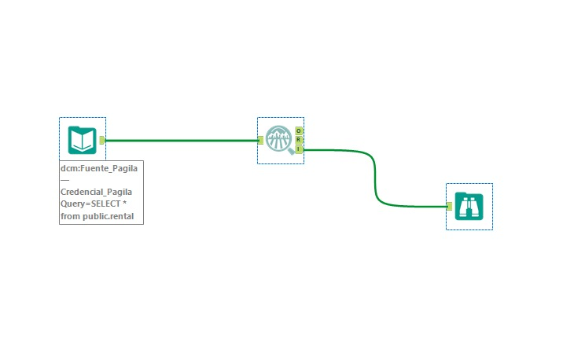
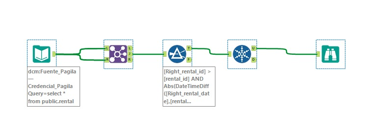
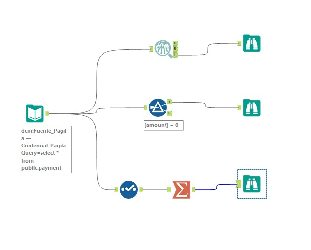
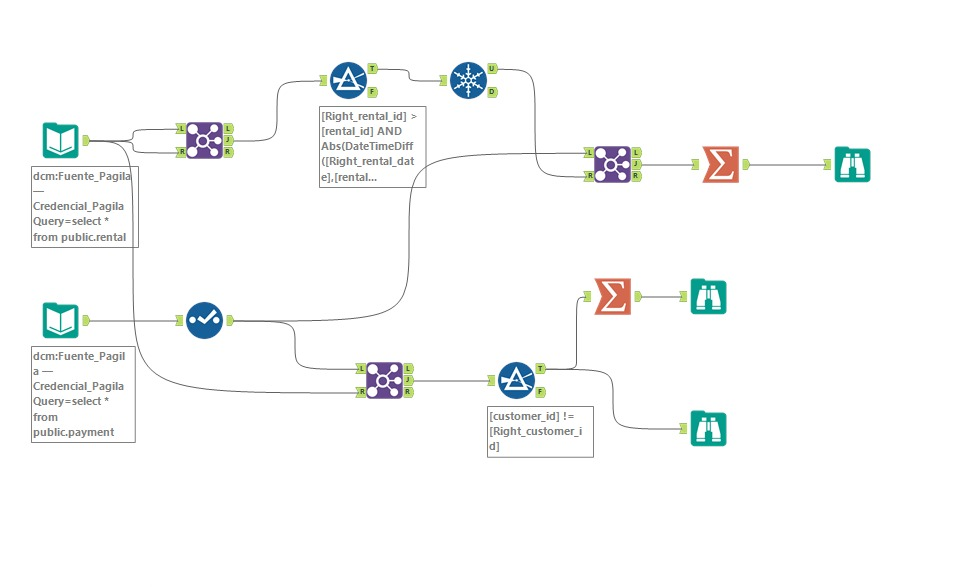
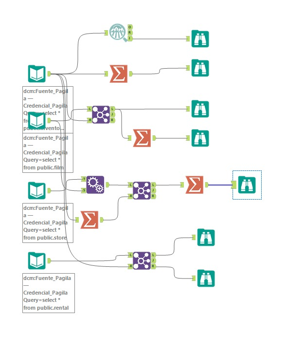
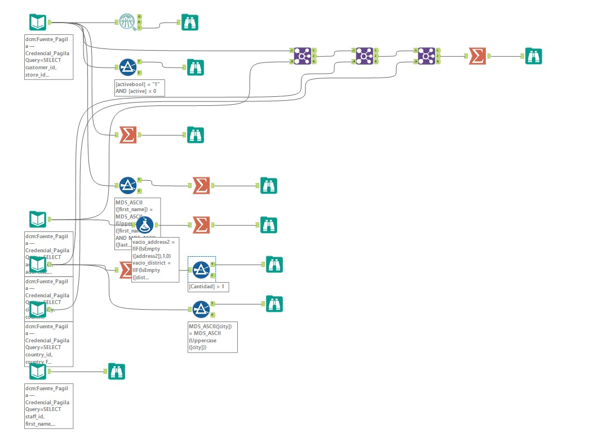
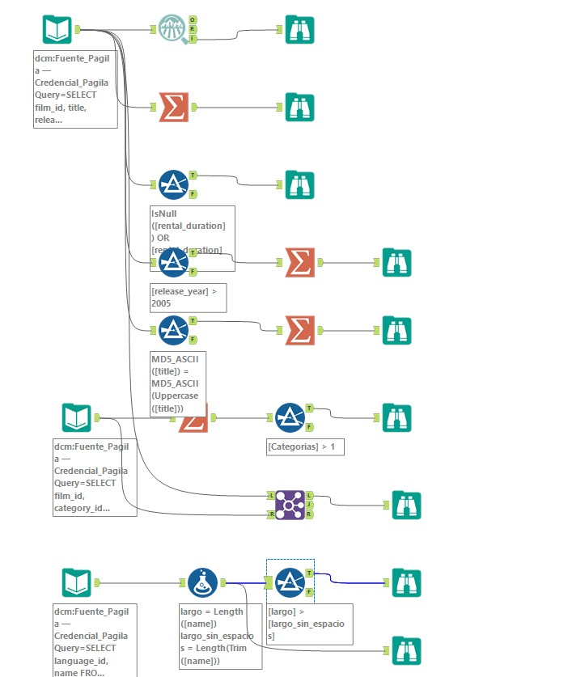
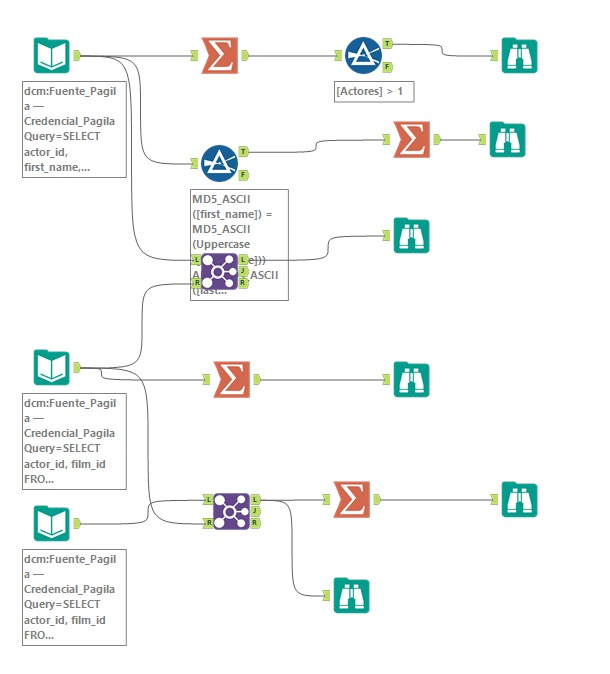

# Perfilado de los datos de la base de datos fuente

> Tarea 5 del enunciado (primera parte): *Analizar la calidad de los datos de la base fuente e identificar problemas como nulos, duplicados y formatos inconsistentes.*
> Jira: DWI-25 · Épica: DWI-3 — Fuentes y calidad de datos
> Responsables: Juan Daniel Ulate Aguilar y Kristel Daniela Ramírez Duarte

## 1. Objetivo

Evaluar la calidad de los datos de `pagila_dvd_rental` antes de cargarlos al Data Warehouse de Invacom Inc S.A., identificando situaciones que puedan afectar los conteos de alquileres, los ingresos y los análisis de clientes, películas e inventario.

El perfilado permite medir los problemas, registrar evidencias y justificar las reglas de limpieza que se aplicarán durante el proceso ETL.

## 2. Fuente y alcance del análisis

La fuente corresponde a una base PostgreSQL, ubicada en el esquema `public`.

| Tabla | Registros | Información analizada |
|---|---:|---|
| `rental` | 32.088 | Alquileres, fechas, devoluciones y posibles duplicados. |
| `payment` | 32.093 | Montos, fechas y correspondencia de los pagos con los alquileres. |
| `inventory` | 4.581 | Copias físicas y su distribución por tienda. |
| `customer` | 599 | Estado de los clientes, fecha de alta y ubicación. |
| `film` | 1.000 | Categoría, clasificación, idioma, año y plazo de alquiler. |
| `actor` | 200 | Nombres y relaciones con las películas. |

También se revisaron las tablas `address`, `city`, `country`, `store`, `staff`, `language`, `category`, `film_category` y `film_actor`.

Los resultados indicados en este documento corresponden al perfilado documentado de la base restaurada. Las consultas SQL permiten reproducir y contrastar las mediciones.

## 3. Preparación del perfilado

### 3.1 Conexión desde Alteryx

1. Abrir Alteryx Designer y crear un workflow.
2. Agregar una herramienta **Input Data**.
3. Seleccionar la conexión configurada para `pagila_dvd_rental`.
4. Utilizar la conexión ODBC del DSN `pagila_local`, registrada en DCM como `pagila_dvd_rental — Credential_Pagila`.
5. Abrir el editor SQL e indicar la tabla que se desea analizar.
6. Agregar las herramientas de revisión correspondientes.
7. Conectar un **Browse** para consultar los resultados.
8. Ejecutar el workflow y guardar la evidencia obtenida.

Ejemplo de consulta de entrada:

```sql
SELECT *
FROM public.rental;
```

Para analizar pagos se consulta la tabla madre `public.payment`, que reúne los datos de sus particiones.

### 3.2 Herramientas utilizadas

| Herramienta | Función |
|---|---|
| Input Data | Leer las tablas de PostgreSQL. |
| Field Summary | Obtener estadísticas de las columnas, nulos y valores distintos. |
| Summarize | Calcular conteos, sumas y rangos de fechas. |
| Join | Comparar registros y verificar relaciones entre tablas. |
| Filter | Separar las filas que cumplen una condición de revisión. |
| Formula | Evaluar formatos, espacios y condiciones específicas. |
| Unique | Obtener una sola aparición de cada identificador analizado. |
| Select | Ajustar los tipos de datos utilizados en el flujo. |
| Append Fields | Generar combinaciones entre películas y tiendas. |
| Browse | Revisar los resultados y las evidencias. |

En **Field Summary** se seleccionan los campos necesarios y se desactiva **Sample input data**, para analizar todos los registros.

Sus salidas se utilizan de la siguiente manera:

| Salida | Contenido |
|---|---|
| O — Output | Tabla de estadísticas por columna. |
| R — Report | Reporte con tablas y gráficos. |
| I — Interactive | Tablero interactivo que puede visualizarse con Browse. |

Los rangos de fechas se obtienen mediante **Summarize**, utilizando las operaciones **Min** y **Max**.

### 3.3 Organización de los workflows

Los archivos se organizan en `alteryx/workflows/perfilado/`.

| Archivo | Revisión |
|---|---|
| `01_rental_columnas.yxmd` | Perfil general de alquileres. |
| `02_rental_duplicados.yxmd` | Detección de alquileres duplicados. |
| `03_payment_columnas.yxmd` | Montos y fechas de pagos. |
| `04_payment_vs_rental.yxmd` | Correspondencia entre pagos y alquileres. |
| `05_inventory.yxmd` | Copias físicas y existencias por tienda. |
| `06_customer_geografia.yxmd` | Clientes, direcciones, ciudades y países. |
| `07_film_catalogo.yxmd` | Películas, categorías, clasificación e idiomas. |
| `08_actores.yxmd` | Actores y relaciones película–actor. |

## 4. Procedimiento y resultados por bloque

### 4.1 Perfil general de alquileres

**Archivo:** `01_rental_columnas.yxmd`

**Objetivo:** identificar nulos, identificadores repetidos y rangos de fechas en `rental`.

**Pasos en Alteryx:**

1. Leer `public.rental` mediante **Input Data**.
2. Conectar una herramienta **Field Summary**.
3. Seleccionar todos los campos y desactivar el muestreo.
4. Conectar la salida **I** a un **Browse**.
5. Agregar un **Summarize** para obtener las fechas mínima y máxima de alquiler.
6. Revisar especialmente `rental_id`, `rental_date`, `return_date`, `customer_id` e `inventory_id`.

**Consulta de verificación en PostgreSQL:**

```sql
SELECT
    COUNT(*) AS "TotalAlquileres",
    COUNT(DISTINCT rental_id) AS "IdsUnicos",
    COUNT(*) - COUNT(DISTINCT rental_id) AS "IdsRepetidos",
    COUNT(*) FILTER (
        WHERE return_date IS NULL
    ) AS "AlquileresSinDevolver",
    MIN(rental_date) AS "PrimerAlquiler",
    MAX(rental_date) AS "UltimoAlquiler"
FROM public.rental;
```

**Resultados registrados:**

- 32.088 alquileres.
- 0 identificadores de alquiler repetidos.
- 366 alquileres sin fecha de devolución, equivalentes al 1,14 %.
- Fechas de alquiler comprendidas entre el 24/05/2005 y el 14/02/2017.

La ausencia de identificadores repetidos no descarta duplicados de negocio, porque dos registros pueden representar el mismo alquiler con códigos diferentes.

### 4.2 Detección de alquileres duplicados

**Archivo:** `02_rental_duplicados.yxmd`

**Objetivo:** identificar registros que representan un mismo alquiler con distinto `rental_id`.

La regla utilizada en este perfilado compara alquileres con:

- La misma copia física: `inventory_id`.
- El mismo cliente: `customer_id`.
- Una diferencia entre fechas de 30 minutos o menos.

Dentro de cada pareja identificada, el registro con el identificador mayor se marca como duplicado.

**Pasos en Alteryx:**

1. Leer la tabla `rental`.
2. Conectar la misma entrada a los lados **L** y **R** de un **Join**.
3. Configurar la unión por `inventory_id` y `customer_id`.
4. Conectar la salida **J** a un **Filter**.
5. Aplicar la siguiente expresión:

```text
[Right_rental_id] > [rental_id]
AND
Abs(
    DateTimeDiff(
        [Right_rental_date],
        [rental_date],
        "seconds"
    )
) <= 1800
```

6. Conectar la salida **T** del filtro a un **Unique**.
7. Seleccionar `Right_rental_id` como campo único.
8. Conectar la salida **U** a un **Browse**.

La comparación de identificadores evita conservar las uniones de un registro consigo mismo y contar dos veces una misma pareja.

**Consulta de verificación:**

```sql
SELECT
    COUNT(DISTINCT b.rental_id) AS "AlquileresDuplicados"
FROM public.rental a
JOIN public.rental b
    ON a.inventory_id = b.inventory_id
    AND a.customer_id = b.customer_id
    AND b.rental_id > a.rental_id
    AND ABS(
        EXTRACT(EPOCH FROM b.rental_date - a.rental_date)
    ) <= 1800;
```

**Resultado registrado:** 16.044 alquileres duplicados, asociados a los empleados 3, 4 y 5.

Estos registros corresponden al hallazgo **C01**. Sus pagos deben identificarse por separado mediante **C02**.

### 4.3 Perfil de montos y fechas de pagos

**Archivo:** `03_payment_columnas.yxmd`

**Objetivo:** revisar montos, fechas, pagos en cero y capacidad de los tipos de datos utilizados en Alteryx.

**Pasos en Alteryx:**

1. Leer los pagos mediante:

```sql
SELECT *
FROM public.payment;
```

2. Conectar un **Field Summary** para revisar nulos y valores distintos.
3. Agregar un **Filter** con la condición:

```text
[amount] = 0
```

4. Conectar la salida **T** a un **Browse** para observar los pagos en cero.
5. En otra rama, utilizar **Select** para ajustar el tipo de `amount`.
6. En el flujo documentado se utilizó `Double` para superar el error de capacidad presentado al sumar los montos en Alteryx.
7. Agregar un **Summarize** con estas operaciones:

| Campo | Operación |
|---|---|
| `payment_id` | Count |
| `payment_date` | Min y Max |
| `amount` | Min, Max y Sum |

El ajuste de tipo corresponde al procesamiento en Alteryx. La suma calculada en PostgreSQL sirve como referencia para comprobar el total monetario.

**Consulta de verificación:**

```sql
SELECT
    COUNT(*) AS "TotalPagos",
    COUNT(*) FILTER (
        WHERE amount = 0
    ) AS "PagosEnCero",
    MIN(payment_date) AS "PrimerPago",
    MAX(payment_date) AS "UltimoPago",
    MIN(amount) AS "MontoMinimo",
    MAX(amount) AS "MontoMaximo",
    SUM(amount) AS "IngresoFuente"
FROM public.payment;
```

**Resultados registrados:**

| Medición | Resultado |
|---|---:|
| Total de pagos | 32.093 |
| Pagos en cero | 24 |
| Monto mínimo | 0 |
| Monto máximo | 15 |
| Suma de pagos | 227.768,87 |

Las fechas de pago se encuentran entre el 24/01/2017 y el 31/05/2017. Esta distribución temporal debe revisarse junto con las fechas de alquiler.

Los pagos en cero corresponden a **C04**, las fechas de pago a **C05** y el problema de capacidad numérica a **C26**.

### 4.4 Comparación de pagos con alquileres

**Archivo:** `04_payment_vs_rental.yxmd`

**Objetivo:** identificar pagos de alquileres duplicados y pagos cuyo cliente no coincide con el cliente del alquiler.

#### A. Pagos de alquileres duplicados

**Pasos en Alteryx:**

1. Utilizar la lista de identificadores duplicados obtenida en el bloque 4.2.
2. Leer la tabla `payment`.
3. Agregar un **Join** entre los pagos y la lista de duplicados.
4. Relacionar `payment.rental_id` con `Right_rental_id`.
5. Utilizar la salida **J** para identificar los pagos asociados a duplicados.
6. Agregar un **Summarize** para contar los pagos y sumar `amount`.
7. Revisar los resultados con **Browse**.

**Consulta de verificación:**

```sql
WITH AlquileresDuplicados AS (
    SELECT DISTINCT
        b.rental_id
    FROM public.rental a
    JOIN public.rental b
        ON a.inventory_id = b.inventory_id
        AND a.customer_id = b.customer_id
        AND b.rental_id > a.rental_id
        AND ABS(
            EXTRACT(EPOCH FROM b.rental_date - a.rental_date)
        ) <= 1800
)
SELECT
    COUNT(*) AS "PagosDuplicados",
    SUM(p.amount) AS "MontoPagosDuplicados"
FROM public.payment p
JOIN AlquileresDuplicados d
    ON p.rental_id = d.rental_id;
```

**Resultado registrado:** 16.044 pagos duplicados que suman 160.352,36.

#### B. Pagos de un cliente diferente

**Pasos en Alteryx:**

1. Unir `payment` con `rental` mediante `rental_id`.
2. Conservar los identificadores de cliente de ambas tablas.
3. Conectar la salida **J** a un **Filter**.
4. Aplicar esta condición:

```text
[customer_id] != [Right_customer_id]
```

5. Conectar la salida **T** a un **Summarize**.
6. Contar los pagos, sumar sus montos y revisar el detalle con **Browse**.

**Consulta de verificación:**

```sql
SELECT
    COUNT(*) AS "PagosOtroCliente",
    COALESCE(SUM(p.amount), 0) AS "MontoOtroCliente"
FROM public.payment p
JOIN public.rental r
    ON p.rental_id = r.rental_id
WHERE p.customer_id <> r.customer_id;
```

**Resultado registrado:** 5 pagos que suman 9,95, asociados al alquiler 4591.

Los pagos de duplicados corresponden a **C02** y los pagos de otro cliente a **C03**.

### 4.5 Revisión del inventario

**Archivo:** `05_inventory.yxmd`

**Objetivo:** comprobar la relación entre alquileres, copias físicas, películas y tiendas.

**Pasos en Alteryx:**

1. Leer `inventory`, `film`, `store` y `rental`.
2. Utilizar **Summarize** sobre `inventory` para agrupar por `store_id`, contar copias y contar películas distintas.
3. Unir `film` con `inventory` por `film_id`; la salida **L** identifica películas sin copias.
4. Usar **Append Fields** para combinar cada película con cada tienda.
5. Configurar `store` como **Targets** y `film` como **Source**, permitiendo todas las combinaciones mediante **Allow All Appends**.
6. Comparar esas combinaciones con el inventario agrupado por película y tienda.
7. Utilizar la salida **L** para identificar combinaciones sin existencias.
8. Unir `rental` con `inventory` para comprobar que cada alquiler tenga una copia física asociada.

**Copias por tienda:**

```sql
SELECT
    store_id AS "Tienda",
    COUNT(*) AS "Copias",
    COUNT(DISTINCT film_id) AS "PeliculasDistintas"
FROM public.inventory
GROUP BY store_id
ORDER BY store_id;
```

**Películas sin ninguna copia:**

```sql
SELECT
    COUNT(*) AS "PeliculasSinCopias"
FROM public.film f
LEFT JOIN public.inventory i
    ON f.film_id = i.film_id
WHERE i.inventory_id IS NULL;
```

**Combinaciones película–tienda sin existencias:**

```sql
SELECT
    COUNT(*) AS "CombinacionesSinCopias"
FROM public.film f
CROSS JOIN public.store s
LEFT JOIN public.inventory i
    ON i.film_id = f.film_id
    AND i.store_id = s.store_id
WHERE i.inventory_id IS NULL;
```

**Alquileres sin copia asociada:**

```sql
SELECT
    COUNT(*) AS "AlquileresSinCopia"
FROM public.rental r
LEFT JOIN public.inventory i
    ON r.inventory_id = i.inventory_id
WHERE i.inventory_id IS NULL;
```

**Resultados registrados:**

- Tienda 1: 2.270 copias y 759 películas distintas.
- Tienda 2: 2.311 copias y 762 películas distintas.
- 42 películas sin ninguna copia física.
- 479 combinaciones película–tienda sin existencias.
- 0 alquileres sin copia asociada.
- 1 copia física que nunca fue alquilada.

Las películas sin existencias deben contemplarse en los reportes de inventario con valor 0.

### 4.6 Revisión de clientes y geografía

**Archivo:** `06_customer_geografia.yxmd`

**Objetivo:** comprobar el estado de los clientes, sus fechas de alta y la relación con ciudad y país.

**Ejemplos de los workflows de perfilado**

Las capturas están enumeradas en el mismo orden que los ocho bloques de perfilado del documento.

**Ejemplo 1. Perfil general de alquileres**

Lectura de rental y revisión de sus campos con Field Summary.



**Ejemplo 2. Detección de alquileres duplicados**

Comparación de alquileres, filtrado de coincidencias y selección de identificadores únicos.



**Ejemplo 3. Perfil de montos y fechas de pagos**

Revisión de payment, detección de montos iguales a cero y resumen de pagos.



**Ejemplo 4. Comparación de pagos con alquileres**

Cruce de pagos y alquileres para revisar duplicados y diferencias entre clientes.



**Ejemplo 5. Revisión del inventario**

Revisión de existencias y registros sin correspondencia entre inventario, películas, tiendas y alquileres.



**Ejemplo 6. Revisión de clientes y geografía**

Revisión de estados de clientes, direcciones, ciudades y países, con controles de campos vacíos y nombres.



**Ejemplo 7. Revisión de películas y catálogo**

Revisión de películas, categorías e idiomas para identificar valores que requieren atención.



**Ejemplo 8. Revisión de actores y relaciones con películas**

Revisión de nombres de actores y relaciones película–actor mediante uniones, filtros y resúmenes.




**Pasos en Alteryx:**

1. Leer `customer`.
2. Revisar sus campos con **Field Summary**.
3. Detectar contradicciones entre `activebool` y `active`.
4. En la conexión documentada, `activebool` llega como texto; por eso se utilizó:

```text
[activebool] = "1" AND [active] = 0
```

5. Usar **Summarize** para contar las fechas distintas de `create_date`.
6. Encadenar las siguientes uniones:

| Unión | Campo |
|---|---|
| `customer` con `address` | `address_id` |
| `address` con `city` | `city_id` |
| `city` con `country` | `country_id` |

7. Revisar las salidas **L** para detectar clientes sin correspondencia.
8. Agrupar `city` por nombre y filtrar los grupos con más de un registro.
9. Revisar vacíos en los campos de dirección.
10. Identificar nombres en mayúsculas con una expresión como:

```text
MD5_ASCII([first_name]) = MD5_ASCII(Uppercase([first_name]))
AND
MD5_ASCII([last_name]) = MD5_ASCII(Uppercase([last_name]))
```

**Estados y fechas de alta en PostgreSQL:**

```sql
SELECT
    COUNT(*) AS "TotalClientes",
    COUNT(*) FILTER (
        WHERE activebool IS TRUE AND active = 0
    ) AS "EstadosContradictorios",
    COUNT(DISTINCT create_date) AS "FechasAltaDistintas",
    MIN(create_date) AS "PrimeraAlta",
    MAX(create_date) AS "UltimaAlta"
FROM public.customer;
```

**Clientes sin ciudad o país:**

```sql
SELECT
    COUNT(*) AS "ClientesSinUbicacion"
FROM public.customer c
LEFT JOIN public.address a
    ON c.address_id = a.address_id
LEFT JOIN public.city ci
    ON a.city_id = ci.city_id
LEFT JOIN public.country co
    ON ci.country_id = co.country_id
WHERE ci.city_id IS NULL
   OR co.country_id IS NULL;
```

**Nombres de ciudades repetidos:**

```sql
SELECT
    city AS "Ciudad",
    COUNT(*) AS "Cantidad"
FROM public.city
GROUP BY city
HAVING COUNT(*) > 1;
```

**Campos vacíos en direcciones:**

```sql
SELECT
    COUNT(*) FILTER (
        WHERE COALESCE(TRIM(address2), '') = ''
    ) AS "DireccionSecundariaVacia",
    COUNT(*) FILTER (
        WHERE COALESCE(TRIM(district), '') = ''
    ) AS "DistritoVacio",
    COUNT(*) FILTER (
        WHERE COALESCE(TRIM(postal_code), '') = ''
    ) AS "CodigoPostalVacio",
    COUNT(*) FILTER (
        WHERE COALESCE(TRIM(phone), '') = ''
    ) AS "TelefonoVacio"
FROM public.address;
```

**Resultados registrados:**

- 599 clientes.
- 15 clientes con estados contradictorios.
- Una sola fecha de alta para todos los clientes: 14/02/2017.
- Los 599 clientes cuentan con ciudad y país.
- Dos ciudades llamadas London.
- 603 direcciones con `address2` vacío.
- 3 distritos, 4 códigos postales y 2 teléfonos vacíos.
- Los 599 clientes tienen nombres y apellidos en mayúsculas.

Las ciudades con el mismo nombre deben distinguirse por sus identificadores y países.

### 4.7 Revisión de películas y catálogo

**Archivo:** `07_film_catalogo.yxmd`

**Objetivo:** revisar los atributos que permiten analizar películas, categorías, clasificaciones y plazos de devolución.

**Consulta de entrada:**

```sql
SELECT
    film_id,
    title,
    release_year,
    rental_duration,
    rental_rate,
    rating::text AS rating,
    language_id,
    original_language_id
FROM public.film;
```

La conversión `rating::text` permite leer la clasificación como texto desde Alteryx.

**Pasos en Alteryx:**

1. Leer los campos de `film`.
2. Utilizar **Field Summary** para revisar nulos y valores distintos.
3. Agrupar por `rating` mediante **Summarize**.
4. Revisar plazos inválidos con:

```text
IsNull([rental_duration]) OR [rental_duration] <= 0
```

5. Identificar películas con año de estreno posterior a 2005 para revisar la inconsistencia temporal:

```text
[release_year] > 2005
```

6. Unir `film` con `film_category` por `film_id`.
7. Revisar películas sin categoría y agrupar por película para detectar más de una categoría.
8. Leer `language` y comparar el largo del nombre antes y después de aplicar `Trim()`.

**Consulta de verificación de películas:**

```sql
SELECT
    COUNT(*) AS "TotalPeliculas",
    COUNT(*) FILTER (
        WHERE release_year > 2005
    ) AS "PeliculasPosteriores2005",
    COUNT(*) FILTER (
        WHERE original_language_id IS NULL
    ) AS "IdiomaOriginalNulo",
    COUNT(*) FILTER (
        WHERE rating IS NULL
    ) AS "ClasificacionNula",
    COUNT(*) FILTER (
        WHERE rental_duration IS NULL
           OR rental_duration <= 0
    ) AS "PlazoInvalido"
FROM public.film;
```

**Películas sin categoría o con varias categorías:**

```sql
SELECT
    f.film_id AS "CodigoPelicula",
    COUNT(fc.category_id) AS "CantidadCategorias"
FROM public.film f
LEFT JOIN public.film_category fc
    ON f.film_id = fc.film_id
GROUP BY f.film_id
HAVING COUNT(fc.category_id) <> 1;
```

**Idiomas con espacios de relleno:**

```sql
SELECT
    COUNT(*) AS "IdiomasConEspacios"
FROM public.language
WHERE OCTET_LENGTH(name) > OCTET_LENGTH(TRIM(name));
```

**Resultados registrados:**

- 1.000 películas.
- 472 películas con año de estreno posterior a 2005.
- `original_language_id` nulo en las 1.000 películas.
- 0 clasificaciones nulas.
- 0 plazos de alquiler inválidos; los plazos van de 3 a 7 días.
- Todas las películas tienen exactamente una categoría.
- Los seis nombres de idioma presentan relleno en PostgreSQL.

En la conexión utilizada, ODBC elimina los espacios de relleno antes de entregar los valores a Alteryx. Por eso el resultado puede diferir entre la revisión de PostgreSQL y la realizada después de la extracción.

### 4.8 Revisión de actores y relaciones con películas

**Archivo:** `08_actores.yxmd`

**Objetivo:** comprobar nombres repetidos y relaciones faltantes en `actor` y `film_actor`.

**Pasos en Alteryx:**

1. Leer `actor` y agrupar por `first_name` y `last_name`.
2. Contar los registros de cada nombre completo.
3. Filtrar los grupos cuya cantidad sea mayor que 1.
4. Unir `film` con `film_actor` por `film_id` y revisar la salida **L**.
5. Unir `actor` con `film_actor` por `actor_id` y revisar la salida **L**.
6. Utilizar **Summarize** para contar las relaciones y los identificadores distintos.

**Actores con nombre completo repetido:**

```sql
SELECT
    first_name AS "Nombre",
    last_name AS "Apellido",
    COUNT(*) AS "Cantidad"
FROM public.actor
GROUP BY first_name, last_name
HAVING COUNT(*) > 1;
```

**Películas sin actores:**

```sql
SELECT
    f.film_id AS "CodigoPelicula",
    f.title AS "Titulo"
FROM public.film f
LEFT JOIN public.film_actor fa
    ON f.film_id = fa.film_id
WHERE fa.film_id IS NULL
ORDER BY f.film_id;
```

**Resultados registrados:**

- 200 actores.
- 5.462 relaciones película–actor.
- Dos actores llamados Susan Davis.
- Tres películas sin actores: identificadores 257, 323 y 803.
- 0 actores sin películas asociadas.

Los actores homónimos deben mantenerse separados mediante `actor_id`. Las películas sin actores no participan en el ranking por actor.

## 5. Validación de los ingresos

Los hallazgos que afectan directamente los ingresos son los pagos de alquileres duplicados y los pagos cuyo cliente no coincide con el del alquiler.

| Concepto | Monto |
|---|---:|
| Total registrado en la fuente | 227.768,87 |
| Pagos de alquileres duplicados — C02 | 160.352,36 |
| Pagos de otro cliente — C03 | 9,95 |
| Ingreso válido esperado | 67.406,56 |

El cálculo documentado es:

**227.768,87 − 160.352,36 − 9,95 = 67.406,56**

La siguiente consulta permite verificar el ingreso esperado conservando los pagos de alquileres no duplicados y cuyo cliente coincide con el del alquiler:

```sql
WITH AlquileresDuplicados AS (
    SELECT DISTINCT
        b.rental_id
    FROM public.rental a
    JOIN public.rental b
        ON a.inventory_id = b.inventory_id
        AND a.customer_id = b.customer_id
        AND b.rental_id > a.rental_id
        AND ABS(
            EXTRACT(EPOCH FROM b.rental_date - a.rental_date)
        ) <= 1800
),
PagosValidos AS (
    SELECT
        p.amount
    FROM public.payment p
    JOIN public.rental r
        ON p.rental_id = r.rental_id
    LEFT JOIN AlquileresDuplicados d
        ON p.rental_id = d.rental_id
    WHERE d.rental_id IS NULL
      AND p.customer_id = r.customer_id
)
SELECT
    COUNT(*) AS "CantidadPagosValidos",
    COALESCE(SUM(amount), 0) AS "IngresoValidoEsperado"
FROM PagosValidos;
```

Este resultado se utilizará como referencia al validar la carga de ingresos al Data Warehouse.

