# Descripción de la solución

> Jira: DWI-55 · Responsables: Marco Andrey López Quesada y Kristel Ramírez
> Sección del documento final.

## Arquitectura

La solución tiene cuatro componentes, por los que los datos avanzan en una sola dirección:

| Componente | Herramienta | Función |
|---|---|---|
| Fuente | PostgreSQL 15 (base Pagila) | Sistema transaccional de Invacom con los alquileres, pagos e inventario |
| ETL | Alteryx Designer 2025.2 | Extrae, limpia, transforma y carga los datos |
| Data warehouse | SQL Server 2025 Developer (base `DW_Invacom`) | Almacena el modelo dimensional |
| Reportes | Microsoft Excel | Tablas dinámicas conectadas directamente al data warehouse |

La base fuente no se modifica: toda corrección ocurre en Alteryx y queda documentada. Esto separa el sistema que registra las operaciones del sistema que las analiza, que es el principio de un data warehouse (Kimball & Ross, 2013). Se usó SQL Server como destino porque es gratuito en su edición Developer, admite llaves primarias, foráneas y restricciones que rechazan datos inválidos, y Excel se conecta a él de forma nativa. Alteryx Designer fue la herramienta ETL asignada al grupo; permite construir el proceso con herramientas visuales y dejar cada paso documentado en el mismo flujo.

Las conexiones se hacen por ODBC: el DSN `pagila_local` (controlador psqlODBC) para leer PostgreSQL y el DSN `DW_Invacom` (ODBC Driver 18 for SQL Server) para escribir en el data warehouse. Las contraseñas se configuran en cada equipo y no se guardan en el repositorio.

## Proceso ETL en Alteryx

El proceso se divide en cinco flujos que se ejecutan en orden. Cada flujo deja su resultado en archivos `.yxdb`, el formato nativo de Alteryx, y el siguiente los lee:

| Orden | Flujo | Responsable | Qué hace |
|---|---|---|---|
| 1 | `01_extraccion` | Juan Daniel Ulate | Lee 14 tablas de PostgreSQL y las guarda sin modificarlas |
| 2 | `02_limpieza` | Kristel Ramírez | Aplica las reglas de limpieza y genera los archivos limpios y los rechazos |
| 3 | `dim_fecha` | Krisley Castro | Genera el calendario (4 285 días) y carga `dim_fecha` |
| 4 | `03_dimensiones` | Marco López | Asigna llaves sustitutas y carga las dimensiones cliente, película, tienda y actor |
| 5 | `04_hechos` | Marco López | Calcula las medidas, busca las llaves y carga los hechos y la tabla puente |

**Extracción sin cambios.** El primer flujo copia las tablas tal como están, incluidos duplicados y nulos. Así la limpieza trabaja sobre una copia estable y cada exclusión queda registrada, en lugar de perderse al leer la fuente. Kimball y Caserta (2004) recomiendan esta separación entre extraer y limpiar para que el proceso se pueda repetir y auditar.

**Acuerdo de archivos entre flujos.** Los nombres, columnas y tipos de los archivos limpios se definieron por escrito antes de construir los flujos de carga (`docs/etl/01-contrato-archivos-limpios.md`). Esto permitió que cada integrante trabajara en paralelo sin depender de cómo el otro resolvía su parte.

**Llaves sustitutas.** Las dimensiones reciben llaves propias del data warehouse con las herramientas *Sort* y *Record ID*, y conservan el identificador de Pagila como llave de negocio única. Los hechos reemplazan cada identificador por su llave con la herramienta *Join* contra las dimensiones ya cargadas. Con esto, el data warehouse no depende de la numeración de la fuente (Kimball & Ross, 2013).

**Medidas calculadas.** El flujo de hechos suma los pagos de cada alquiler (*Summarize*) y calcula con *Formula* los días que duró el alquiler, los días de atraso y tres indicadores de 0 o 1: si se devolvió, si se devolvió fuera de plazo y si el pago fue de cero. Se guardan como números para que Excel pueda sumarlos y calcular porcentajes.

**Carga completa y repetible.** Como la fuente no recibe datos nuevos, cada ejecución vuelve a cargar todo. Antes de escribir, cada salida ejecuta un `DELETE` que vacía primero los hechos y después su propia tabla; así el proceso se puede ejecutar varias veces sin duplicar registros. No se usa la opción *Delete Data & Append* de Alteryx porque la ejecuta como `TRUNCATE`, y SQL Server no permite `TRUNCATE` en tablas referenciadas por llaves foráneas.

## Limpieza de datos

El perfilado de la fuente encontró 26 problemas, documentados con un código en la estrategia de limpieza (`docs/analisis/07-estrategia-de-limpieza.md`). Se aplicaron tres criterios:

1. **Nada se borra en silencio.** Lo que se excluye va al archivo `rechazos.yxdb` con el código de la regla que lo excluyó.
2. **Lo real pero especial se conserva con una marca.** Por ejemplo, los alquileres sin devolver o los pagos de cero.
3. **Las reglas no dependen de esta base en particular.** Se escriben como condiciones generales, no con identificadores fijos.

Los problemas que más afectan los resultados son:

| Código | Problema | Casos | Tratamiento |
|---|---|---:|---|
| C01 | Alquileres duplicados: misma copia y mismo cliente a 30 minutos o menos | 16 044 | Se excluye el de identificador mayor |
| C02 | Pagos de los alquileres duplicados | 16 044 | Se excluyen |
| C03 | Pagos asociados a un alquiler de otro cliente | 5 | Se excluyen |
| C05 | Todos los pagos están fechados en 2017, aunque los alquileres son de 2005 | todos | El análisis usa la fecha del alquiler |
| C06 | Alquileres sin fecha de devolución | 183 | Se conservan con `devuelto` = 0 |
| C04 | Pagos con monto cero | 24 | Se conservan con `pago_cero` = 1 |
| C14 | Nombres y títulos en mayúsculas | 1 799 | Se convierten a mayúscula inicial |
| C13 | Dos actrices con el mismo nombre | 2 | Se agrega su identificador al nombre |

El hallazgo principal fue C01: la mitad de los alquileres eran copias de otros. Sin la regla C01 (y sus pagos C02), los ingresos serían 227 758,92 en lugar de 67 406,56.

## Validación

Los conteos del data warehouse se compararon con la fuente. La diferencia corresponde exactamente a los registros del archivo de rechazos:

| Dato | Fuente | Rechazados | Data warehouse |
|---|---:|---:|---:|
| Alquileres | 32 088 | 16 044 | 16 044 |
| Pagos | 32 093 | 16 049 | 16 044 |
| Copias | 4 581 | 0 | 4 581 |
| Película–actor | 5 462 | 0 | 5 462 |

Los totales cargados también coinciden con las consultas de referencia: ingresos de 67 406,56, 183 alquileres sin devolver y 51,2 % de devoluciones fuera de plazo. Además, las restricciones de SQL Server rechazan cualquier llave repetida o valor fuera de regla, así que un error de carga no pasa inadvertido.

## Reportes

Los reportes están en el libro `reportes/reportes_invacom.xlsx`, con una hoja por tema y tablas dinámicas que responden las 12 preguntas de negocio (`docs/analisis/04-preguntas-de-negocio.md`).

### Conexión de Excel al data warehouse

Las tablas dinámicas leen directamente del data warehouse; el libro no guarda copias de los datos en sus hojas. La conexión se arma en tres pasos:

1. **Consultas de Power Query.** Las consultas `Consulta1` a `Consulta11` se conectan a SQL Server con `Sql.Database("localhost", "DW_Invacom")` y autenticación de Windows. Cada una ejecuta una consulta SQL que une la tabla de hechos con las dimensiones que necesita su reporte.
2. **Carga como "Solo conexión".** Ninguna consulta descarga filas a una hoja; solo dejan disponible la conexión.
3. **Tablas dinámicas con origen externo.** Cada tabla dinámica usa como origen la conexión de su consulta (`Consulta - ConsultaN`) y no un rango de celdas. Con *Datos → Actualizar todo*, Excel vuelve a leer los datos desde SQL Server.

Se eligió esta forma de conexión por tres razones. 
1. El data warehouse es la única fuente de los números: si se vuelve a ejecutar el ETL, basta con actualizar el libro, y no hay hojas intermedias que puedan quedar desactualizadas.

2. Cada consulta recorre el modelo estrella desde la tabla de hechos hacia sus dimensiones, que es el uso para el que se diseña un modelo dimensional: filtrar y agrupar las medidas por los atributos de las dimensiones.

3. Tercero, Excel no necesita el DSN `DW_Invacom`, que solo usa Alteryx, por lo que el libro funciona en cualquier equipo que tenga el data warehouse cargado.

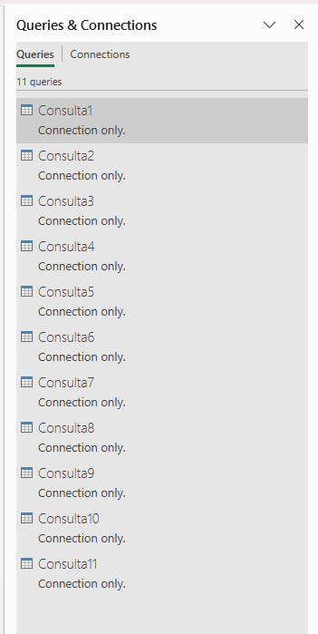

### Tablas dinámicas por pregunta de negocio

| # | Pregunta de negocio (resumen) | Hoja | Tabla dinámica | Consulta |
|---|---|---|---|---|
| 1 | Monto cobrado y promedio por pago, por mes y tienda | `alquileres_ingresos` | AlquileresIngresos y PromedioPago | Consulta1 |
| 2 | Alquileres por mes y tienda | `alquileres_ingresos` | AlquileresIngresos | Consulta1 |
| 3 | 10 películas más alquiladas | `peliculas_mas_alquiladas` | RankingPeliculas | Consulta2 |
| 4 | Ingresos por categoría y mes | `ingresos_categorias` | IngresosCategorias | Consulta3 |
| 5 | 10 clientes con mayores pagos | `clientes_mayores_pagos` | RankingClientes | Consulta4 |
| 6 | Alquileres por país y ciudad del cliente | `alquileres_geografia` | AlquileresGeografia | Consulta5 |
| 7 | 10 actores cuyas películas se alquilan más | `actores_mas_alquilados` | RankingActores | Consulta6 |
| 8 | Alquileres e ingresos por clasificación y tienda | `clasificacion_tienda` | ClasificacionTienda | Consulta7 |
| 9 | Porcentaje de devoluciones fuera de plazo por tienda y mes | `devoluciones_tardias` | DevolucionesTardias | Consulta8 |
| 10 | Copias por película y tienda, y porcentaje sin alquileres en el trimestre | `inventario_rotacion` | InventarioRotacion | Consulta9 |
| 11 | Ticket promedio por cliente y categoría | `ticket_cliente_categoria` | TicketClienteCategoria | Consulta10 |
| 12 | Días entre alquileres y clientes nuevos y recurrentes por mes | `frecuencia_clientes` | IntervalosPorCliente y ClientesPorMes | Consulta11 |

### Decisiones de cálculo

Algunas preguntas no se responden con una suma directa, y para ellas se tomaron estas decisiones:

- **Porcentajes y promedios a partir de totales.** El promedio por pago, el ticket promedio y el porcentaje de devoluciones tardías se calculan dividiendo los totales del grupo (por ejemplo, ingresos entre pagos), no promediando porcentajes o promedios de grupos menores, que daría un resultado sesgado. Por eso el porcentaje general de devoluciones tardías es 51,2 % (8 121 de 15 861 devueltos) y el ticket general es 4,20. Estos cálculos son fórmulas ubicadas a la derecha de las tablas dinámicas, que toman los totales que la tabla dinámica trae del data warehouse.
- **Indicadores de 0 o 1.** Los indicadores de la tabla de hechos (devuelto, devuelto fuera de plazo y pago de cero) se suman para contar casos, sin necesidad de filtros adicionales en cada reporte.
- **Actores sin total general.** Un alquiler incluye a todos los actores de la película, así que la consulta de actores cuenta alquileres distintos por actor (`COUNT(DISTINCT)`) a través de la tabla puente. El reporte no muestra total general, porque sumar por actor contaría el mismo alquiler varias veces (Kimball & Ross, 2013).
- **Rankings con empates.** El ranking de películas incluye los empates del décimo lugar, por lo que muestra 16 películas. Los clientes se agrupan por su identificador, no por nombre, para no mezclar personas con el mismo nombre.
- **Grupos sin datos.** Los meses sin devoluciones muestran "Sin devoluciones" en lugar de 0 %, para no confundir la falta de casos con un desempeño perfecto. El inventario se consulta para un solo año y trimestre a la vez.

### Validación de los reportes

Cada tabla dinámica se comparó con una consulta escrita directamente sobre el data warehouse (`sql/06_validacion_reportes.sql`). En los 12 reportes coinciden los conteos exactos y los importes, porcentajes y promedios a dos decimales; los totales de 16 044 alquileres y 67 406,56 de ingresos son los mismos que en la validación del ETL. El detalle está en `docs/validaciones/validacion_reportes.md`.

### Capturas

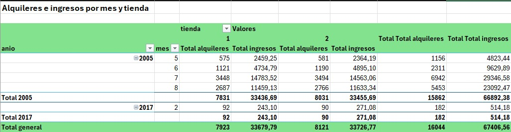

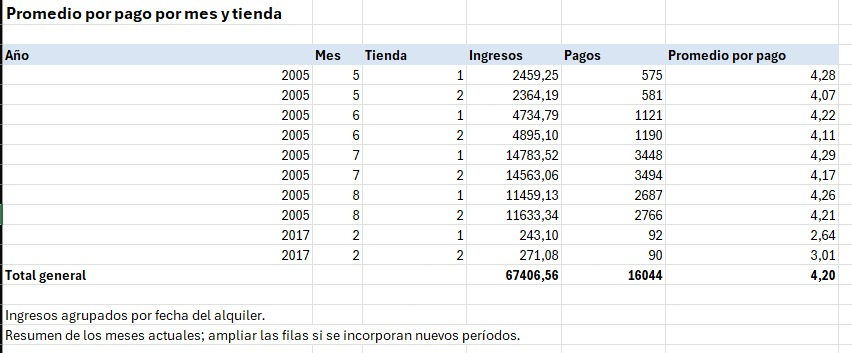

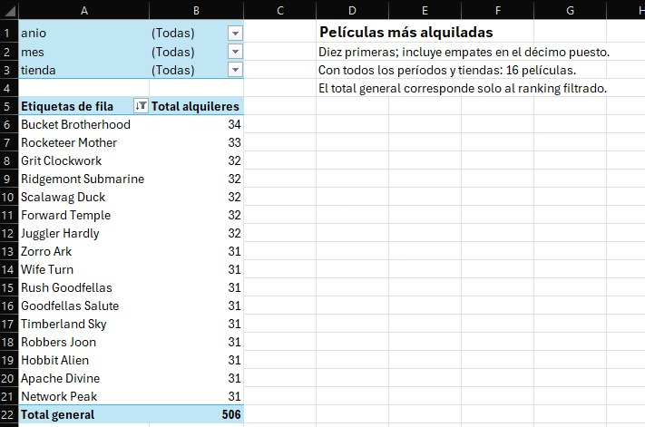

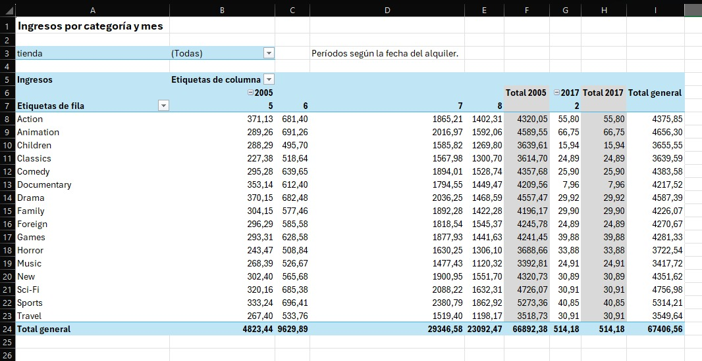

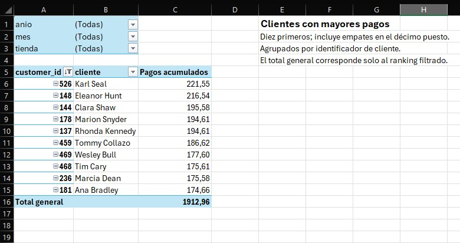

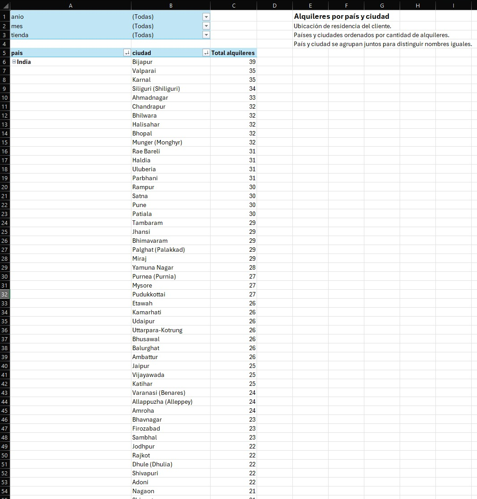

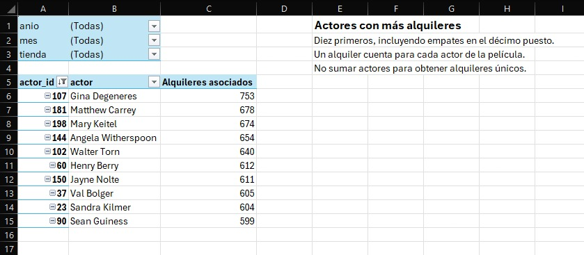

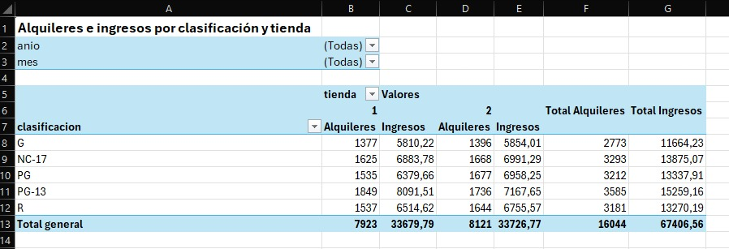

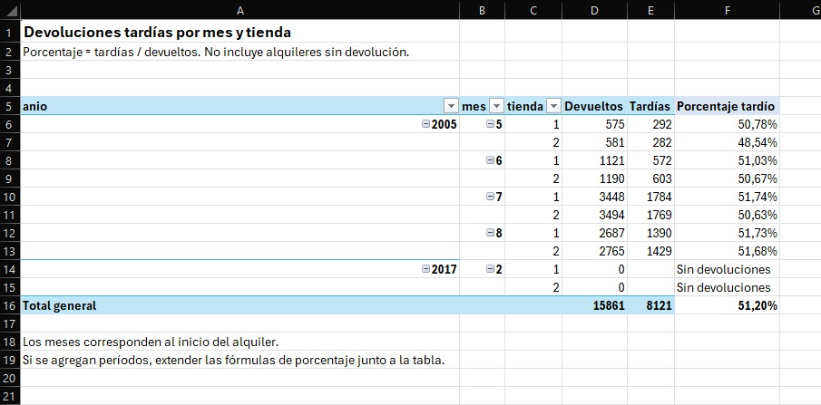

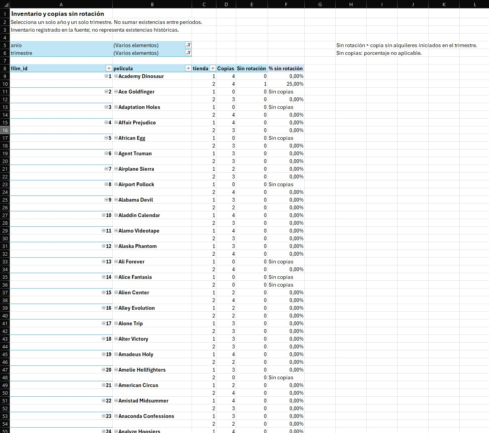

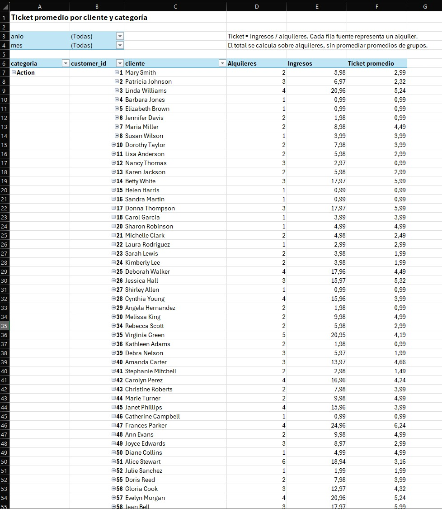

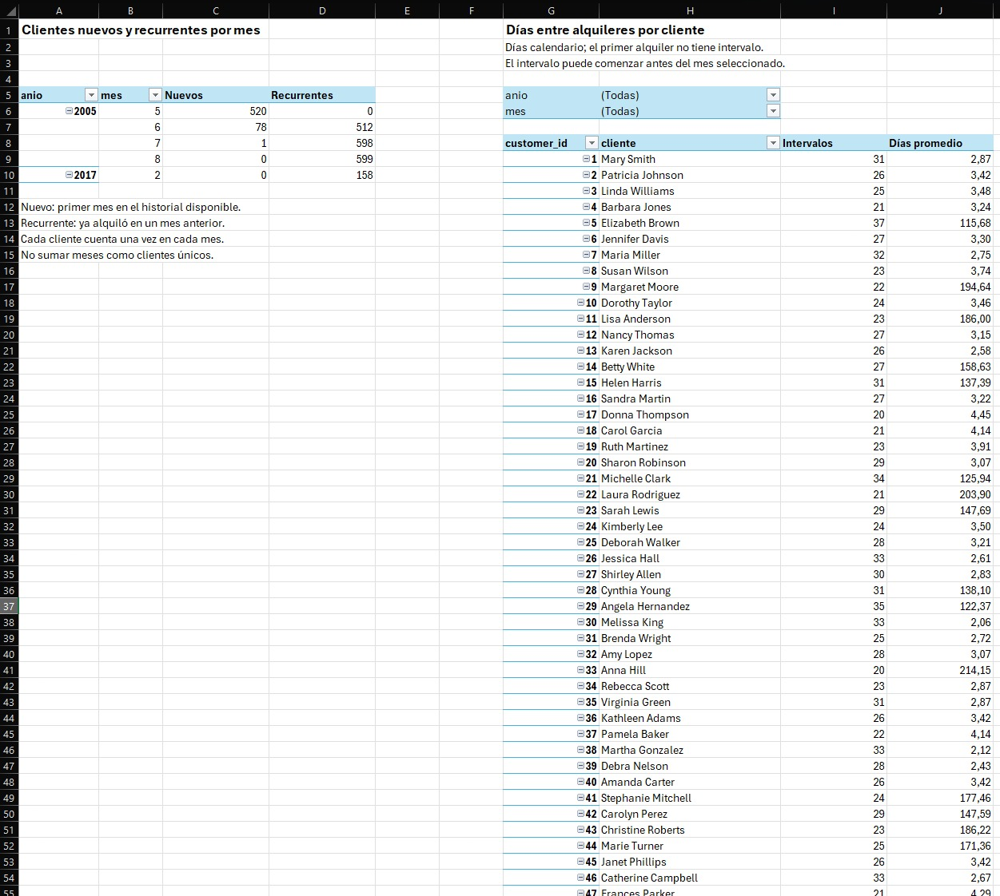

## Referencias

Kimball, R., & Caserta, J. (2004). *The data warehouse ETL toolkit: Practical techniques for extracting, cleaning, conforming, and delivering data*. Wiley.

Kimball, R., & Ross, M. (2013). *The data warehouse toolkit: The definitive guide to dimensional modeling* (3.ª ed.). Wiley.
