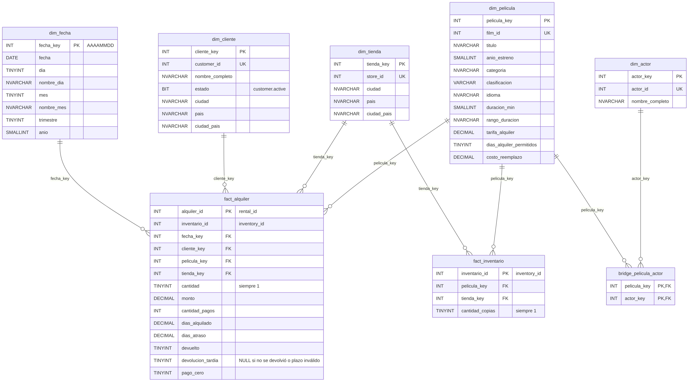

# Diagrama del modelo dimensional

> Jira: DWI-56 · Responsable: Marco Andrey López Quesada
> Sección del documento final. La imagen está en `docs/modelo/04-diagrama-dw.png`.

**Figura 1**

*Modelo dimensional del data warehouse de Invacom Inc S.A.*

*Nota.* Elaboración propia. PK = llave primaria; FK = llave foránea; UK = llave de negocio única tomada de la base Pagila.

El data warehouse sigue un esquema estrella: cada tabla de hechos se une directamente a sus dimensiones, que se guardan desnormalizadas en una sola tabla cada una (Kimball & Ross, 2013). El modelo tiene dos tablas de hechos que comparten las dimensiones Película y Tienda, por lo que forma una constelación de hechos. Se eligió este esquema en lugar del copo de nieve porque cada pregunta de negocio se responde uniendo el hecho con cada dimensión una sola vez, lo que simplifica las tablas dinámicas de Excel; el ahorro de espacio del copo de nieve es despreciable con dimensiones de 599 clientes y 1 000 películas.

## Tablas de hechos

- **`fact_alquiler`** registra una fila por cada alquiler válido (16 044 filas). Sus medidas son el monto cobrado, la cantidad de pagos, los días que duró el alquiler, los días de atraso y tres indicadores de 0 o 1: si la película se devolvió, si se devolvió fuera de plazo y si el pago fue de cero. Los indicadores se guardan como números para poder sumarlos y calcular porcentajes, por ejemplo el de devoluciones tardías.
- **`fact_inventario`** registra una fila por cada copia física de una película en una tienda (4 581 filas). Permite responder cuántas copias tiene cada tienda de cada película.

## Dimensiones

| Dimensión | Una fila por | Atributos principales |
|---|---|---|
| `dim_fecha` | día del calendario (4 285 días) | día, mes, trimestre y año |
| `dim_cliente` | cliente (599) | nombre, estado, ciudad y país |
| `dim_pelicula` | película (1 000) | título, categoría, clasificación, idioma, duración y tarifa |
| `dim_tienda` | tienda (2) | ciudad y país |
| `dim_actor` | actor (200) | nombre |

## Tabla puente

Una película tiene varios actores y un actor participa en varias películas. Si los actores se guardaran dentro de `dim_pelicula`, cada alquiler se contaría una vez por actor y los totales se multiplicarían. Por eso la relación se resuelve con la tabla puente `bridge_pelicula_actor` (5 462 filas), que solo se usa para la pregunta de los actores más alquilados (Kimball & Ross, 2013).

## Llaves

Cada dimensión tiene una llave sustituta propia del data warehouse (`*_key`), generada en Alteryx con las herramientas *Sort* y *Record ID*, y conserva el identificador de Pagila como llave de negocio única. Así el data warehouse no depende de la numeración de la base fuente y una recarga no duplica registros. La única excepción es `fecha_key`, que se calcula a partir de la fecha con el formato AAAAMMDD (por ejemplo, 20050524). Las tablas de hechos se unen a las dimensiones solo por estas llaves.

## Relación con las preguntas de negocio

| Preguntas | Tabla de hechos | Dimensiones |
|---|---|---|
| Ingresos y alquileres por mes y tienda; categorías y clasificaciones con más ingresos; clientes que más pagan; países y ciudades con más alquileres; devoluciones fuera de plazo | `fact_alquiler` | Fecha, Tienda, Película, Cliente |
| Actores cuyas películas se alquilan más | `fact_alquiler` | Película → tabla puente → Actor |
| Copias físicas por película y tienda | `fact_inventario` | Película, Tienda |

## Referencia

Kimball, R., & Ross, M. (2013). *The data warehouse toolkit: The definitive guide to dimensional modeling* (3.ª ed.). Wiley.
