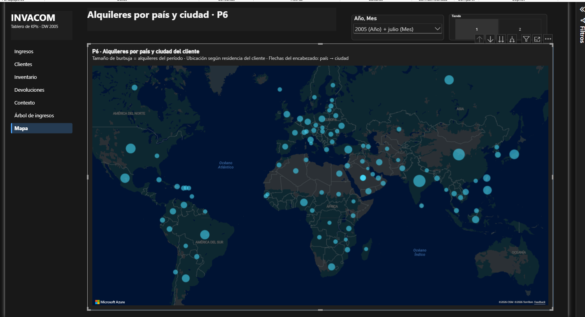

# Proyecto 2 — Metodología y KPIs gerenciales aprobados

**Curso:** Minería de Datos · III cuatrimestre 2026  
**Fuente de información:** Data Warehouse `DW_Invacom`, desarrollado en el Proyecto 1  
**Herramienta de visualización:** Microsoft Power BI  
**Estado:** Los ocho KPIs gerenciales fueron revisados y aprobados por el profesor.  
**Tarea relacionada:** DWI-77 — Investigar la metodología para diseñar KPIs gerenciales.

## Introducción

En el Proyecto 1 se construyó el Data Warehouse `DW_Invacom` para organizar y analizar la información de alquileres, pagos, clientes, películas, tiendas e inventario. En el Proyecto 2 se utiliza esa misma información para elaborar un tablero gerencial en Power BI que ayude a interpretar el desempeño del negocio y tomar decisiones.

Antes de diseñar las visualizaciones, es importante contar con una metodología que explique cómo se definen los indicadores, qué datos requieren, cómo se calculan y de qué manera se interpretan. Por eso, este documento desarrolla el marco de referencia solicitado en el punto I.a del enunciado y lo relaciona con los **ocho KPIs aprobados**, distribuidos en dos indicadores por integrante.

---

## I.a. Metodología para el diseño y la construcción de KPIs gerenciales

## Marco de referencia

El Proyecto 2 adopta un **ciclo de diseño, construcción y seguimiento de KPIs basado en resultados**. El punto de partida es la decisión que debe tomar la gerencia. A partir de ella se define el resultado que se quiere observar, se selecciona un indicador, se establece una línea base y se fija una meta. Después se construye la medida, se valida con los datos del Proyecto 1 y se usa el resultado para decidir una acción. Este ciclo adapta las etapas de selección de indicadores, establecimiento de líneas base, fijación de metas y seguimiento del modelo de Kusek y Rist (2004).

El ciclo se complementa con una **ficha técnica por KPI**, adaptada de la ficha de referencia de indicadores de USAID. La ficha documenta la definición, unidad, fuente, frecuencia, desagregación y persona responsable. En el Proyecto 2, esos campos se traducen en reglas de cálculo reproducibles sobre **DW_Invacom**, comparaciones mensuales por tienda y controles de calidad antes de mostrar los resultados en Power BI.

La metodología se aplica a los ocho KPIs que **ya fueron aprobados por el profesor**. Su aprobación define qué se medirá; la construcción del tablero permitirá calcular los resultados y comprobar que las medidas funcionen correctamente.

## Aplicación del ciclo al Proyecto 2

| Etapa | Aplicación en Invacom | Resultado esperado |
|---|---|---|
| 1. Definir el propósito | Vincular una pregunta del Proyecto 1 con una decisión gerencial. Por ejemplo, comparar la rotación por tienda para decidir dónde trasladar copias. | Pregunta de negocio, usuario, decisión y estudiante responsable. |
| 2. Diseñar el indicador | Definir la población, la fórmula, la unidad, los campos, los filtros y el período. Aclarar qué representa cada fila de la fuente y cuándo un resultado queda sin dato. | Ficha técnica con definición y criterios S.M.A.R.T. |
| 3. Establecer la línea base y aplicar la meta aprobada | Calcular el valor histórico con la misma fórmula, por tienda y en períodos comparables. Registrar la meta aprobada, su sentido favorable y el mes de evaluación. | Línea base reproducible y meta documentada. |
| 4. Construir y comprobar | Implementar la medida en Power BI y comparar su resultado con SQL sobre el DW, utilizando la misma tienda y el mismo mes. Probar los casos sin datos, los denominadores en cero y los totales generales. | Medida comprobada y evidencia de comparación. |
| 5. Interpretar y dar seguimiento | Mostrar el valor del mes, la meta y el resultado anterior cuando exista una comparación válida. Ante una desviación, revisar los datos de contexto y registrar la decisión que corresponda. | Resultado interpretable y decisión vinculada al KPI. |

La fecha de inicio del alquiler determina el mes de los indicadores derivados de **`fact_alquiler`**. Para K5 y K6 se utilizan las copias físicas registradas en **`fact_inventario`**, que no tiene un historial mensual de existencias; por eso, el resultado debe interpretarse con esa limitación. Los períodos parciales, como mayo de 2005, deben identificarse para evitar comparaciones engañosas.

En las tasas, las diferencias absolutas entre porcentajes se expresan en *puntos porcentuales*. En los indicadores de crecimiento se calcula la variación respecto al valor anterior; si el denominador es cero o no existe, debe mostrarse **«sin dato»**, en lugar de inventar un porcentaje. Véase [Granularidad del Data Warehouse](../modelo/08-granularidad.md).

## Criterios S.M.A.R.T. para las fichas

Se utiliza la versión S.M.A.R.T. de **Específico, Medible, Alcanzable, Relevante y Temporal**, vinculada al enfoque de formulación de objetivos presentado por Doran (1981). Cada KPI cuenta con un responsable y una explicación concreta de los cinco criterios, como solicita el enunciado.

| Criterio | Evidencia que debe quedar en la ficha |
|---|---|
| **S · Específico** | Resultado que se observa, población, tienda y reglas de inclusión o exclusión. |
| **M · Medible** | Fórmula, unidad, tablas y campos del DW. En una razón, precisar el numerador, el denominador y el caso en que este sea cero. |
| **A · Alcanzable** | Línea base comparable, meta y justificación con datos históricos y condiciones de operación. |
| **R · Relevante** | Pregunta de negocio y decisión que puede tomar la persona usuaria. |
| **T · Temporal** | Fecha usada para asignar períodos, frecuencia de medición, plazo de la meta y regla para comparar meses. |

## Aplicación a los ocho KPIs aprobados

El equipo tiene cuatro integrantes y dos indicadores aprobados por persona, para un total de ocho. La tabla vincula cada KPI con la decisión gerencial que busca apoyar. Sus metas y criterios S.M.A.R.T. se detallan en las fichas siguientes.

| Estudiante responsable | Indicadores | Decisión gerencial y comprobación |
|---|---|---|
| Kristel Daniela Ramírez Duarte | K1 Crecimiento mensual de ingresos · K2 Ticket promedio por alquiler | Evaluar la evolución de ingresos y orientar promociones. Verificar los pagos válidos, el mes anterior en K1 y el total de alquileres en K2. |
| Krisley Endrina Castro Barrantes | K3 Tasa de clientes recurrentes · K4 Ingreso promedio por cliente activo | Orientar campañas de fidelización y analizar el ingreso por cliente. Contar clientes distintos y, para K3, revisar el historial anterior del cliente en todo el negocio, como se hizo en las consultas del Proyecto 1. |
| Juan Daniel Ulate Aguilar | K5 Rotación del inventario · K6 Porcentaje de copias sin rotación | Decidir compras o traslados de copias. Comprobar el inventario registrado y contar copias distintas alquiladas en K6. |
| Marco Andrey López Quesada | K7 Tasa de devoluciones fuera de plazo · K8 Días promedio de atraso | Ajustar recordatorios y seguimiento de atrasos. Verificar el universo de devoluciones de K7 y calcular K8 sobre las devoluciones tardías. |

## Fichas técnicas de los ocho KPIs aprobados

Los siguientes **ocho KPIs y sus metas forman parte de la propuesta aprobada por el profesor**. Los datos globales validados en el Proyecto 1 son: **16.044 alquileres**, **67.406,56 de ingresos**, **4.581 copias físicas**, **599 clientes** y **8.121 devoluciones tardías de 15.861 alquileres devueltos (51,2 %)**. Estas cifras describen el conjunto de datos y sirven como referencia general; no sustituyen la medición mensual por tienda.

Fuentes internas: [Conteos del DW](../validaciones/conteos_totales.md) y [Validación de reportes](../validaciones/validacion_reportes.md).

### K1. Crecimiento mensual de ingresos

**Responsable** — Kristel Daniela Ramírez Duarte. **Meta** — Al menos +5 % frente al mes anterior.

**Justificación.** Los ingresos permiten detectar qué tiendas ganan o pierden actividad comercial entre períodos. La comparación mensual muestra dónde investigar antes de ajustar tarifas, promociones o catálogo.

- **S · Específico.** Mide la variación de los ingresos por tienda. Se usan los pagos válidos asociados a los alquileres según su mes de inicio.
- **M · Medible.** (Ingreso del mes − ingreso anterior) ÷ ingreso anterior × 100. El ingreso es la suma de `fact_alquiler[monto]`. Si el ingreso anterior es cero o falta, se muestra «sin dato».
- **A · Alcanzable.** El ingreso total de 67.406,56 es una referencia del conjunto de datos. Para analizar el cumplimiento de la meta aprobada del 5 %, se calculan variaciones entre meses comparables de cada tienda.
- **R · Relevante.** La gerencia puede detectar caídas y decidir dónde revisar el volumen de alquileres, las tarifas o el catálogo.
- **T · Temporal.** Se evalúa al cierre de cada mes frente al anterior. La comparación de junio con mayo de 2005 debe identificarse porque mayo es parcial.

### K2. Ticket promedio por alquiler

**Responsable** — Kristel Daniela Ramírez Duarte. **Meta** — Al menos 4,25 por alquiler.

**Justificación.** Dos tiendas pueden ingresar lo mismo con volúmenes de alquiler diferentes. El ticket promedio permite evaluar cuánto deja cada alquiler y si los cambios de tarifas o catálogo se reflejan en ese valor.

- **S · Específico.** Mide el monto promedio por alquiler válido de cada tienda, incluyendo los alquileres con pago en cero.
- **M · Medible.** Suma de `fact_alquiler[monto]` ÷ suma de `fact_alquiler[cantidad]`. Se expresa en la moneda del DW con dos decimales.
- **A · Alcanzable.** El promedio global de 4,20 se obtiene de 67.406,56 y 16.044 alquileres. La meta aprobada de 4,25 representa aproximadamente un 1,2 % más que el promedio general. Su cumplimiento se comprueba por mes y tienda.
- **R · Relevante.** La gerencia comercial puede evaluar tarifas y promociones al distinguir el monto por alquiler del volumen total.
- **T · Temporal.** Se calcula al cierre de cada mes y se compara con la meta y el ticket del mes anterior.

### K3. Tasa de clientes recurrentes

**Responsable** — Krisley Endrina Castro Barrantes. **Meta** — Al menos 85 % de clientes recurrentes.

**Justificación.** El número de clientes activos no revela cuántos volvieron. La proporción de recurrentes ayuda a distinguir la continuidad de la clientela de la captación de clientes nuevos.

- **S · Específico.** Un cliente activo alquiló en el mes. Es recurrente si además alquiló en un mes anterior. Siguiendo la consulta utilizada en el Proyecto 1, el historial anterior se revisa **en todo el negocio**. Al desglosar por tienda se toma la tienda donde el cliente alquiló en el mes evaluado, sin limitar su historial previo únicamente a esa tienda. [Consulta SQL del historial de clientes](../../sql/06_validacion_reportes.sql)
- **M · Medible.** Clientes activos distintos con alquileres anteriores ÷ clientes activos distintos del mes × 100. Se usa `fact_alquiler[cliente_key]` y la fecha de alquiler.
- **A · Alcanzable.** El DW registra 599 clientes con alquileres. La meta aprobada del 85 % se evalúa sobre la tasa mensual de clientes recurrentes de cada tienda, utilizando el historial general del cliente a partir del segundo mes disponible.
- **R · Relevante.** Mercadeo puede decidir si prioriza campañas de fidelización o de captación.
- **T · Temporal.** Se evalúa mensualmente desde junio de 2005. Mayo carece de historial previo en el período de la propuesta.

### K4. Ingreso promedio por cliente activo

**Responsable** — Krisley Endrina Castro Barrantes. **Meta** — Al menos +5 % frente al mes anterior.

**Justificación.** Un aumento en los ingresos puede deberse a que alquilan más personas o a que cada cliente aporta más. Medir el ingreso por cliente activo permite distinguir ambos efectos al evaluar campañas.

- **S · Específico.** Mide el ingreso medio generado por clientes que alquilaron durante el mes en cada tienda.
- **M · Medible.** Suma de `fact_alquiler[monto]` ÷ clientes activos distintos. La variación es la diferencia entre promedios mensuales dividida entre el promedio anterior, multiplicada por 100.
- **A · Alcanzable.** El cociente global de 67.406,56 entre 599 clientes es aproximadamente 112,53 **para todo el período**, no por mes. Para evaluar la meta aprobada de crecimiento del 5 %, se calculan promedios mensuales por tienda y se comparan períodos equivalentes.
- **R · Relevante.** Mercadeo puede observar si mejora el ingreso por cliente y orientar las promociones.
- **T · Temporal.** Se calcula al cierre mensual. Si el promedio anterior falta o es cero, se muestra «sin dato» para la variación. Los meses parciales deben identificarse.

### K5. Rotación del inventario

**Responsable** — Juan Daniel Ulate Aguilar. **Meta** — Al menos 1,0 alquiler por copia en un mes completo.

**Justificación.** Contar alquileres sin considerar cuántas copias hay dificulta comparar tiendas de diferente tamaño. La rotación mide la demanda en relación con el inventario disponible para orientar la distribución de copias.

- **S · Específico.** Mide el uso de las copias registradas por tienda. Usa los alquileres del mes y el inventario registrado.
- **M · Medible.** Suma de `fact_alquiler[cantidad]` ÷ suma de `fact_inventario[cantidad_copias]`. Se expresa en alquileres por copia.
- **A · Alcanzable.** Como referencia aproximada, el equipo estimó alrededor de 1,07 alquileres por copia al mes con los datos de 2005. La meta aprobada de 1,0 se evalúa con los datos de cada mes completo y tienda.
- **R · Relevante.** Inventario puede evaluar si conviene comprar o trasladar copias según la demanda observada.
- **T · Temporal.** El cálculo es mensual. La meta se evalúa en meses completos y mayo de 2005 se identifica como parcial.

### K6. Porcentaje de copias sin rotación

**Responsable** — Juan Daniel Ulate Aguilar. **Meta** — Como máximo 30 % en un mes completo.

**Justificación.** Una rotación promedio alta puede concentrarse en pocas copias. Medir las copias sin alquiler hace visible el inventario inmovilizado que podría trasladarse o promocionarse.

- **S · Específico.** Una copia registrada queda sin rotación si su `inventario_id` no registra alquileres en la tienda durante el período.
- **M · Medible.** Copias registradas sin alquiler ÷ copias registradas × 100. Una copia alquilada varias veces cuenta una sola vez entre las copias que rotaron.
- **A · Alcanzable.** El Proyecto 1 validó una copia sin rotación de 4.581 en el tercer trimestre de 2005. Ese dato trimestral no equivale a una tasa mensual. El cumplimiento de la meta aprobada del 30 % se calcula por tienda y mes completo. [Validación de inventario y rotación](../validaciones/validacion_reportes.md#validación-de-inventario-y-rotación)
- **R · Relevante.** Inventario puede identificar copias para traslado, promoción o retiro.
- **T · Temporal.** Se evalúa mensualmente en meses completos. Para el corte trimestral se comprueba si cada copia se alquiló alguna vez durante el trimestre.

### K7. Tasa de devoluciones fuera de plazo

**Responsable** — Marco Andrey López Quesada. **Meta** — Como máximo 45 % de devoluciones tardías.

**Justificación.** Una devolución tardía prolonga el tiempo durante el cual la copia no está disponible. La tasa cuantifica con qué frecuencia ocurre y ayuda a priorizar acciones preventivas.

- **S · Específico.** Mide qué proporción de los alquileres devueltos excedió su plazo, por tienda y mes de inicio del alquiler.
- **M · Medible.** Suma de `fact_alquiler[devolucion_tardia]` ÷ suma de `fact_alquiler[devuelto]` × 100. Al implementar la medida se comprueba el tratamiento de registros cuyo estado de devolución tardía sea nulo, sin alterar la definición del KPI aprobado.
- **A · Alcanzable.** La referencia global es 51,2 %. Llegar a 45 % exige una reducción de 6,2 puntos porcentuales. El cumplimiento de la meta aprobada se comprueba por tienda; los recordatorios previos al vencimiento son una posible acción de mejora.
- **R · Relevante.** Operaciones puede decidir dónde reforzar recordatorios para mejorar la disponibilidad de copias.
- **T · Temporal.** Se evalúa mensualmente por tienda y se compara con el mes anterior en puntos porcentuales.

### K8. Días promedio de atraso

**Responsable** — Marco Andrey López Quesada. **Meta** — Como máximo 2,0 días de atraso promedio.

**Justificación.** Dos tiendas con la misma tasa de devoluciones tardías pueden enfrentar atrasos de distinta duración. El promedio de días mide la gravedad del atraso y complementa la frecuencia que muestra K7.

- **S · Específico.** Mide la duración del atraso entre los alquileres devueltos fuera de plazo, por tienda y mes de inicio del alquiler.
- **M · Medible.** Promedio de `fact_alquiler[dias_atraso]` entre las filas con `devolucion_tardia = 1`. Se expresa en días con un decimal. Si el mes carece de devoluciones tardías, se muestra «sin dato».
- **A · Alcanzable.** La meta aprobada de 2,0 días se compara con el atraso promedio observado por tienda y mes.
- **R · Relevante.** Operaciones puede evaluar la gravedad de los atrasos y decidir cuándo contactar al cliente o revisar los recargos.
- **T · Temporal.** Se evalúa mensualmente por tienda frente a la meta y al promedio del mes anterior cuando está disponible.

## Interpretación de los resultados en Power BI

El tablero debe permitir seleccionar el mes y la tienda para comparar los valores de cada indicador con su meta aprobada. Para facilitar las decisiones, se propone mostrar el valor actual, el comportamiento del período anterior cuando sea comparable y gráficos de contexto relacionados con clientes, ingresos, películas e inventario.

Los resultados de los KPIs no deben interpretarse únicamente por el color de una tarjeta. Por ejemplo, si disminuye la tasa de clientes recurrentes (K3), se debe revisar también la cantidad de clientes nuevos y activos antes de concluir que existe un problema de fidelización. Si aumenta el ingreso promedio por cliente activo (K4), conviene comprobar si cambió la cantidad de clientes o el volumen de alquileres.

Las medidas de Power BI deben contrastarse con consultas SQL sobre `DW_Invacom` usando los mismos filtros. Esto permite comprobar que los totales, porcentajes y promedios coincidan con los datos del proyecto anterior. **Los ocho KPIs ya cuentan con aprobación del profesor**; esta comprobación se realiza para asegurar que se implementen correctamente.

## Requisitos para visualizar la página Mapa

La página **Mapa** responde la pregunta de negocio 6 con el visual nativo **Azure Maps** de Power BI. Microsoft está retirando el visual de mapa anterior, basado en Bing Maps, y recomienda migrar a Azure Maps; por eso el tablero usa el visual nuevo. Muestra los alquileres por país y ciudad de residencia del cliente: el tamaño de cada burbuja corresponde a los alquileres del período, la información sobre herramientas agrega los ingresos y las flechas del encabezado permiten bajar de país a ciudad.

A diferencia del resto de los gráficos, Azure Maps necesita un servicio en línea de Microsoft. Si el mapa aparece en blanco o con un mensaje de error al abrir `Dashboard_Invacom.pbix`, se deben revisar estos puntos:

1. **Conexión a Internet.** El mapa descarga el fondo geográfico desde los servidores de Microsoft.
2. **Sesión iniciada en Power BI Desktop.** Si aparece el mensaje «Para mostrar los objetos visuales de Azure Maps, inicie sesión», hay que iniciar sesión con una cuenta profesional o educativa (botón *Iniciar sesión*, arriba a la derecha).
3. **Azure Maps habilitado en la organización.** Si con la sesión iniciada el mensaje indica que el visual no está habilitado para la organización, el bloqueo depende del administrador del inquilino de Power BI y no del archivo. En ese caso se puede cerrar la sesión o usar otra cuenta.
4. **Opción de seguridad de mapas.** Si el mensaje indica que los objetos visuales de mapa están deshabilitados, hay que ir a *Archivo → Opciones y configuración → Opciones → Global → Seguridad*, marcar **«Usar objetos visuales de mapa y de mapa coroplético»**, aceptar y volver a abrir la página.

Estas condiciones dependen de la computadora y de la cuenta de quien abre el archivo, no de los datos ni de las medidas del modelo. Como respaldo, la siguiente captura muestra la página funcionando con julio de 2005 y la tienda 1 seleccionados:

## Conclusión

La metodología seleccionada establece un proceso ordenado para relacionar las necesidades de la gerencia con indicadores medibles. Partir de las preguntas de negocio, definir las fórmulas, documentar los criterios S.M.A.R.T. y comprobar los cálculos ayuda a construir un tablero que no se limite a mostrar gráficos, sino que aporte información útil para tomar decisiones.

En este Proyecto 2, el equipo cuenta con ocho KPIs aprobados, dos por integrante, construidos a partir de los datos del `DW_Invacom`. La investigación desarrollada en la tarea DWI-77 sirve como fundamento para su implementación y seguimiento en Power BI.

### Documentación técnica del Proyecto 1

- [Modelo y granularidad del Data Warehouse](../modelo/08-granularidad.md).
- [Conteos y totales validados](../validaciones/conteos_totales.md).
- [Validación de los reportes](../validaciones/validacion_reportes.md).
- [Consultas SQL de validación](../../sql/06_validacion_reportes.sql).
