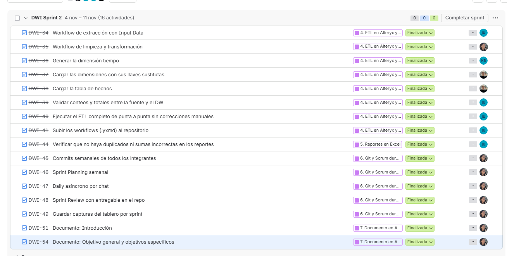

# Sprint 2

| | |
|---|---|
| **Fechas en Jira** | Inicio: 04/11/2026 · fin planificado: 11/11/2026 · cierre real: 13/11/2026 |
| **Scrum Master** | Kristel Daniela Ramírez Duarte |
| **Coordinadores** | Juan Daniel Ulate Aguilar y Marco Andrey López Quesada |
| **Product Owner** | El profesor |
| **Objetivo del sprint** | Construir el ETL completo en Alteryx, cargar el DW y validar sus datos contra la fuente. |
| **Épicas** | DWI-5 ETL en Alteryx y construcción del DW · DWI-6 Reportes en Excel · DWI-7 Git y Scrum · DWI-8 Documento en APA 7 |
| **Tareas del enunciado** | 9 y 10 (ETL y carga del DW) |

## Sprint Planning (04/11/2026)

Sprint Backlog, según Jira:

| Tarea | Descripción | Responsable |
|---|---|---|
| DWI-34 | Workflow de extracción con Input Data | Juan Daniel |
| DWI-35 | Workflow de limpieza y transformación | Kristel |
| DWI-36 | Generar la dimensión tiempo | Krisley |
| DWI-37 | Cargar las dimensiones con sus llaves sustitutas | Marco |
| DWI-38 | Cargar la tabla de hechos | Marco |
| DWI-39 | Validar conteos y totales entre la fuente y el DW | Juan Daniel |
| DWI-40 | Ejecutar el ETL completo de punta a punta sin correcciones manuales | Juan Daniel |
| DWI-41 | Subir los workflows (`.yxmd`) al repositorio | Juan Daniel |
| DWI-44 | Verificar que no haya duplicados ni sumas incorrectas en los reportes | Juan Daniel |
| DWI-45 a DWI-49 | Commits semanales, Sprint Planning, Daily, Sprint Review y capturas del tablero | Kristel |
| DWI-51 | Documento: Introducción | Krisley |
| DWI-54 | Documento: Objetivo general y objetivos específicos | Krisley |

## Daily

El daily es asíncrono, por el chat del grupo.

### Avances registrados en el repositorio

| Fecha | Integrante | Avance | Commit |
|---|---|---|---|
| 04/11 | Marco | DWI-33 ajuste a `dim_pelicula`; acuerdo de archivos entre los flujos del ETL | [d4a1c4c](https://github.com/marcoalq9/PROYECTO_1_MINERIA-dw-invacom-alteryx/commit/d4a1c4c), [9113c49](https://github.com/marcoalq9/PROYECTO_1_MINERIA-dw-invacom-alteryx/commit/9113c49) |
| 04/11 | Juan Daniel | DWI-34 Flujo de extracción (PR #6) | [a3fe97a](https://github.com/marcoalq9/PROYECTO_1_MINERIA-dw-invacom-alteryx/commit/a3fe97a) |
| 05/11 | Marco | Agrega el archivo de rechazos al acuerdo de archivos | [d9237f3](https://github.com/marcoalq9/PROYECTO_1_MINERIA-dw-invacom-alteryx/commit/d9237f3) |
| 05/11 | Kristel | Corrección de la estrategia de limpieza | [098ba89](https://github.com/marcoalq9/PROYECTO_1_MINERIA-dw-invacom-alteryx/commit/098ba89) |
| 08/11 | Kristel | DWI-35 Flujo de limpieza en Alteryx | [52a0863](https://github.com/marcoalq9/PROYECTO_1_MINERIA-dw-invacom-alteryx/commit/52a0863) |
| 09/11 | Krisley | DWI-36 Dimensión tiempo generada y cargada | [74691ed](https://github.com/marcoalq9/PROYECTO_1_MINERIA-dw-invacom-alteryx/commit/74691ed) |
| 11/11 | Marco | DWI-37 Carga de dimensiones; la dimensión tiempo se puede volver a cargar | [f1c1ef6](https://github.com/marcoalq9/PROYECTO_1_MINERIA-dw-invacom-alteryx/commit/f1c1ef6), [5469b9f](https://github.com/marcoalq9/PROYECTO_1_MINERIA-dw-invacom-alteryx/commit/5469b9f) |
| 12/11 | Marco | DWI-38 Carga de hechos y tabla puente | [a5bee06](https://github.com/marcoalq9/PROYECTO_1_MINERIA-dw-invacom-alteryx/commit/a5bee06) |
| 12/11 | Marco | Primeras secciones del documento: diagrama (DWI-56) y descripción de la solución (DWI-55) | [b657aa3](https://github.com/marcoalq9/PROYECTO_1_MINERIA-dw-invacom-alteryx/commit/b657aa3), [2bfeff7](https://github.com/marcoalq9/PROYECTO_1_MINERIA-dw-invacom-alteryx/commit/2bfeff7) |
| 12/11 | Juan Daniel | DWI-39 Validación de conteos y DWI-40 ejecución completa del ETL | [d40b0fb](https://github.com/marcoalq9/PROYECTO_1_MINERIA-dw-invacom-alteryx/commit/d40b0fb), [9d09a76](https://github.com/marcoalq9/PROYECTO_1_MINERIA-dw-invacom-alteryx/commit/9d09a76) |
| 13/11 | Juan Daniel | DWI-44 Reportes de Excel y validación contra SQL | [1e2d342](https://github.com/marcoalq9/PROYECTO_1_MINERIA-dw-invacom-alteryx/commit/1e2d342) |

## Sprint Review (13/11/2026)

Las tareas del sprint quedaron finalizadas en Jira.

| Tarea | Resultado | Evidencia |
|---|---|---|
| DWI-34 | 14 tablas extraídas (32 088 alquileres, 32 093 pagos, 4 581 copias) | `alteryx/workflows/01_extraccion.yxmd` y `.md` |
| DWI-35 | 9 archivos limpios y 32 093 rechazos con su código | `alteryx/workflows/02_limpieza.yxmd` y `.md` |
| DWI-36 | 4 285 fechas cargadas | `alteryx/workflows/dim_fecha.yxmd` y `.md` |
| DWI-37 | 599 clientes, 1 000 películas, 2 tiendas y 200 actores | `alteryx/workflows/03_dimensiones.yxmd` y `.md` |
| DWI-38 | 16 044 alquileres, 4 581 copias y 5 462 relaciones película–actor | `alteryx/workflows/04_hechos.yxmd` y `.md` |
| DWI-39 | La fuente limpia y el DW coinciden (ingresos 67 406,56) | `docs/validaciones/conteos_totales.md` |
| DWI-40 | Los 5 flujos corren en orden sin errores | `docs/validaciones/ejecucion_ETL.md` |
| DWI-41 | Workflows en el repositorio | `alteryx/workflows/` |
| DWI-44 | Los reportes coinciden con las consultas SQL | `docs/validaciones/validacion_reportes.md`, `sql/06_validacion_reportes.sql` |
| DWI-45 a DWI-49 | Gestión del sprint en Jira y en el repositorio | `docs/sprints/` |
| DWI-51, DWI-54 | Introducción y objetivos del documento final | Documento final |

**Incremento entregado:** el DW está cargado de punta a punta con Alteryx y validado contra la fuente.

## Captura del tablero

