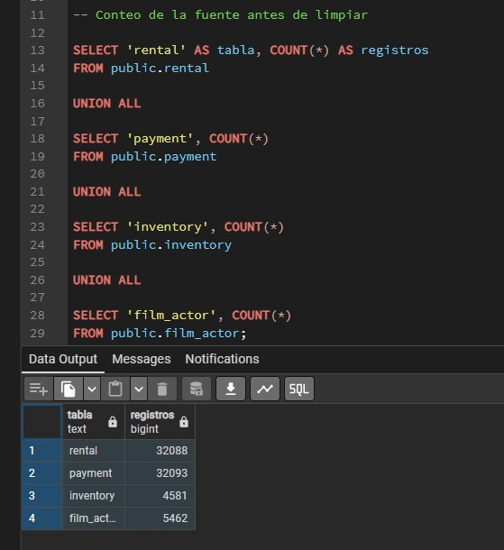
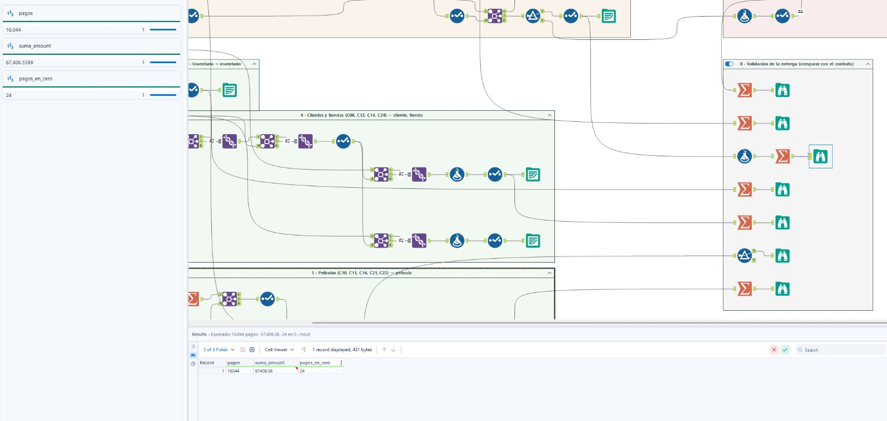
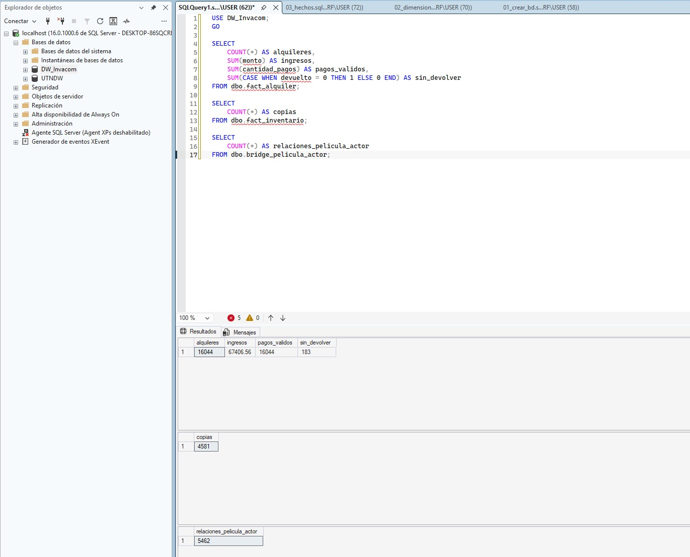

# Validación de conteos y totales

Responsable: Juan Daniel Ulate Aguilar
Fecha: 12/11/2026
Base fuente: pagila_dvd_rental
Base del DW: DW_Invacom

## Objetivo

Comprobar que los conteos y totales de la fuente, después
de aplicar las reglas de limpieza, coincidan con el DW.

## Procedimiento

## Conteos de la fuente antes de la limpieza

Base consultada: pagila_dvd_rental
Esquema: public

| Tabla | Registros |
|---|---:|
| rental | 32.088 |
| payment | 32.093 |
| inventory | 4.581 |
| film_actor | 5.462 |

Los conteos coinciden con los valores documentados para la fuente.
Todavía falta validar las salidas de limpieza y compararlas con el DW.

## Validación de pagos después de la limpieza

Se verificó la salida del workflow 02_limpieza en Alteryx.

| Control | Resultado |
|---|---:|
| Pagos válidos | 16.044 |
| Suma de pagos | 67.406,56 |
| Pagos con monto cero | 24 |

Los valores coinciden con lo documentado para la limpieza.
Queda pendiente compararlos con el DW.

## Comparación de la fuente limpia contra el DW

| Control | Fuente limpia | DW | Diferencia | Estado |
|---|---:|---:|---:|---|
| Alquileres válidos | 16.044 | 16.044 | 0 | Coincide |
| Pagos válidos | 16.044 | 16.044 | 0 | Coincide |
| Ingresos totales | 67.406,56 | 67.406,56 | 0,00 | Coincide |
| Copias de inventario | 4.581 | 4.581 | 0 | Coincide |
| Relaciones película–actor | 5.462 | 5.462 | 0 | Coincide |

## Conclusión

Los conteos y el total de ingresos comprobados en el DW
coinciden con las salidas de limpieza de Alteryx.
No se encontraron diferencias en los controles realizados.
