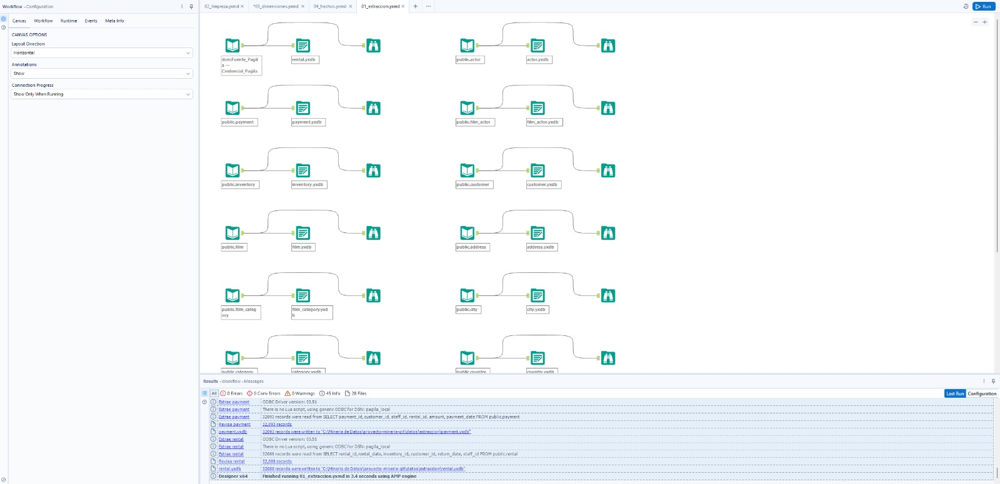
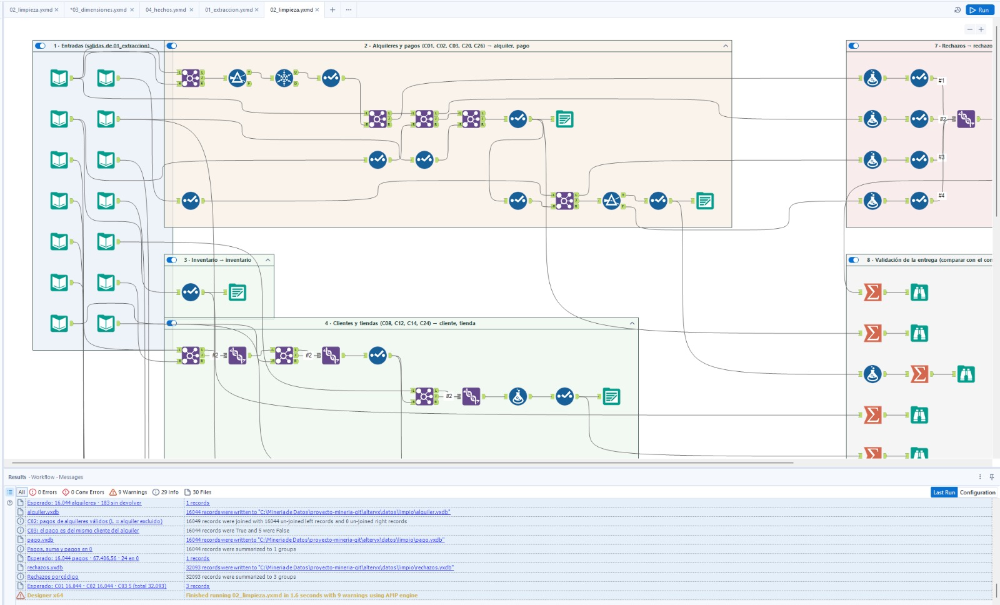
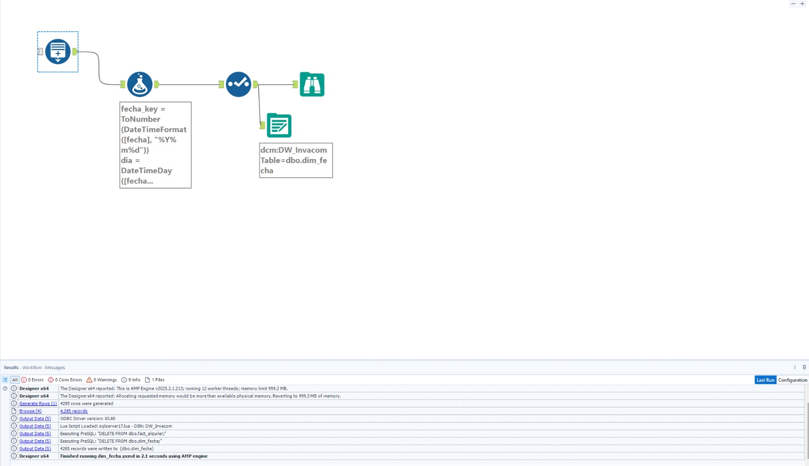
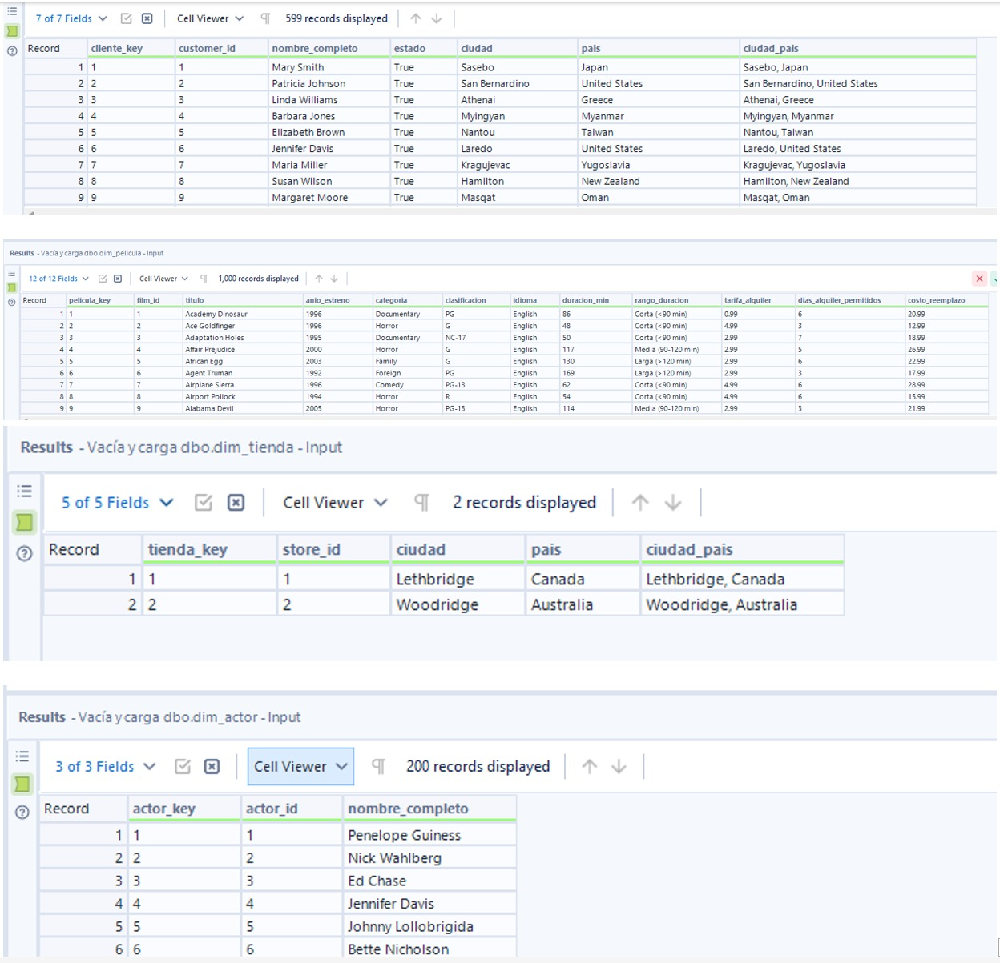
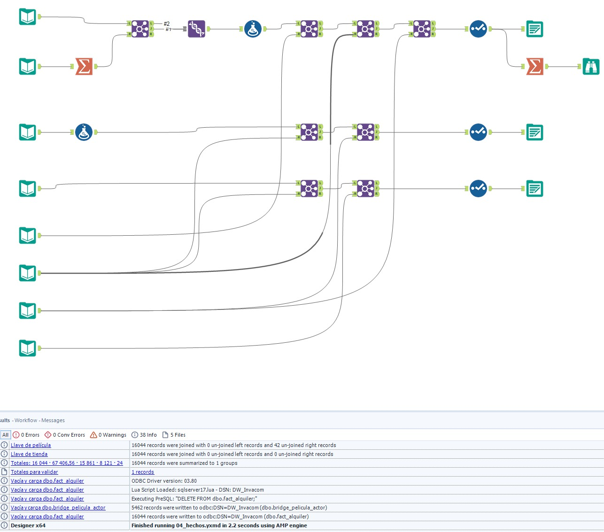
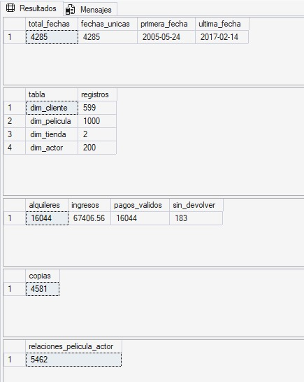

# DWI-40 — Ejecución completa del ETL

Responsable: Juan Daniel Ulate Aguilar
Fecha: 12/11/2026
Entorno: PostgreSQL como fuente y SQL Server local como DW.

## Objetivo

Comprobar la ejecución de todas las etapas del ETL en orden,
sin correcciones manuales de datos entre etapas.

## Ejecución

| Orden | Workflow | Resultado | Errores | Advertencias |
|---|---|---|---:|---:|
| 1 | 01_extraccion | Completado en 3,4 segundos | 0 | 0 |
| 2 | 02_limpieza | Completado en 1,6 segundos | 0 | 9 |
| 3 | dim_fecha | 4.285 filas cargadas; no muestra | 0 | 0|
| 4 | 03_dimensiones | Completado en 1,3 segundos | 0 | 0 |
| 5 | 04_hechos | Completado en 2,3 segundos | 0 | 0 |

## Evidencia de extracción

El workflow 01_extraccion finalizó en 3,4 segundos,
sin errores ni advertencias reportados, y generó los 14 archivos de salida.

## Evidencia de limpieza

El workflow 02_limpieza finalizó en 1,6 segundos, sin errores
y con 9 advertencias sobre campos no presentes en todas las
entradas de algunas uniones.

Se generaron las siguientes salidas:
- 16.044 alquileres válidos.
- 16.044 pagos válidos.
- 4.581 copias de inventario.
- 5.462 relaciones película–actor.
- 32.093 registros de rechazo.

Las advertencias quedan registradas para su revisión.

## Evidencia de carga de fechas

## Evidencia de carga de dimensiones

## Evidencia de carga de hechos

## Validación final del DW

Los resultados finales del DW coinciden con los valores esperados:

| Control | Resultado |
|---|---:|
| Fechas / fechas únicas | 4.285 / 4.285 |
| Clientes | 599 |
| Películas | 1.000 |
| Tiendas | 2 |
| Actores | 200 |
| Alquileres | 16.044 |
| Ingresos | 67.406,56 |
| Pagos válidos | 16.044 |
| Alquileres sin devolver | 183 |
| Copias de inventario | 4.581 |
| Relaciones película–actor | 5.462 |