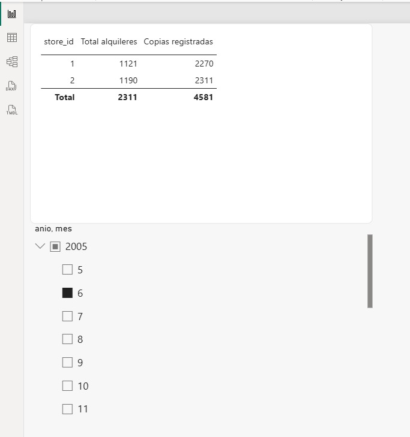
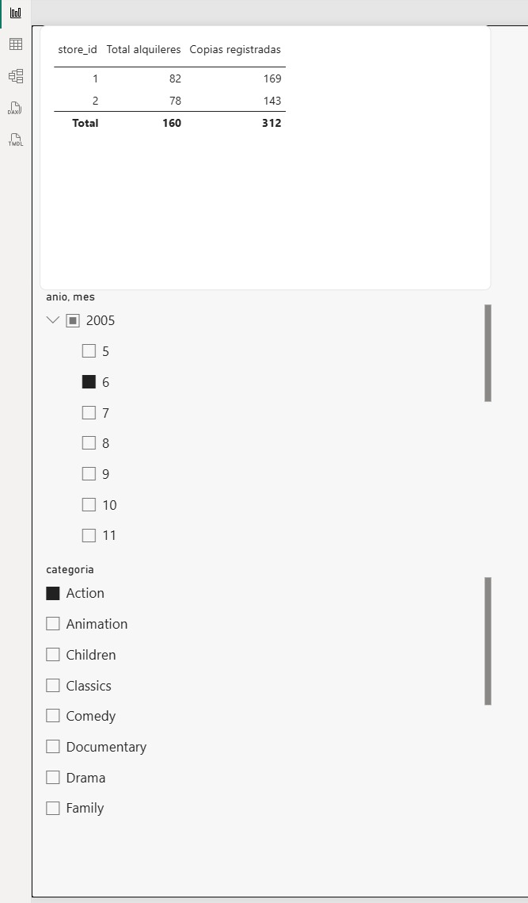
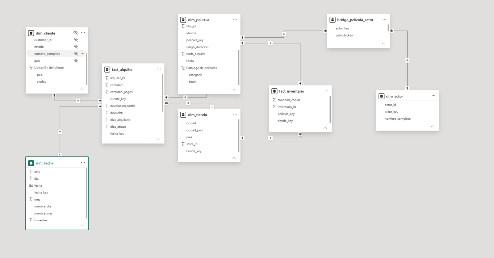
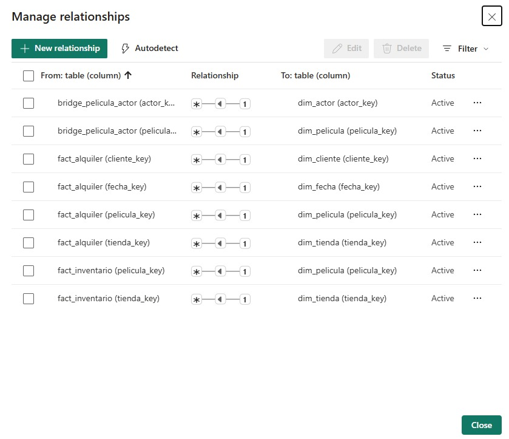
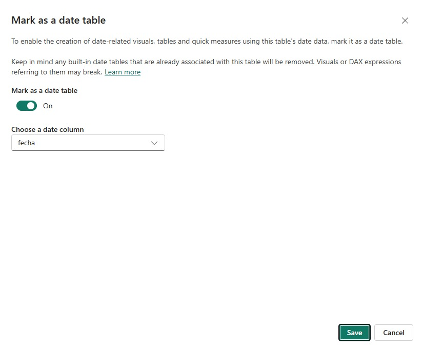
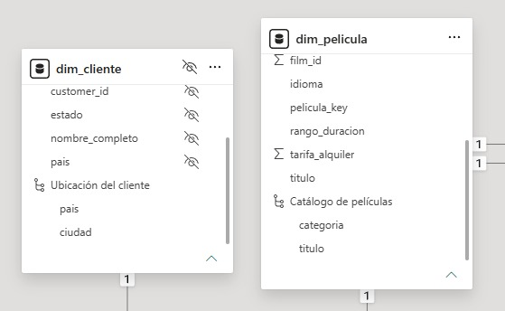

# Modelo de datos en Power BI

Responsable: Juan Daniel Ulate Aguilar
Fecha: 24/11/2026
Archivo: powerbi/Dashboard_Invacom.pbix

## Comprobación del filtro de fecha

Al seleccionar junio de 2005, los alquileres cambian a 2.311,
mientras el inventario permanece en 4.581 copias.

Esto comprueba que dim_fecha filtra fact_alquiler y que el
inventario registrado no se limita por la fecha del alquiler.

## Comprobación del filtro de categoría

Manteniendo junio de 2005 y seleccionando Action, se muestran:

| Tienda | Alquileres | Copias |
|---|---:|---:|
| 1 | 82 | 169 |
| 2 | 78 | 143 |
| Total | 160 | 312 |

La categoría de dim_pelicula filtra ambas tablas de hechos.

## Relaciones del modelo

Las relaciones están activas y utilizan cardinalidad uno a
varios, con filtro único desde las dimensiones hacia los hechos
o hacia la tabla puente.

| Dimensión, lado 1 | Tabla, lado varios | Columna |
|---|---|---|
| dim_fecha | fact_alquiler | fecha_key |
| dim_cliente | fact_alquiler | cliente_key |
| dim_pelicula | fact_alquiler | pelicula_key |
| dim_tienda | fact_alquiler | tienda_key |
| dim_pelicula | fact_inventario | pelicula_key |
| dim_tienda | fact_inventario | tienda_key |
| dim_pelicula | bridge_pelicula_actor | pelicula_key |
| dim_actor | bridge_pelicula_actor | actor_key |

La tabla puente contiene 5.462 asociaciones película–actor.
No se relacionan directamente las dos tablas de hechos.

Para el análisis por actor, será necesaria una medida DAX
que propague la selección hacia las películas y los alquileres.

Se verificaron las ocho relaciones en Manage relationships:
todas están activas, con cardinalidad varios a uno y dirección
de filtro única desde las dimensiones.

## Tabla de fechas

Se configuró dim_fecha como tabla de fechas mediante
Mark as a date table, utilizando la columna fecha.

La relación con fact_alquiler utiliza fecha_key.
No se relaciona dim_fecha con fact_inventario, porque el
inventario registrado no contiene un historial de fechas.

## Jerarquías del modelo

Se crearon las siguientes jerarquías:

- Ubicación del cliente, en dim_cliente: pais → ciudad.
- Catálogo de películas, en dim_pelicula: categoria → titulo.

Permiten navegar desde el nivel general hasta el detalle.

## Conclusión

Se configuraron y verificaron las ocho relaciones activas
del modelo, la tabla de fechas y las jerarquías solicitadas.

Se comprobó que Fecha filtra los alquileres sin modificar
el inventario registrado, y que Categoría filtra ambas tablas
de hechos.

La tabla puente película–actor quedó importada y relacionada.
La medida para propagar el filtro de actor hacia los alquileres
se implementará en DWI-96.