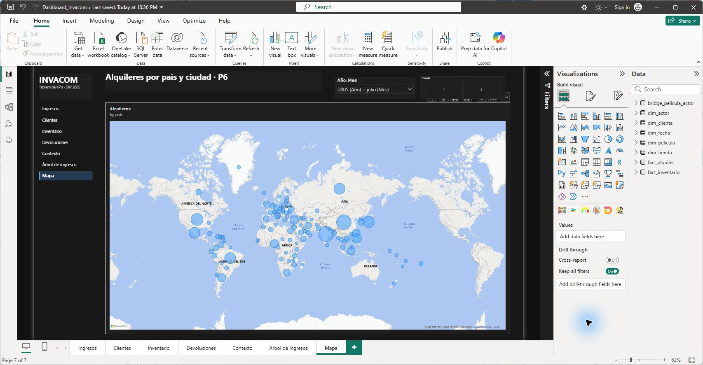
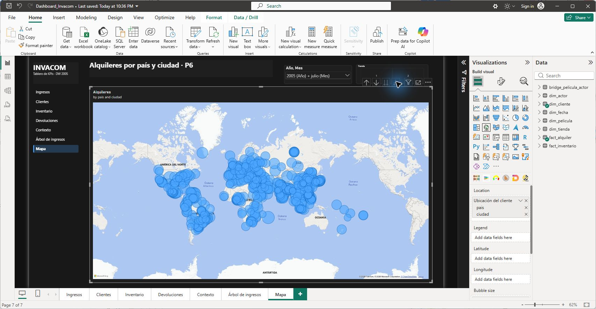
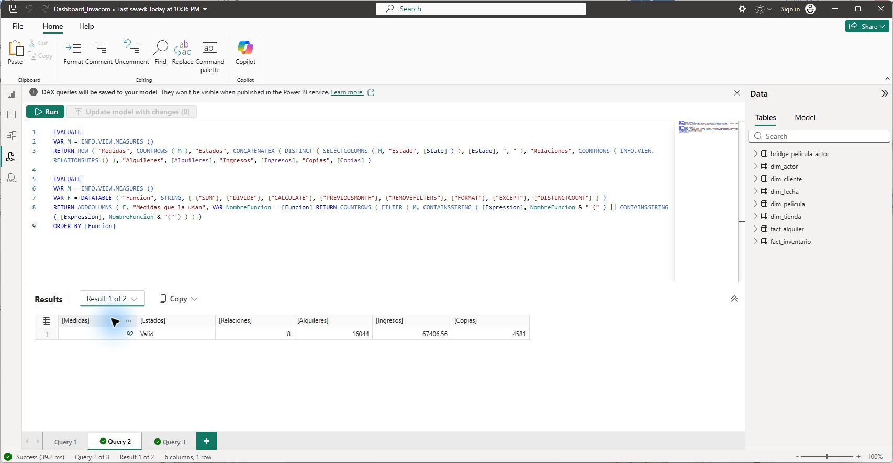
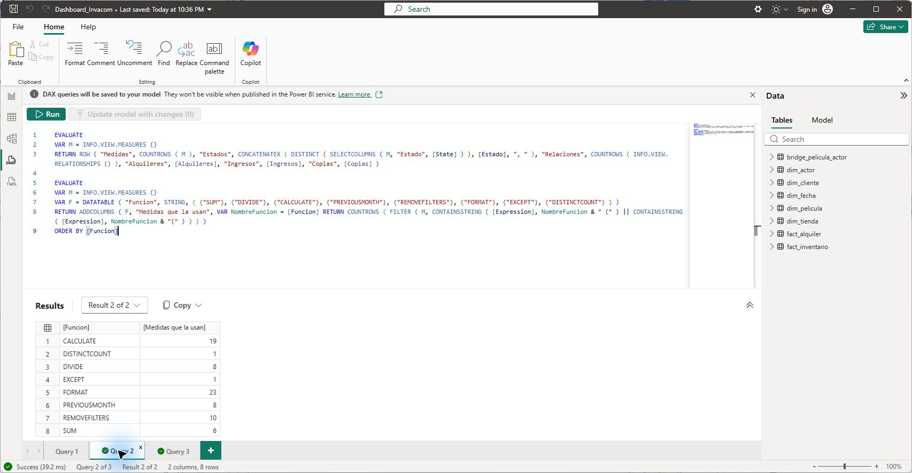
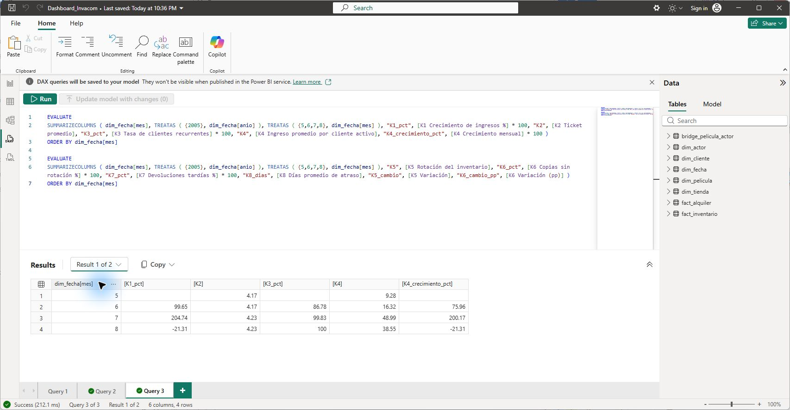
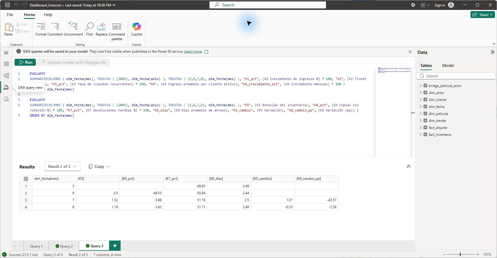
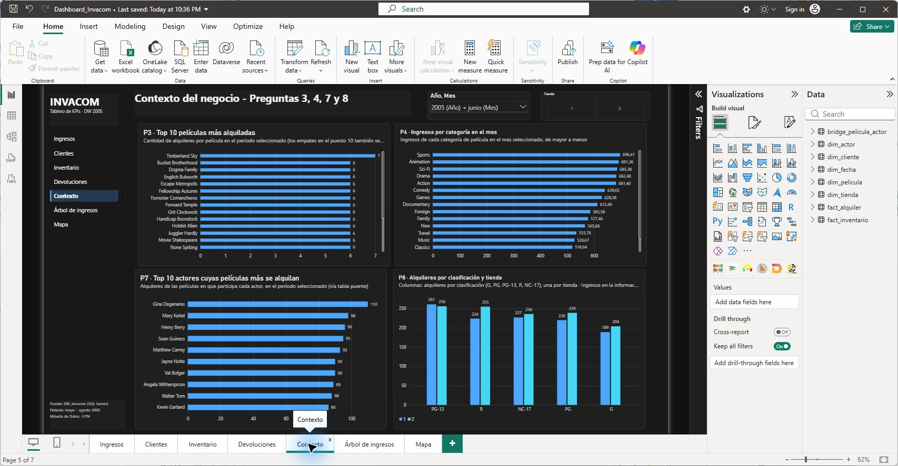
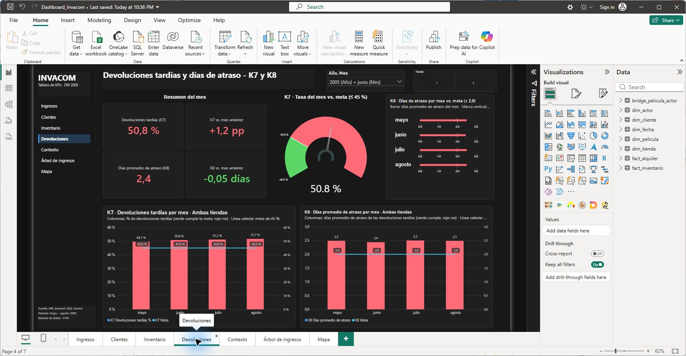
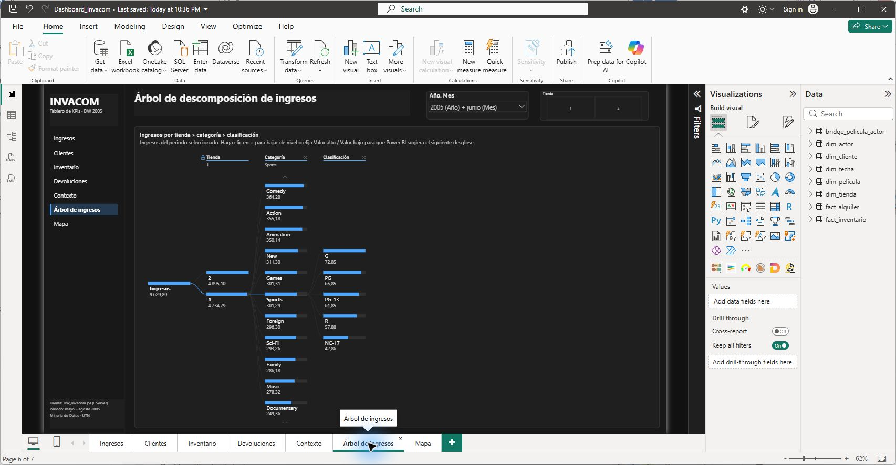
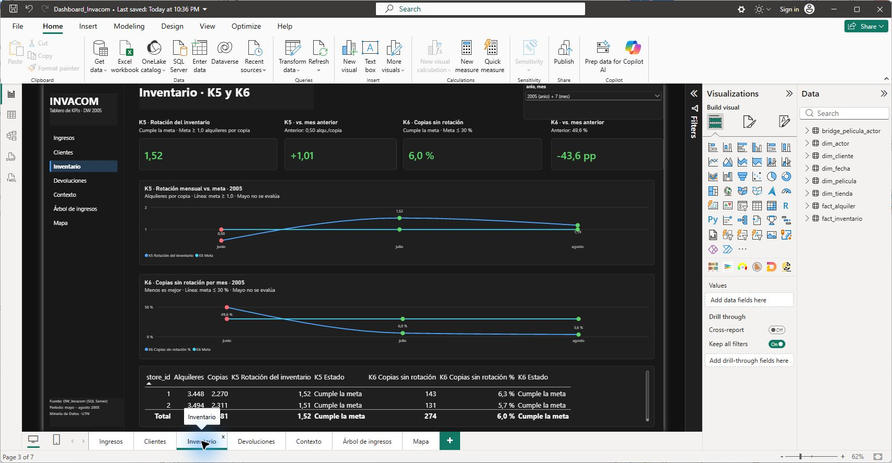

# QA del dashboard de Invacom

Fecha: 27/11/2026. Responsable de la revisión: Juan Daniel.
Archivo revisado: `powerbi/Dashboard_Invacom.pbix`. Trabajo local, sin commit ni push automático.

## Resultado y alcance

Los ocho componentes del checklist compartido están implementados. Se revisaron las siete páginas del PBIX, sus definiciones de visuales, los documentos de medidas, las validaciones anteriores del DW y consultas DAX ejecutadas sobre el modelo importado. Se incorporaron título, navegación y filtros comunes a Mapa. Por indicación de Juan Daniel del 28/11/2026, se revirtió el ajuste de color de K2; K2 y K3 quedan a cargo de sus compañeros, sin cambios de este QA.

**Resultado: checklist funcional verificado con observaciones abiertas.** Esta revisión no certifica la rúbrica completa: el enunciado original del Proyecto 2 no está en el repositorio y no se recibió su ubicación durante el QA. No se volvió a ejecutar el ETL, actualizar desde SQL Server ni ejecutar los scripts SQL; las comparaciones numéricas usan el modelo importado y los controles documentados del Proyecto 1.

## Checklist

| Requisito | Resultado | Evidencia y alcance |
|---|---|---|
| UI personalizada | Cumple con observaciones | Tema oscuro, títulos, navegación y composición personalizada. Se agregó cabecera, menú, filtros de fecha y tienda a Mapa. Revisar las observaciones de legibilidad y cantidad de visuales. |
| Contexto | Cumple | Contexto responde P3, P4, P7 y P8 con películas, categorías, actores y clasificación. P6 se responde en Mapa. Los gráficos de contexto cambian por período y tienda. |
| Comparación mensual | Cumple en el alcance resumido | K1 compara ingresos; K4 calcula crecimiento del promedio; K5/K6 y K7/K8 muestran variaciones. K3 muestra evolución mensual y K2 líneas por mes y tienda. No todos muestran valor anterior y delta explícitos: ver observaciones. |
| Al menos 6 funciones DAX | Cumple | Se verificaron ocho funciones diferentes en las expresiones actuales del modelo, sin contar VAR/RETURN como funciones. Hay 92 medidas, todas en estado Valid. |
| 2 AppSource | Cumple | Bullet Chart y Tachometer están usados y se renderizan en Devoluciones. Deneb también está usado en Clientes. No se contó como cumplimiento la mera instalación de visuales sin uso. |
| Mapa nativo | Cumple | Tipo nativo `map`, jerarquía País → Ciudad de dim_cliente y tamaño por Alquileres. Se expandió a ciudad y se regresó a país. Se probaron filtros y la tabla del visual. |
| Árbol nativo | Cumple | Tipo `decompositionTreeVisual`, analiza Ingresos y permite desglosar Tienda → Categoría → Clasificación. Se cambió de tienda y se actualizó el desglose. |
| Formato condicional | Implementado con observación en K2 | Se observaron estados y variaciones en Clientes, Inventario y Devoluciones. El color de la tarjeta K2 mantiene su configuración original; su revisión queda a cargo del compañero responsable. |

## Correcciones realizadas

### K2 y K3: sin cambios por indicación del usuario

El 28/11/2026 Juan Daniel pidió conservar K2 y K3 como estaban y dejar sus correcciones a los compañeros responsables. Se retiró la asignación específica a K2 Color que se había añadido durante el QA. La tarjeta K2 conserva su comportamiento original: en julio de 2005, con ambas tiendas, muestra 4,23 en verde mientras el medidor indica incumplimiento frente a 4,25. K3 no fue modificado. El documento de K1/K2 también se restauró a su versión anterior al QA.

Las capturas qa_ingresos_corregido.jpg y qa_k2_tienda1.jpg corresponden a la prueba previa a esta reversión; no representan una corrección vigente. Las observaciones de K2/K3 se conservan para sus responsables.

### Página Mapa

Se ajustó el mapa a la derecha del menú, se agregó el encabezado «Alquileres por país y ciudad · P6», el identificador INVACOM, el navegador de páginas y los segmentadores de año/mes y tienda. Los nuevos segmentadores se dejaron independientes de las otras páginas.

El mapa usa la residencia del cliente, no la ubicación de la tienda. Los filtros de mes y tienda afectan a los alquileres, mientras la ubicación sigue siendo la del cliente.

| Prueba del visual, julio de 2005 | India | China |
|---|---:|---:|
| Ambas tiendas | 671 | 619 |
| Tienda 1 | 338 | 313 |

Se comprobaron esos valores con «Show as a table» del propio mapa. Se restauraron ambas tiendas y se guardó julio de 2005. La expansión a ciudad ya no presentó el bloqueo de seguridad observado en la revisión anterior. La disponibilidad del servicio de mapas depende de la configuración local y de la conexión; no se cambiaron opciones de seguridad durante este QA. No se verificaron manualmente las coordenadas de las 597 ubicaciones, dado que el visual geocodifica los nombres.

## Comprobaciones del modelo

| Control ejecutado en DAX Query View | Resultado |
|---|---:|
| Medidas | 92 |
| Estado de las medidas | Todas Valid |
| Relaciones | 8 |
| Alquileres | 16.044 |
| Ingresos | 67.406,56 |
| Copias | 4.581 |

El estado Valid confirma que las expresiones son válidas para el modelo; por sí solo no demuestra la exactitud de cada definición de negocio. Se complementó con los resultados mensuales y las pruebas visuales.

La validación geográfica anterior sobre este modelo dio 108 países, 597 combinaciones de país y ciudad y 599 clientes, con los mismos 16.044 alquileres. Referencia de control: [validación de reportes del Proyecto 1](../validacion_reportes.md).

### Funciones DAX verificadas

Se consultaron las expresiones mediante `INFO.VIEW.MEASURES()` y se buscó cada nombre seguido de paréntesis. Esta es una muestra suficiente para demostrar el mínimo de seis, no un inventario exhaustivo de todas las funciones del modelo.

| Función | Medidas que la utilizan |
|---|---:|
| CALCULATE | 19 |
| DISTINCTCOUNT | 1 |
| DIVIDE | 8 |
| EXCEPT | 1 |
| FORMAT | 23 |
| PREVIOUSMONTH | 8 |
| REMOVEFILTERS | 10 |
| SUM | 6 |

VAR y RETURN son palabras clave y no se sumaron al mínimo. La matriz del 26/11 es un registro histórico; sus 78 medidas no representan el conteo actual.

### Pruebas mensuales

Ambas tiendas, año 2005. Porcentajes expresados en escala 0–100. Valores redondeados solo para presentación.

| Mes | K1 crecimiento | K2 ticket | K3 recurrencia | K4 ingreso/cliente | Crecimiento K4 |
|---|---:|---:|---:|---:|---:|
| Mayo | Vacío | 4,17 | Vacío | 9,28 | Vacío |
| Junio | 99,65 % | 4,17 | 86,78 % | 16,32 | 75,96 % |
| Julio | 204,74 % | 4,23 | 99,83 % | 48,99 | 200,17 % |
| Agosto | −21,31 % | 4,23 | 100,00 % | 38,55 | −21,31 % |

| Mes | K5 alquileres/copia | K6 sin rotación | K7 tardías | K8 días | Cambio K5 | Cambio K6 |
|---|---:|---:|---:|---:|---:|---:|
| Mayo | Vacío | Vacío | 49,65 % | 2,49 | Vacío | Vacío |
| Junio | 0,50 | 49,55 % | 50,84 % | 2,44 | Vacío | Vacío |
| Julio | 1,52 | 5,98 % | 51,18 % | 2,50 | +1,01 | −43,57 pp |
| Agosto | 1,19 | 3,62 % | 51,71 % | 2,49 | −0,33 | −2,36 pp |

K1 conserva el aviso de comparación con mayo parcial. K3/K5/K6 no evalúan mayo. K4 muestra junio frente a mayo parcial sin evaluar su cumplimiento, según la ficha documentada. K5/K6 no inventan una comparación de junio con mayo excluido. Las diferencias se calculan antes de redondear los valores de las tarjetas.

Las consultas reproducibles están guardadas en la vista DAX del PBIX: Query 1 (geografía previa), Query 2 (modelo y funciones) y Query 3 (K1–K8 por mes). No se crearon tablas ni medidas permanentes para ejecutar el QA.

## Visuales y contexto inspeccionados

Se inspeccionó la definición guardada del PBIX y se contrastó con las páginas abiertas. Hay siete páginas visibles: Ingresos, Clientes, Inventario, Devoluciones, Contexto, Árbol de ingresos y Mapa.

| Página | Objetos analíticos, excluidos filtros, títulos y menú |
|---|---:|
| Ingresos | 5: tarjeta múltiple, matriz, medidor y dos gráficos |
| Clientes | 6: cinco gráficos y tarjeta múltiple |
| Inventario | 7: cuatro tarjetas, dos gráficos y una tabla |
| Devoluciones | 5: tarjeta múltiple, Tachometer, Bullet Chart y dos gráficos |
| Contexto | 4 |
| Árbol de ingresos | 1 |
| Mapa | 1 |

## Observaciones abiertas antes de aprobar la entrega

1. **Enunciado original pendiente de contraste.** El checklist de este informe es el compartido en el chat y las reglas documentadas en el repositorio. Falta comprobar la redacción exacta de los criterios y su ponderación.
2. **Alcance del filtro de tienda en el gráfico de K2.** Al seleccionar tienda 1, el título dice «Tienda 1», pero la tendencia conserva las dos líneas. La tarjeta y el medidor sí cambian correctamente. Definir si la tendencia debe filtrar la serie o comparar siempre ambas tiendas; en el segundo caso, mantener un título que lo indique. No se cambió ese diseño del compañero sin resolver su intención.
3. **Comparación explícita por KPI.** K2 tiene medidas de mes anterior y variación, pero no se muestran explícitamente en su tarjeta; K3 muestra evolución, sin una tarjeta de delta. Si el enunciado exige valor anterior y variación para cada KPI, hace falta completar esas presentaciones. Si exige comparación mensual general del tablero, ya hay comparaciones implementadas.
4. **Máximo de seis visuales.** El README anterior afirmaba que ninguna página superaba seis gráficos. Inventario tiene siete objetos analíticos si se cuentan tarjetas y tabla individualmente. Confirmar cómo lo cuenta la rúbrica; si incluye todos esos objetos, agrupar las tarjetas en una tarjeta múltiple. No se eliminaron evidencias ni visuales para reducir el conteo sin esa definición.
5. **Documentación de Clientes.** El documento K3/K4 menciona un árbol de clientes activos que no figura entre los seis visuales actuales de esa página. El árbol de ingresos sí está presente en su página propia. Actualizar esa descripción con su responsable.
6. **Legibilidad.** Algunos subtítulos de Contexto y Devoluciones se abrevian con puntos suspensivos. El detalle existe, pero conviene comprobar la lectura en la pantalla de sustentación y ampliar el espacio o resumirlos si la rúbrica exige texto completo.

No se ejecutó una actualización del origen ni se publicaron cambios a GitHub o Power BI Service. La revisión del modelo usa los datos ya importados, de acuerdo con el alcance señalado.
