# Validación de reportes

Responsable: Juan Daniel Ulate Aguilar y Kristel Ramírez
Fecha:12/11/2026
Período de validación: 12–13/11/2026
Última actualización: 13/11/2026
Base del DW: DW_Invacom
Libro: reportes/reportes_invacom.xlsx
Consultas de validación: sql/06_validacion_reportes.sql
Revisión: Kristel Daniela Ramírez Duarte, 13/11/2026 (conexión directa de las tablas dinámicas al DW y fechas en UTC)

## Objetivo

Verificar que los reportes no presenten duplicaciones
ni sumas incorrectas al consultar el DW.

## Conexión de Excel al DW

Las tablas dinámicas del libro leen directamente del DW.
No hay copias de los datos en hojas del libro.

La conexión tiene tres partes:

1. **Consultas de Power Query** (`Consulta1` a `Consulta11`).
   Cada una se conecta a SQL Server con
   `Sql.Database("localhost", "DW_Invacom")` y autenticación
   de Windows, y ejecuta una consulta SQL que une la tabla
   de hechos con sus dimensiones.
2. **Carga como "Solo conexión".** Las consultas no descargan
   filas a ninguna hoja.
3. **Tablas dinámicas con origen externo.** Cada tabla dinámica
   usa como origen la conexión de su consulta
   (`Consulta - ConsultaN`), no un rango de celdas.
   Al usar *Datos → Actualizar todo*, los datos se vuelven
   a leer desde SQL Server.

| Hoja | Tabla dinámica | Consulta |
|---|---|---|
| alquileres_ingresos | AlquileresIngresos y PromedioPago | Consulta1 |
| peliculas_mas_alquiladas | RankingPeliculas | Consulta2 |
| ingresos_categorias | IngresosCategorias | Consulta3 |
| clientes_mayores_pagos | RankingClientes | Consulta4 |
| alquileres_geografia | AlquileresGeografia | Consulta5 |
| actores_mas_alquilados | RankingActores | Consulta6 |
| clasificacion_tienda | ClasificacionTienda | Consulta7 |
| devoluciones_tardias | DevolucionesTardias | Consulta8 |
| inventario_rotacion | InventarioRotacion | Consulta9 |
| ticket_cliente_categoria | TicketClienteCategoria | Consulta10 |
| frecuencia_clientes | IntervalosPorCliente y ClientesPorMes | Consulta11 |

Excel crea una copia de la conexión por cada tabla dinámica,
por eso el libro muestra más conexiones que consultas.
Excel no usa el DSN `DW_Invacom`; ese DSN solo lo usa Alteryx.

Para comprobar la conexión en cualquier tabla dinámica:
*Analizar tabla dinámica → Cambiar origen de datos* muestra
"Usar un origen de datos externo" con la conexión
`Consulta - ConsultaN`.

Las 11 consultas están cargadas como "Solo conexión"
(*Connection only*): ninguna descarga filas a una hoja.

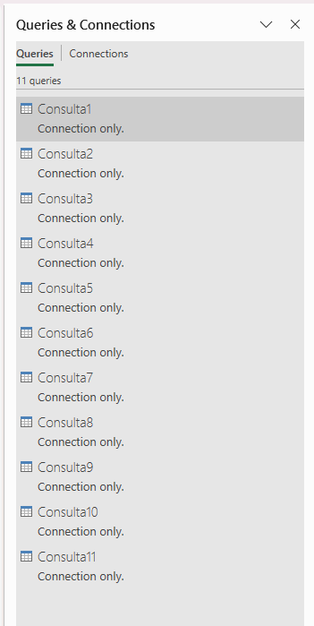

> **Pendiente:** agregar a `evidencias/` la captura del origen
> externo de una tabla dinámica (*Cambiar origen de datos*).

## Cambios del 13/11/2026 y revalidación

Después de la primera validación se hicieron dos cambios:

| Cambio | Detalle | Efecto en las cifras |
|---|---|---|
| Conexión directa | Las tablas dinámicas pasaron de leer las hojas `datos_*` a leer las conexiones al DW. Se eliminaron las 11 hojas `datos_*`. El promedio por pago pasó de fórmulas `SUMIFS` a una tabla dinámica. | Ninguno: los campos, filtros y diseño de cada tabla son los mismos. |
| Fechas en UTC | `01_extraccion` lee `rental_date`, `return_date` y `payment_date` con `AT TIME ZONE 'UTC'`. Antes, la fecha dependía de la zona horaria de PostgreSQL en cada equipo (America/Guatemala o America/Mexico_City, que en 2005 tenía horario de verano). | Los totales no cambian. Algunos alquileres cerca de la medianoche cambian de día, así que cambian las cifras por mes y por trimestre. |

Totales confirmados con el DW en UTC:
16.044 alquileres, 67.406,56 de ingresos,
15.861 devueltos, 8.121 devoluciones tardías (51,2 %).

## Resultados

| Reporte | Control realizado | Valor DW | Valor Excel | Estado |
|---|---|---:|---:|---|
| Alquileres e ingresos | Total de alquileres | 16.044 | 16.044 | Coincide |
| Alquileres e ingresos | Total de ingresos | 67.406,56 | 67.406,56 | Coincide |
| Alquileres e ingresos | Alquileres por año, mes y tienda | 10 grupos | 10 grupos | Coinciden todos |
| Alquileres e ingresos | Ingresos por año, mes y tienda | 10 grupos | 10 grupos | Coinciden todos |
| Promedio por pago | Pagos y promedio por mes y tienda | 10 grupos | 10 grupos | Coinciden todos |
| Películas más alquiladas | Ranking con empates | 16 películas / 506 alquileres | 16 películas / 506 alquileres | Coincide |
| Ingresos por categoría | Ingresos por categoría, año y mes | 80 grupos / 67.406,56 | 80 grupos / 67.406,56 | Coinciden todos |
| Clientes con mayores pagos | Identificadores e importes del ranking | 10 clientes / 1.912,96 | 10 clientes / 1.912,96 | Coinciden todos |
| Alquileres por ubicación | Conteos por país y ciudad | 597 grupos / 16.044 alquileres | 597 grupos / 16.044 alquileres | Coinciden todos |
| Actores con más alquileres | Identificadores y alquileres únicos por actor | 10 actores | 10 actores | Coinciden todos |
| Clasificación y tienda | Alquileres e ingresos de los 10 grupos | 16.044 / 67.406,56 | 16.044 / 67.406,56 | Coinciden todos |
| Devoluciones tardías | Conteos y porcentajes por mes y tienda | 10 grupos | 10 grupos | Coinciden todos |
| Inventario y rotación | Copias y porcentajes de 2.000 grupos, 2005-T3 | 4.581 copias / 1 sin rotación / 0,02 % | 4.581 copias / 1 sin rotación / 0,02 % | Coinciden todos |
| Ticket por cliente y categoría | Alquileres, ingresos y ticket de 7.741 grupos | 16.044 / 67.406,56 / 4,20 | 16.044 / 67.406,56 / 4,20 | Coinciden todos |
| Frecuencia de alquiler | Intervalos y promedio de días por cliente | 599 clientes / 15.445 intervalos | 599 clientes / 15.445 intervalos | Coinciden todos |
| Clientes nuevos y recurrentes | Conteos únicos por mes | 5 meses | 5 meses | Coinciden todos |

## Evidencias

## Reporte de alquileres e ingresos

La tabla dinámica consulta directamente el DW y contiene
16.044 identificadores de alquiler únicos, sin duplicados.
Los totales de la tabla dinámica coinciden con los valores
comprobados en el DW.

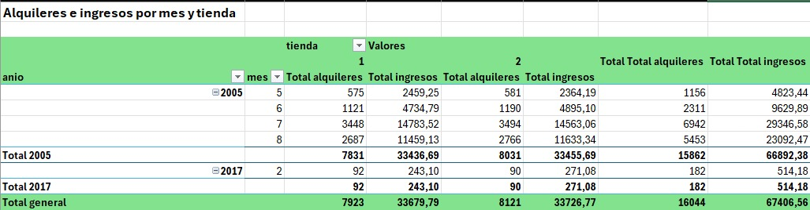

## Comparación por mes y tienda

Se compararon las 10 combinaciones de año, mes y tienda
obtenidas en SQL Server con la tabla dinámica de Excel.
Los conteos de alquileres coinciden exactamente y los ingresos
coinciden a dos decimales en todos los grupos.

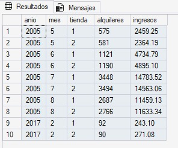

## Validación del promedio por pago

Se compararon los pagos y el promedio por pago de las 10
combinaciones de año, mes y tienda. Los conteos coinciden
exactamente y los promedios coinciden a dos decimales.

El promedio se calcula dividiendo los ingresos del grupo
entre su cantidad de pagos.

Desde el 13/11/2026, los ingresos y los pagos por año, mes
y tienda salen de una tabla dinámica (PromedioPago) conectada
al DW, y una fórmula a su derecha divide ingresos entre pagos.
Antes eran fórmulas `SUMIFS` sobre una hoja de datos.

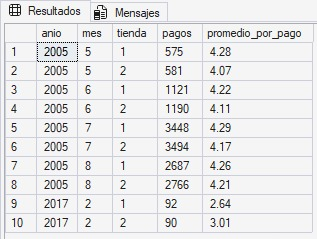

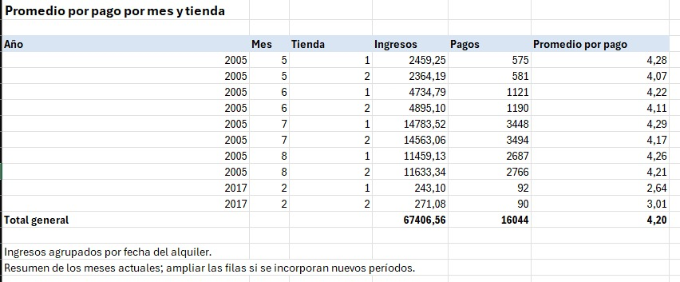

## Validación de películas más alquiladas

El ranking de Excel coincide con SQL Server en las películas
incluidas y en sus cantidades de alquileres.

Se incluyen los empates en el décimo puesto, por lo que aparecen
16 películas que suman 506 alquileres. Bucket Brotherhood ocupa
el primer lugar con 34 alquileres.

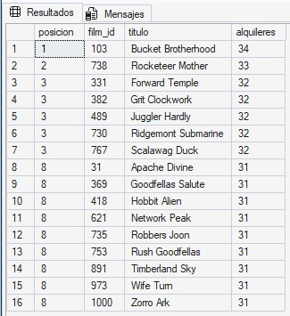

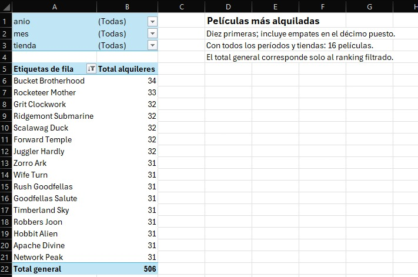

## Validación de ingresos por categoría

Se compararon las 80 combinaciones de categoría, año y mes
obtenidas en SQL Server con la tabla dinámica de Excel,
con todas las tiendas incluidas.

Los ingresos coinciden a dos decimales en todos los grupos.
El total general es 67.406,56.

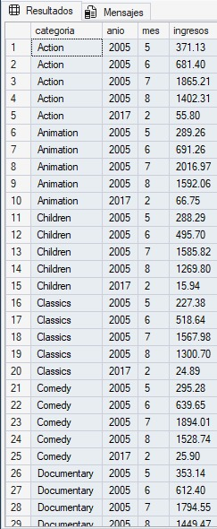

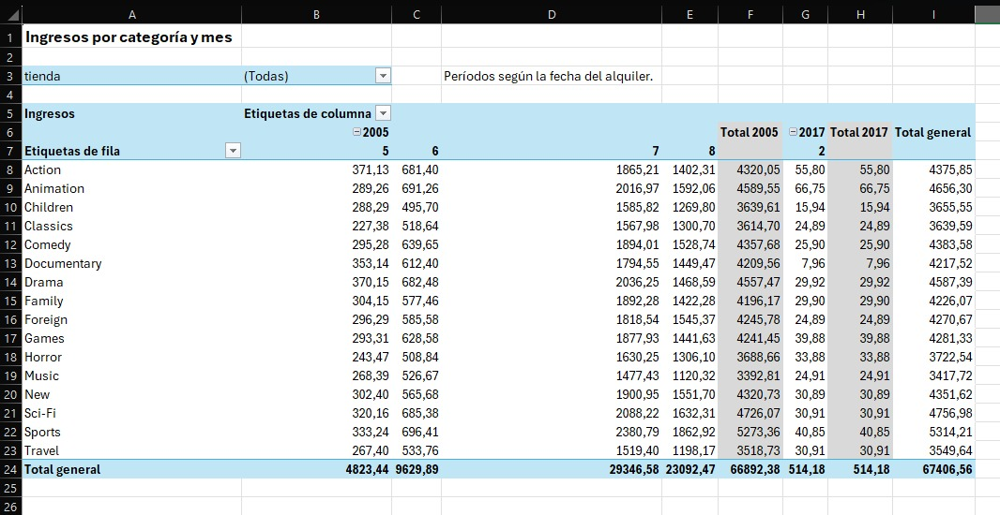

## Validación de clientes con mayores pagos

Los diez identificadores de cliente y sus pagos acumulados
coinciden entre SQL Server y Excel a dos decimales.

El ranking suma 1.912,96. Karl Seal ocupa el primer lugar
con 221,55. Los clientes se agrupan por identificador para
evitar mezclar personas que tengan el mismo nombre.

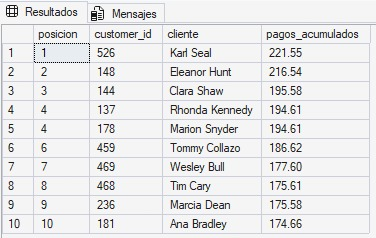

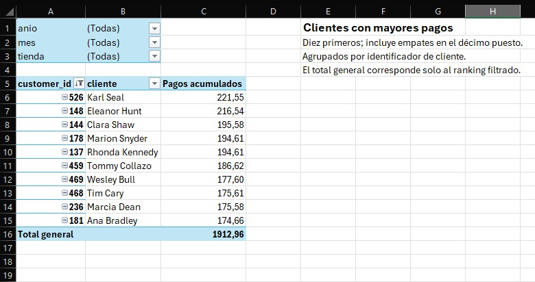

## Validación de alquileres por ubicación

Se compararon individualmente las 597 combinaciones de país
y ciudad entre SQL Server y Excel, sin diferencias ni grupos
duplicados. Se verificaron 108 países y 16.044 alquileres.

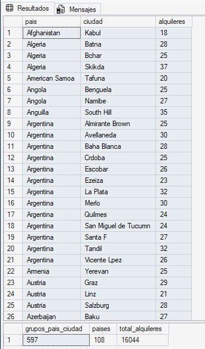

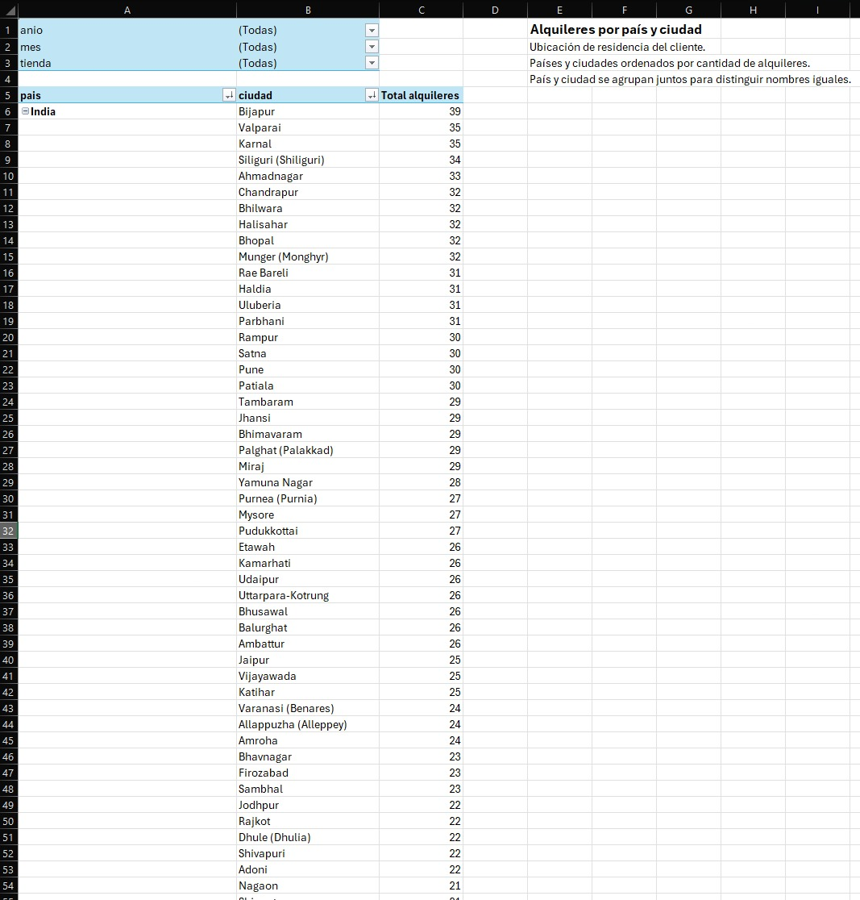

## Validación de alquileres por actor

Los diez actores y sus conteos coinciden entre SQL Server
y Excel. La consulta SQL utiliza COUNT(DISTINCT alquiler_id)
para contar cada alquiler una sola vez por actor.

Gina Degeneres encabeza el ranking con 753 alquileres asociados.
El reporte no muestra un total general, porque un mismo alquiler
puede corresponder a varios actores.

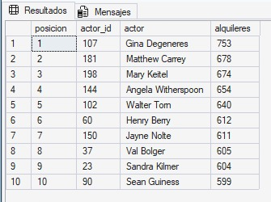

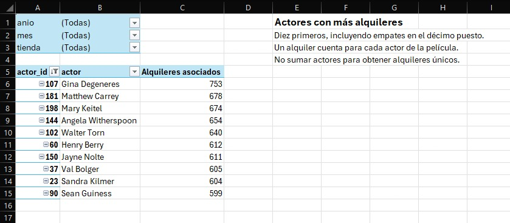

## Validación por clasificación y tienda

Se compararon las 10 combinaciones de clasificación y tienda.
Los alquileres coinciden exactamente y los ingresos coinciden
a dos decimales entre SQL Server y Excel.

El total es de 16.044 alquileres e ingresos por 67.406,56.

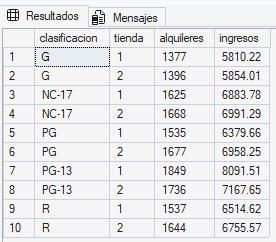

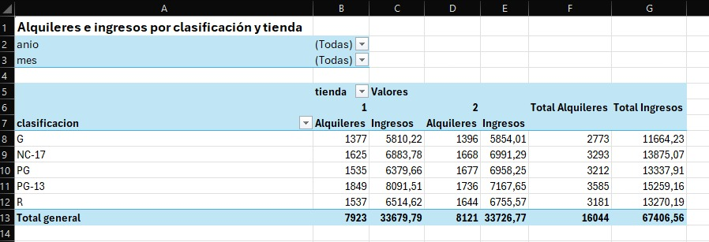

## Validación de devoluciones tardías

Los 10 grupos de año, mes y tienda coinciden entre SQL Server
y Excel en los conteos de devueltos y tardías, y en los
porcentajes a dos decimales.

Los grupos sin devoluciones muestran NULL en SQL y
"Sin devoluciones" en Excel, evitando interpretarlos como 0 %.

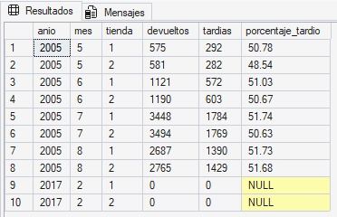

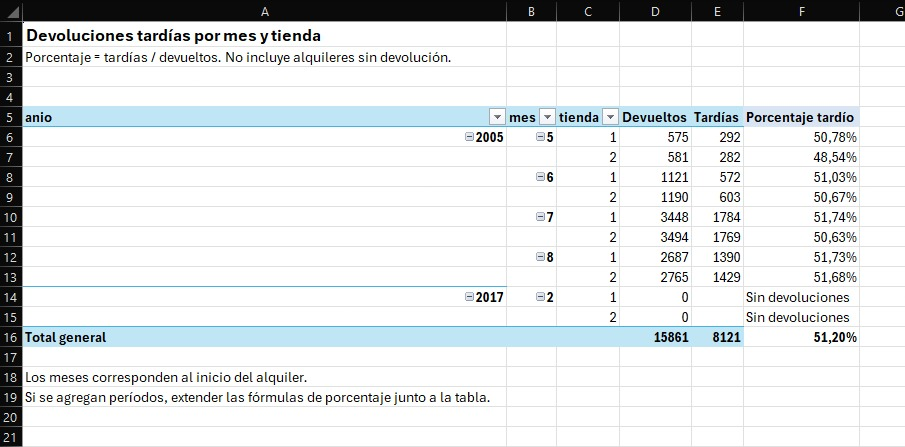

También se comprobó el resumen general: 15.861 alquileres
devueltos y 8.121 devoluciones tardías, equivalentes al 51,20 %.

El porcentaje general se obtiene dividiendo los totales;
no se calcula promediando los porcentajes mensuales.

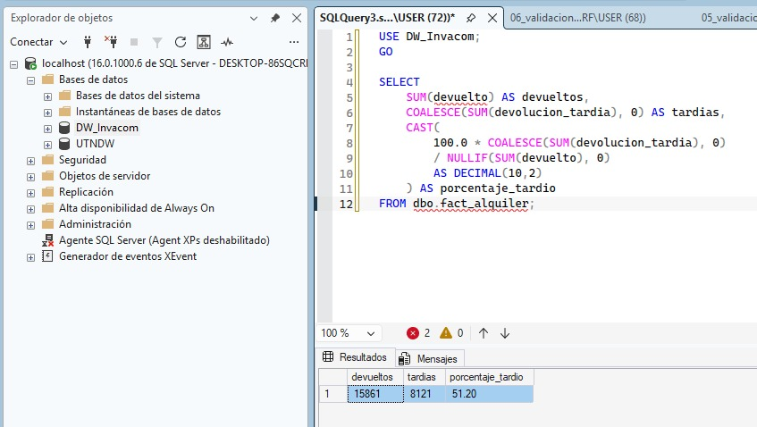

## Validación de inventario y rotación

Se compararon los 2.000 grupos de película y tienda del tercer
trimestre de 2005, sin diferencias en copias, copias sin rotación
ni porcentajes a dos decimales.

Se verificaron 4.581 copias, una sin rotación y 479 combinaciones
sin copias. El porcentaje general sin rotación es 0,02 %.

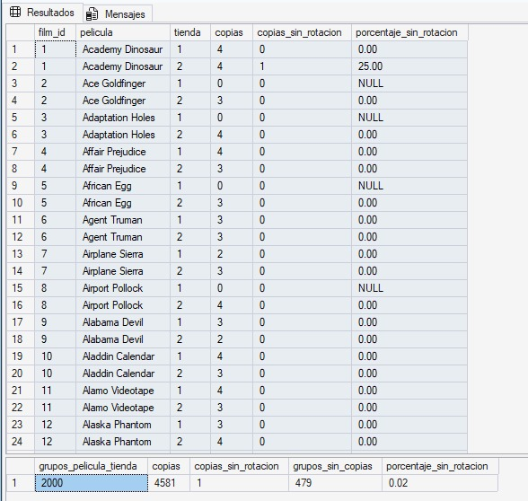

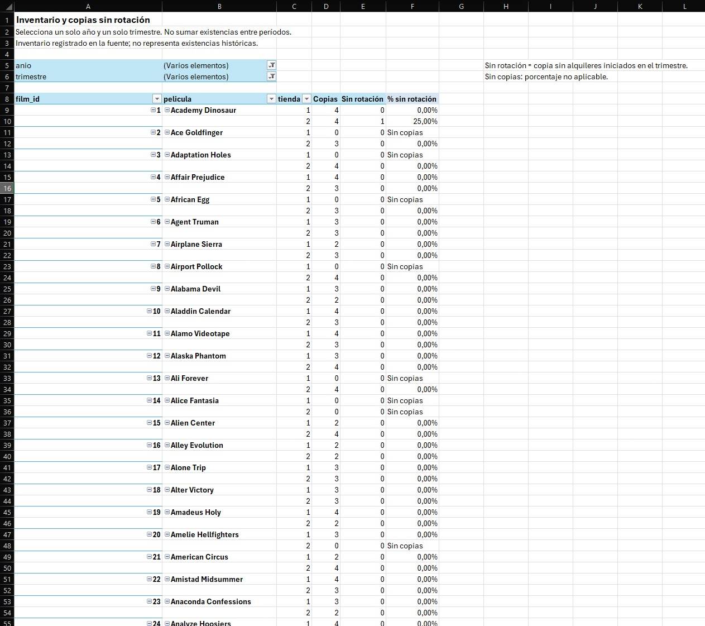

## Validación del ticket promedio

Se compararon individualmente los 7.741 grupos de cliente
y categoría entre SQL Server y Excel, sin diferencias en
alquileres, ingresos ni tickets a dos decimales.

El total es de 16.044 alquileres e ingresos por 67.406,56.
El ticket general es 4,20 y se obtiene dividiendo los ingresos
totales entre los alquileres totales.

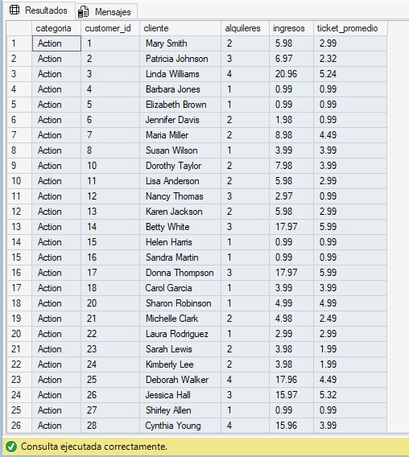

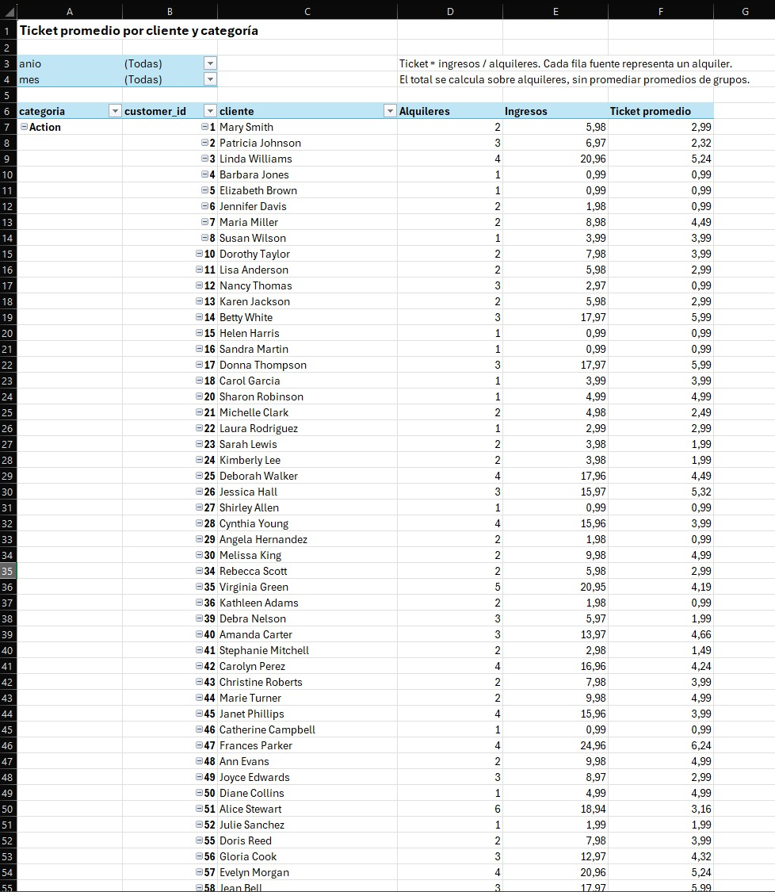

## Validación de frecuencia y clientes mensuales

Se compararon 599 clientes y 15.445 intervalos entre alquileres.
Los conteos coinciden exactamente y los promedios de días
coinciden a dos decimales.

Los conteos de clientes nuevos y recurrentes coinciden en
los cinco meses. Cada cliente se cuenta una sola vez por mes.

Los intervalos se expresan en días calendario. El primer
alquiler no tiene intervalo. La clasificación de cliente nuevo
se basa en el historial disponible.

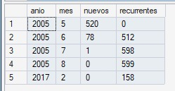

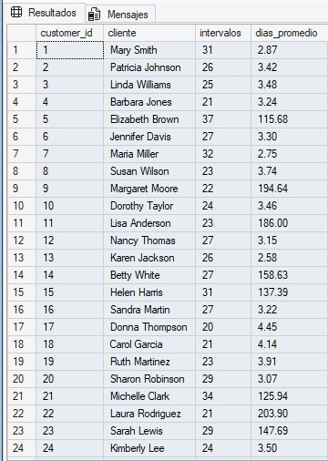

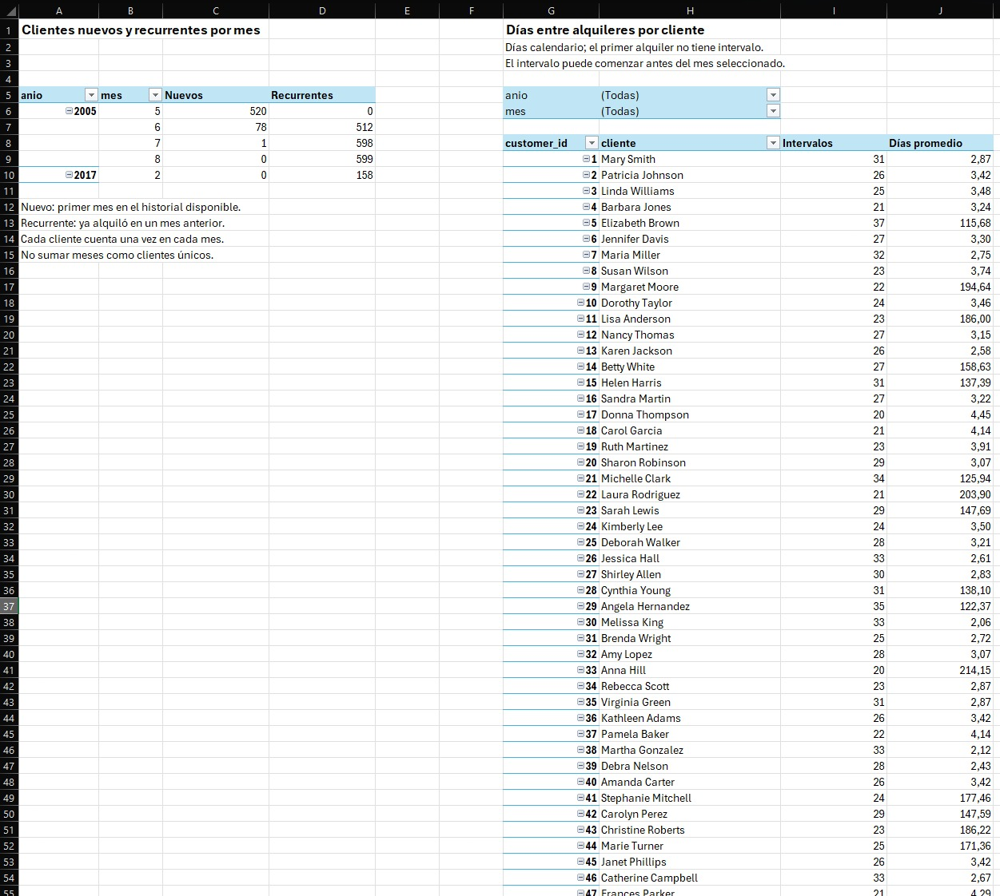

## Diferencias encontradas

No se encontraron diferencias en los controles realizados.
Los conteos coinciden exactamente y los importes, porcentajes
y promedios coinciden a dos decimales.

Los empates de los rankings pueden cambiar el orden de
presentación sin cambiar los resultados.

## Conclusión

Se validaron los reportes correspondientes a las 12 preguntas
de negocio mediante comparaciones entre SQL Server y Excel,
sin diferencias en los controles realizados.

Las validaciones corresponden a los datos y filtros documentados.
El inventario se comprobó para 2005, trimestre 3.
Los alquileres por actor no se suman como alquileres únicos.

## Consideraciones de actualización

Después de actualizar los datos, se deben actualizar las tablas
dinámicas y repetir las validaciones.

Si aparecen nuevos períodos o aumenta el detalle, se deben
revisar y ampliar las fórmulas externas a las tablas dinámicas
de promedio por pago, devoluciones e inventario. Son las
fórmulas de porcentaje y de promedio a la derecha de cada tabla.

El inventario debe consultarse para un solo año y trimestre.

Para que Excel muestre datos, cada equipo debe tener el DW
cargado con el ETL completo. Las fechas se extraen en UTC,
así que todos los equipos obtienen las mismas cifras.

Al dar formato al libro no se deben volver a cargar las
consultas a hojas ni crear tablas dinámicas desde rangos.
Una tabla dinámica nueva se crea con
*Datos → Conexiones existentes → Consulta - ConsultaN →
Informe de tabla dinámica*.

Si una consulta queda en "Waiting for localhost/DW_Invacom"
al actualizar (pasa con Consulta9 y Consulta11, que usan `WITH`),
se presiona Esc y se vuelve a actualizar.