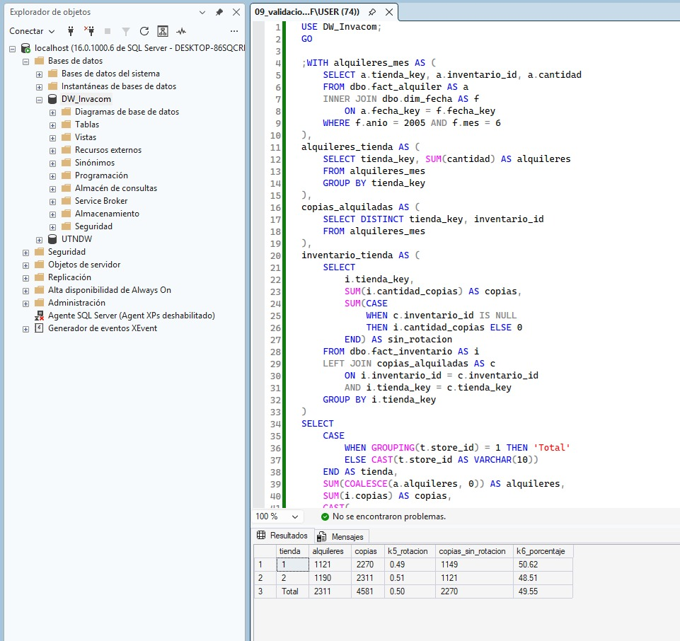
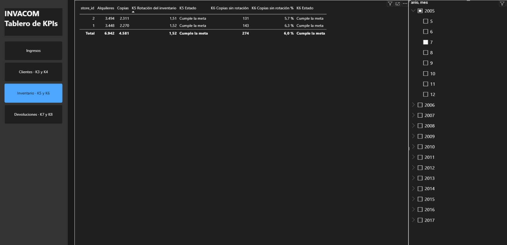
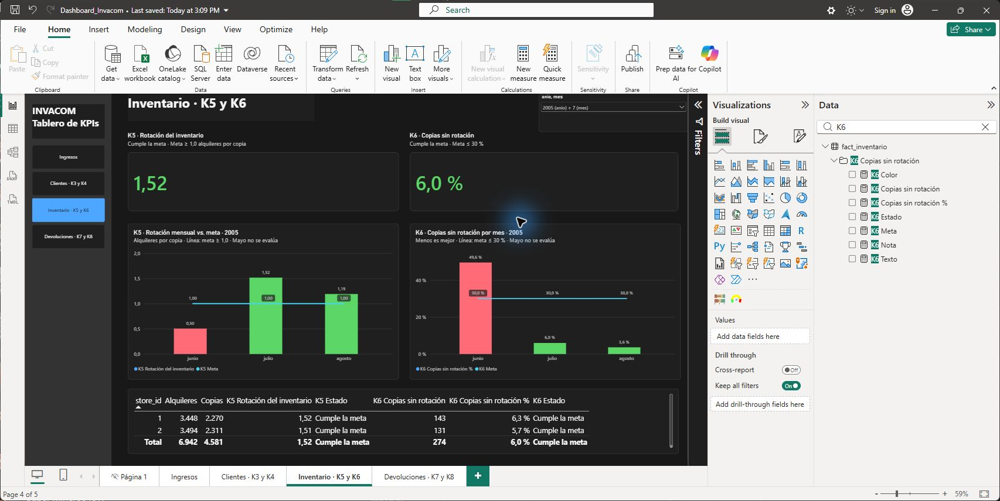
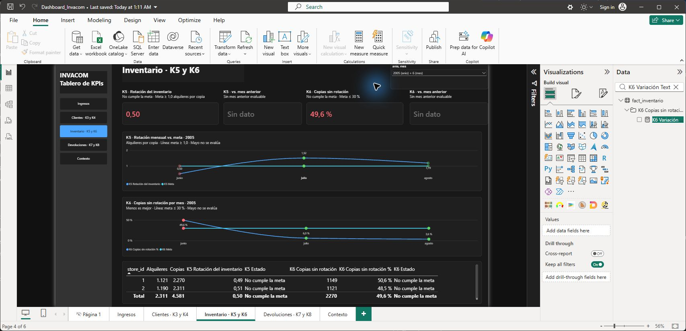
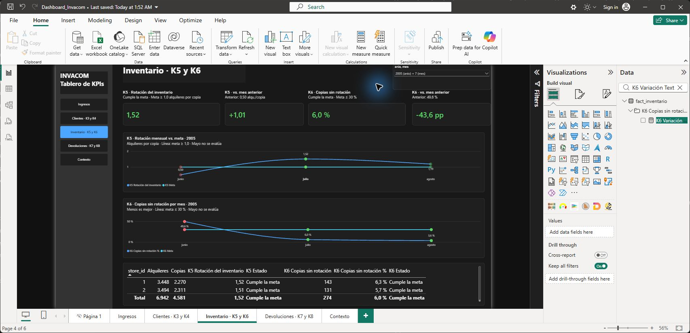
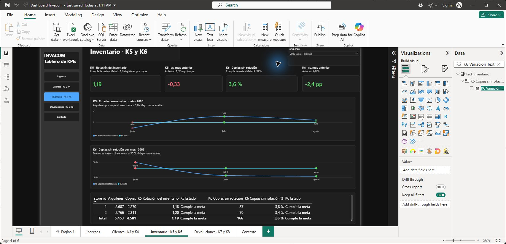

# Medidas DAX de K5 y K6

Responsable: Juan Daniel. Revisión del tablero: 27/11/2026.
Archivo: `powerbi/Dashboard_Invacom.pbix`, página **Inventario · K5 y K6**.
Base del DW: SQL Server, `DW_Invacom`.

Las medidas usan las bases `Alquileres` y `Copias` de `base.md` (DWI-84), con el mismo esquema de colores de K1 y K2.

| KPI | Cálculo | Meta | Sentido favorable |
|---|---|---|---|
| K5 · Rotación del inventario | Alquileres del mes / copias registradas | ≥ 1,0 alquiler por copia | Subir |
| K6 · Copias sin rotación | Copias sin alquiler en el mes / copias registradas | ≤ 30 % | Bajar |

## Modelo y alcance

`dim_tienda` y `dim_pelicula` filtran ambas tablas de hechos mediante relaciones activas de uno a varios y dirección única. `dim_fecha` filtra `fact_alquiler`; no filtra el censo de `fact_inventario`. Así, cambiar el mes cambia los alquileres y las copias que tuvieron movimiento, pero conserva el inventario registrado como denominador.

No se agrega una relación directa entre las tablas de hechos. K6 las cruza en la medida mediante `inventario_id`. El modelo actual tiene una fila por copia en `fact_inventario` y `cantidad_copias = 1`; por eso contar los identificadores sin alquiler equivale a contar las copias sin rotación. Este inventario es el censo cargado al DW, no una serie histórica de existencias mensuales.

Los indicadores requieren un solo año y un solo mes. Mayo de 2005 no se evalúa porque los datos empiezan el 24/05/2005. Los meses sin actividad en toda la fuente se muestran como «Sin dato». La guarda de datos se comprueba globalmente para no confundir un segmento con cero alquileres con un mes sin información.

## Organización en el PBIX

| Tabla | Carpeta | Medidas |
|---|---|---|
| `fact_alquiler` | `K5 Rotación del inventario` | K5 Rotación del inventario, K5 Meta, K5 Estado, K5 Texto, K5 Color, K5 Nota, K5 Mes anterior, K5 Variación, K5 Variación Texto, K5 Color variación, K5 Comparación Nota |
| `fact_inventario` | `K6 Copias sin rotación` | K6 Copias sin rotación, K6 Copias sin rotación %, K6 Meta, K6 Estado, K6 Texto, K6 Color, K6 Nota, K6 Mes anterior, K6 Variación (pp), K6 Variación Texto, K6 Color variación, K6 Comparación Nota |
| `fact_alquiler` | `Apoyo inventario` | Inventario Mes con datos |

## Medida de apoyo

```dax
Inventario Mes con datos =
VAR FechasSeleccionadas = VALUES ( dim_fecha[fecha_key] )
VAR FilasDelMes =
    CALCULATE (
        COUNTROWS ( fact_alquiler ),
        REMOVEFILTERS (),
        TREATAS ( FechasSeleccionadas, fact_alquiler[fecha_key] )
    )
RETURN
    FilasDelMes > 0
```

## K5 · Rotación del inventario

Formato del valor: número decimal, 2 decimales.

```dax
K5 Rotación del inventario =
VAR UnMes =
    HASONEVALUE ( dim_fecha[anio] ) && HASONEVALUE ( dim_fecha[mes] )
VAR MayoParcial =
    SELECTEDVALUE ( dim_fecha[anio] ) = 2005
        && SELECTEDVALUE ( dim_fecha[mes] ) = 5
RETURN
    IF (
        NOT UnMes || MayoParcial || NOT [Inventario Mes con datos],
        BLANK (),
        DIVIDE ( COALESCE ( [Alquileres], 0 ), [Copias] )
    )

K5 Meta = 1.0
```

## K6 · Copias sin rotación

El conteo usa conjuntos de identificadores distintos: una copia alquilada varias veces en el mes se resta una sola vez del inventario.

```dax
K6 Copias sin rotación =
VAR CopiasRegistradas =
    FILTER (
        VALUES ( fact_inventario[inventario_id] ),
        NOT ISBLANK ( fact_inventario[inventario_id] )
    )
VAR CopiasAlquiladas =
    FILTER (
        VALUES ( fact_alquiler[inventario_id] ),
        NOT ISBLANK ( fact_alquiler[inventario_id] )
    )
VAR SinAlquiler = EXCEPT ( CopiasRegistradas, CopiasAlquiladas )
RETURN
    IF (
        ISBLANK ( [Copias] ) || [Copias] = 0,
        BLANK (),
        COALESCE ( COUNTROWS ( SinAlquiler ), 0 )
    )

K6 Copias sin rotación % =
VAR UnMes =
    HASONEVALUE ( dim_fecha[anio] ) && HASONEVALUE ( dim_fecha[mes] )
VAR MayoParcial =
    SELECTEDVALUE ( dim_fecha[anio] ) = 2005
        && SELECTEDVALUE ( dim_fecha[mes] ) = 5
RETURN
    IF (
        NOT UnMes || MayoParcial || NOT [Inventario Mes con datos],
        BLANK (),
        DIVIDE ( [K6 Copias sin rotación], [Copias] )
    )

K6 Meta = 0.30
```

El conteo se muestra como entero y el porcentaje con 1 decimal. El conteo bruto puede seguir visible en mayo; el porcentaje y la evaluación de la meta quedan vacíos.

## Texto, estado y colores

Las medidas `K5 Texto` y `K6 Texto` muestran el valor formateado o el estado cuando no hay valor evaluable. `K5 Nota` y `K6 Nota` alimentan los subtítulos: estado y meta, o el motivo por el que no se evalúa.

| Caso | Estado / presentación |
|---|---|
| Varios meses o sin un único mes | Elige un mes |
| Mayo de 2005 | Mes parcial: no se evalúa |
| Mes sin actividad global | Sin dato |
| Denominador vacío o cero | Sin copias |
| K5 ≥ 1,0 o K6 ≤ 30 % | Cumple la meta, verde `#5BD667` |
| K5 < 1,0 o K6 > 30 % | No cumple la meta, rojo `#FF6B76` |
| Valor no evaluable | Gris `#737373` |

La comparación se hace con el valor sin redondear; el redondeo es solo de presentación.

## Comprobación contra SQL

El script `sql/09_validacion_k5_k6.sql` está guardado para junio de 2005 (`f.anio = 2005 AND f.mes = 6`). Para repetir julio, cambiar el mes a 7 y ejecutar en SSMS. El resultado SQL expresa K6 en puntos porcentuales: 49,55 corresponde aproximadamente a 49,6 % en Power BI.

Resultados contrastados con las capturas SQL y Power BI aportadas durante la validación:

| Mes | Tienda | Alquileres | Copias | K5 | Copias sin rotación | K6 SQL | Evaluación de ambos |
|---|---|---:|---:|---:|---:|---:|---|
| 2005-06 | 1 | 1.121 | 2.270 | 0,49 | 1.149 | 50,62 % | No cumple |
| 2005-06 | 2 | 1.190 | 2.311 | 0,51 | 1.121 | 48,51 % | No cumple |
| 2005-06 | Total | 2.311 | 4.581 | 0,50 | 2.270 | 49,55 % | No cumple |
| 2005-07 | 1 | 3.448 | 2.270 | 1,52 | 143 | 6,30 % | Cumple |
| 2005-07 | 2 | 3.494 | 2.311 | 1,51 | 131 | 5,67 % | Cumple |
| 2005-07 | Total | 6.942 | 4.581 | 1,52 | 274 | 5,98 % | Cumple |

En mayo hay 1.156 alquileres y 4.581 copias, pero las tarjetas muestran «Mes parcial: no se evalúa» en gris. Se comprobó nuevamente en la interfaz el 25/11/2026 que junio aparece en rojo, julio en verde y mayo sin evaluación. No se ejecutó nuevamente SQL durante esta revisión de presentación.

Los totales se calculan dividiendo las sumas; no se promedian los porcentajes de las tiendas.

### Evidencias existentes







Estas capturas corresponden a la validación previa al ajuste final de distribución de la página.

## Presentación guardada

La página conserva el fondo oscuro y los colores de K1/K2. Tiene encabezado, selector desplegable de año y mes, tarjetas compactas alineadas con títulos y subtítulos dinámicos, y una tabla de comprobación por tienda. Se ocultaron las etiquetas técnicas de las medidas. El PBIX se guardó con julio de 2005 seleccionado.

### Evolución mensual y distribución final

Se compactaron las tarjetas en la franja superior y se colocaron dos gráficos de líneas con marcadores, K5 arriba y K6 abajo, dejando la tabla por tienda en la parte inferior:

- **K5 · Rotación mensual vs. meta · 2005**: línea con `K5 Rotación del inventario` y línea celeste con `K5 Meta` (1,0).
- **K6 · Copias sin rotación por mes · 2005**: línea con `K6 Copias sin rotación %` y línea celeste con `K6 Meta` (30 %). El subtítulo aclara que menos es mejor.

Ambos usan `dim_fecha[nombre_mes]` como eje y muestran etiquetas numéricas. Los colores de los marcadores dependen del cumplimiento de la meta. El año del gráfico se fija en 2005; el filtro de resultado K5 no vacío conserva junio, julio y agosto, que comparten las mismas condiciones de evaluación de K6. Mayo queda excluido de las tendencias y se mantiene como mes parcial en las tarjetas. Febrero de 2017 no se mezcla con esta comparación.

El selector de mes actualiza las tarjetas y la tabla, mientras las tendencias conservan el contexto de junio–agosto de 2005. Se desactivaron los cruces de cada gráfico hacia las tarjetas, la tabla y el otro gráfico para evitar combinar la selección de un punto con un mes distinto en el selector. Las dos nuevas tarjetas de comparación también tienen desactivada la interacción desde ambos gráficos.

| Mes de 2005 | K5 mostrado en la tendencia | K6 mostrado en la tendencia |
|---|---:|---:|
| Junio | 0,50 | 49,6 % |
| Julio | 1,52 | 6,0 % |
| Agosto | 1,19 | 3,6 % |

Los valores de agosto son los observados en los gráficos del PBIX; no se realizó una nueva ejecución SQL para ese mes durante esta mejora visual. Se volvió a comprobar que junio cambia las tarjetas a rojo, mayo muestra el aviso completo en gris y julio restaura 1,52 y 6,0 % en verde.

La siguiente captura corresponde al diseño previo a añadir las comparaciones mensuales; las evidencias actualizadas están al final del documento.



## Comparación mensual y formato condicional — 27/11/2026

Se siguió la separación entre mes anterior, variación, texto y color usada por los compañeros en [K7/K8](k7_k8.md), conservando el estilo y las metas de K1/K2. El PBIX quedó guardado con julio de 2005 seleccionado.

La franja superior tiene cuatro tarjetas compactas: valor actual de K5, variación de K5, valor actual de K6 y variación de K6. Las tarjetas principales muestran estado y meta; las comparaciones muestran el valor del mes anterior o el motivo por el que no hay comparación. Las etiquetas técnicas de las medidas están ocultas.

K5 expresa la diferencia absoluta en alquileres por copia. K6 expresa la diferencia en **puntos porcentuales (pp)**; una reducción es favorable. Las diferencias se calculan con valores sin redondear.

`PREVIOUSMONTH` obtiene las fechas anteriores y `REMOVEFILTERS(dim_fecha)` elimina el año/mes actual al recalcular. Se mantienen los filtros de tienda y película. La guarda del valor actual respeta las medidas base: un segmento con cero alquileres y copias disponibles no se confunde con un mes globalmente sin datos.

- Mayo de 2005: mes parcial, no se evalúa ni se compara.
- Junio de 2005: valor actual evaluable, pero sin mes anterior evaluable porque mayo está excluido.
- Varios meses: se solicita elegir un único mes.
- Sin valor anterior: variación numérica vacía, texto «Sin dato» y subtítulo «Sin mes anterior evaluable».

| Variación | K5: subir es favorable | K6: bajar es favorable |
|---|---|---|
| Positiva | Verde `#5BD667` | Rojo `#FF6B76` |
| Negativa | Rojo `#FF6B76` | Verde `#5BD667` |
| Cero | Amarillo `#E6C84F` | Amarillo `#E6C84F` |
| No evaluable | Gris `#737373` | Gris `#737373` |

El color del valor actual representa cumplimiento de la meta; el de la variación representa mejora o deterioro frente al mes anterior. En agosto K5 cumple la meta (valor verde) y baja frente a julio (variación roja).

### Medidas de comparación K5

Tabla `fact_alquiler`, carpeta `K5 Rotación del inventario`. Formatos numéricos: mes anterior `0.00`; variación `+0.00;-0.00;0.00`.

```dax
K5 Mes anterior =
VAR Actual = [K5 Rotación del inventario]
RETURN
    IF (
        ISBLANK ( Actual ), BLANK (),
        CALCULATE (
            [K5 Rotación del inventario],
            PREVIOUSMONTH ( dim_fecha[fecha] ),
            REMOVEFILTERS ( dim_fecha )
        )
    )

K5 Variación =
VAR Actual = [K5 Rotación del inventario]
VAR Anterior = [K5 Mes anterior]
RETURN
    IF (
        ISBLANK ( Actual ) || ISBLANK ( Anterior ),
        BLANK (), Actual - Anterior
    )

K5 Variación Texto =
VAR Variacion = [K5 Variación]
RETURN
    IF (
        ISBLANK ( Variacion ), "Sin dato",
        FORMAT ( Variacion, "+0.00;-0.00;0.00" )
    )

K5 Color variación =
VAR Variacion = [K5 Variación]
RETURN
    SWITCH (
        TRUE (),
        ISBLANK ( Variacion ), "#737373",
        Variacion > 0, "#5BD667",
        Variacion < 0, "#FF6B76",
        "#E6C84F"
    )

K5 Comparación Nota =
VAR UnMes =
    HASONEVALUE ( dim_fecha[anio] ) && HASONEVALUE ( dim_fecha[mes] )
VAR Actual = [K5 Rotación del inventario]
VAR Anterior = [K5 Mes anterior]
RETURN
    SWITCH (
        TRUE (),
        NOT UnMes, "Elige un mes",
        ISBLANK ( Actual ), [K5 Estado],
        ISBLANK ( Anterior ), "Sin mes anterior evaluable",
        "Anterior: " & FORMAT ( Anterior, "0.00" ) & " alqu./copia"
    )
```

### Medidas de comparación K6

Tabla `fact_inventario`, carpeta `K6 Copias sin rotación`. Formatos numéricos: mes anterior `0.0%`; variación `+0.0;-0.0;0.0`.

```dax
K6 Mes anterior =
VAR Actual = [K6 Copias sin rotación %]
RETURN
    IF (
        ISBLANK ( Actual ), BLANK (),
        CALCULATE (
            [K6 Copias sin rotación %],
            PREVIOUSMONTH ( dim_fecha[fecha] ),
            REMOVEFILTERS ( dim_fecha )
        )
    )

K6 Variación (pp) =
VAR Actual = [K6 Copias sin rotación %]
VAR Anterior = [K6 Mes anterior]
RETURN
    IF (
        ISBLANK ( Actual ) || ISBLANK ( Anterior ),
        BLANK (), ( Actual - Anterior ) * 100
    )

K6 Variación Texto =
VAR Variacion = [K6 Variación (pp)]
RETURN
    IF (
        ISBLANK ( Variacion ), "Sin dato",
        FORMAT ( Variacion, "+0.0;-0.0;0.0" ) & " pp"
    )

K6 Color variación =
VAR Variacion = [K6 Variación (pp)]
RETURN
    SWITCH (
        TRUE (),
        ISBLANK ( Variacion ), "#737373",
        Variacion < 0, "#5BD667",
        Variacion > 0, "#FF6B76",
        "#E6C84F"
    )

K6 Comparación Nota =
VAR UnMes =
    HASONEVALUE ( dim_fecha[anio] ) && HASONEVALUE ( dim_fecha[mes] )
VAR Actual = [K6 Copias sin rotación %]
VAR Anterior = [K6 Mes anterior]
RETURN
    SWITCH (
        TRUE (),
        NOT UnMes, "Elige un mes",
        ISBLANK ( Actual ), [K6 Estado],
        ISBLANK ( Anterior ), "Sin mes anterior evaluable",
        "Anterior: " & FORMAT ( Anterior, "0.0 %" )
    )
```

### Asignación de campos en las tarjetas

| Tarjeta | Valor | Subtítulo dinámico | Color del valor (fx, Field value) |
|---|---|---|---|
| K5 · Rotación del inventario | K5 Texto | K5 Nota | K5 Color |
| K5 · vs. mes anterior | K5 Variación Texto | K5 Comparación Nota | K5 Color variación |
| K6 · Copias sin rotación | K6 Texto | K6 Nota | K6 Color |
| K6 · vs. mes anterior | K6 Variación Texto | K6 Comparación Nota | K6 Color variación |

### Verificación

Se ejecutó una consulta DAX en el modelo para mayo–agosto de 2005, terminada correctamente con cuatro filas. Se seleccionaron también los meses en el segmentador y se comprobaron valores, notas y colores en las tarjetas. No se volvió a ejecutar SQL en esta revisión; las comprobaciones previas de las bases se conservan arriba.

| Mes | K5 actual | K5 anterior | Cambio K5 | K6 actual | K6 anterior | Cambio K6 | Variación mostrada |
|---|---:|---:|---:|---:|---:|---:|---|
| Mayo | No evaluable | — | — | No evaluable | — | — | Gris; mes parcial |
| Junio | 0,50 | — | — | 49,6 % | — | — | Gris; sin mes anterior evaluable |
| Julio | 1,52 | 0,50 | +1,01 | 6,0 % | 49,6 % | −43,6 pp | Ambas verdes |
| Agosto | 1,19 | 1,52 | −0,33 | 3,6 % | 6,0 % | −2,4 pp | K5 roja; K6 verde |

La diferencia de julio en K5 se obtiene antes de redondear los valores mostrados. No debe calcularse restando 1,52 y 0,50 ya formateados.

Consulta utilizada en DAX Query View:

```dax
EVALUATE
SUMMARIZECOLUMNS (
    dim_fecha[mes],
    TREATAS ( { 2005 }, dim_fecha[anio] ),
    TREATAS ( { 5, 6, 7, 8 }, dim_fecha[mes] ),
    "K5", [K5 Rotación del inventario],
    "AnteriorK5", [K5 Mes anterior],
    "DeltaK5", [K5 Variación],
    "ColorK5", [K5 Color variación],
    "K6", [K6 Copias sin rotación %],
    "AnteriorK6", [K6 Mes anterior],
    "DeltaK6pp", [K6 Variación (pp)],
    "ColorK6", [K6 Color variación]
)
ORDER BY dim_fecha[mes]
```

### Evidencias del formato condicional






