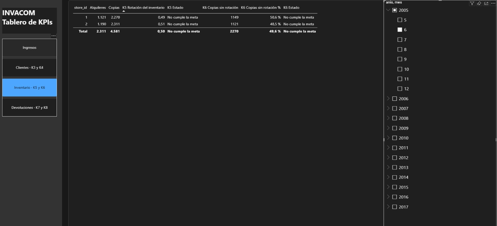
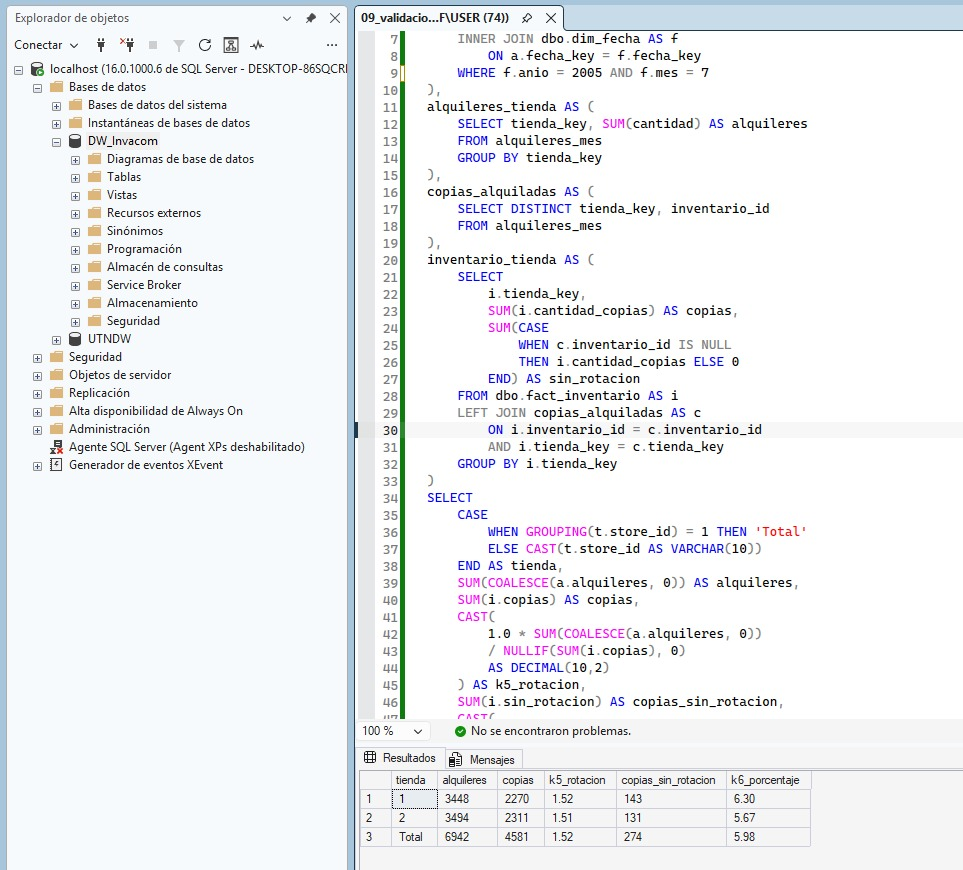
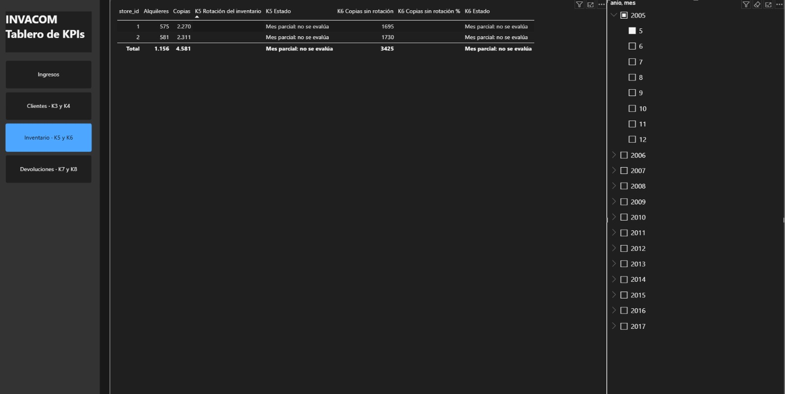

# Medidas DAX de K5 y K6

Responsable: Juan Daniel. Revisión del tablero: 25/11/2026.
Archivo: `powerbi/Dashboard_Invacom.pbix`, página **Inventario · K5 y K6**.
Base del DW: SQL Server, `DW_Invacom`.

Las medidas usan las bases `Alquileres` y `Copias` de `base.md` (DWI-84), con el mismo esquema de colores de K1 y K2.

| KPI | Cálculo | Meta | Sentido favorable |
|---|---|---|---|
| K5 · Rotación del inventario | Alquileres del mes / copias registradas | ≥ 1,0 alquiler por copia | Subir |
| K6 · Copias sin rotación | Copias sin alquiler en el mes / copias registradas | ≤ 30 % | Bajar |

## Modelo y alcance

`dim_tienda` y `dim_pelicula` filtran ambas tablas de hechos mediante relaciones activas de uno a varios y dirección única. `dim_fecha` filtra `fact_alquiler`; no filtra el censo de `fact_inventario`. Así, cambiar el mes cambia los alquileres y las copias que tuvieron movimiento, pero conserva el inventario registrado como denominador.

No se agrega una relación directa entre las tablas de hechos. K6 las cruza en la medida mediante `inventario_id`. El modelo actual tiene una fila por copia en `fact_inventario` y `cantidad_copias = 1`; por eso contar los identificadores sin alquiler equivale a contar las copias sin rotación. Este inventario es el censo cargado al DW, no una serie histórica de existencias mensuales.

Los indicadores requieren un solo año y un solo mes. Mayo de 2005 no se evalúa porque los datos empiezan el 24/05/2005. Los meses sin actividad en toda la fuente se muestran como «Sin dato». La guarda de datos se comprueba globalmente para no confundir un segmento con cero alquileres con un mes sin información.

## Organización en el PBIX

| Tabla | Carpeta | Medidas |
|---|---|---|
| `fact_alquiler` | `K5 Rotación del inventario` | K5 Rotación del inventario, K5 Meta, K5 Estado, K5 Texto, K5 Color, K5 Nota |
| `fact_inventario` | `K6 Copias sin rotación` | K6 Copias sin rotación, K6 Copias sin rotación %, K6 Meta, K6 Estado, K6 Texto, K6 Color, K6 Nota |
| `fact_alquiler` | `Apoyo inventario` | Inventario Mes con datos |

## Medida de apoyo

```dax
Inventario Mes con datos =
VAR FechasSeleccionadas = VALUES ( dim_fecha[fecha_key] )
VAR FilasDelMes =
    CALCULATE (
        COUNTROWS ( fact_alquiler ),
        REMOVEFILTERS (),
        TREATAS ( FechasSeleccionadas, fact_alquiler[fecha_key] )
    )
RETURN
    FilasDelMes > 0
```

## K5 · Rotación del inventario

Formato del valor: número decimal, 2 decimales.

```dax
K5 Rotación del inventario =
VAR UnMes =
    HASONEVALUE ( dim_fecha[anio] ) && HASONEVALUE ( dim_fecha[mes] )
VAR MayoParcial =
    SELECTEDVALUE ( dim_fecha[anio] ) = 2005
        && SELECTEDVALUE ( dim_fecha[mes] ) = 5
RETURN
    IF (
        NOT UnMes || MayoParcial || NOT [Inventario Mes con datos],
        BLANK (),
        DIVIDE ( COALESCE ( [Alquileres], 0 ), [Copias] )
    )

K5 Meta = 1.0
```

## K6 · Copias sin rotación

El conteo usa conjuntos de identificadores distintos: una copia alquilada varias veces en el mes se resta una sola vez del inventario.

```dax
K6 Copias sin rotación =
VAR CopiasRegistradas =
    FILTER (
        VALUES ( fact_inventario[inventario_id] ),
        NOT ISBLANK ( fact_inventario[inventario_id] )
    )
VAR CopiasAlquiladas =
    FILTER (
        VALUES ( fact_alquiler[inventario_id] ),
        NOT ISBLANK ( fact_alquiler[inventario_id] )
    )
VAR SinAlquiler = EXCEPT ( CopiasRegistradas, CopiasAlquiladas )
RETURN
    IF (
        ISBLANK ( [Copias] ) || [Copias] = 0,
        BLANK (),
        COALESCE ( COUNTROWS ( SinAlquiler ), 0 )
    )

K6 Copias sin rotación % =
VAR UnMes =
    HASONEVALUE ( dim_fecha[anio] ) && HASONEVALUE ( dim_fecha[mes] )
VAR MayoParcial =
    SELECTEDVALUE ( dim_fecha[anio] ) = 2005
        && SELECTEDVALUE ( dim_fecha[mes] ) = 5
RETURN
    IF (
        NOT UnMes || MayoParcial || NOT [Inventario Mes con datos],
        BLANK (),
        DIVIDE ( [K6 Copias sin rotación], [Copias] )
    )

K6 Meta = 0.30
```

El conteo se muestra como entero y el porcentaje con 1 decimal. El conteo bruto puede seguir visible en mayo; el porcentaje y la evaluación de la meta quedan vacíos.

## Texto, estado y colores

Las medidas `K5 Texto` y `K6 Texto` muestran el valor formateado o el estado cuando no hay valor evaluable. `K5 Nota` y `K6 Nota` alimentan los subtítulos: estado y meta, o el motivo por el que no se evalúa.

| Caso | Estado / presentación |
|---|---|
| Varios meses o sin un único mes | Elige un mes |
| Mayo de 2005 | Mes parcial: no se evalúa |
| Mes sin actividad global | Sin dato |
| Denominador vacío o cero | Sin copias |
| K5 ≥ 1,0 o K6 ≤ 30 % | Cumple la meta, verde `#5BD667` |
| K5 < 1,0 o K6 > 30 % | No cumple la meta, rojo `#FF6B76` |
| Valor no evaluable | Gris `#737373` |

La comparación se hace con el valor sin redondear; el redondeo es solo de presentación.

## Comprobación contra SQL

El script `sql/09_validacion_k5_k6.sql` está guardado para junio de 2005 (`f.anio = 2005 AND f.mes = 6`). Para repetir julio, cambiar el mes a 7 y ejecutar en SSMS. El resultado SQL expresa K6 en puntos porcentuales: 49,55 corresponde aproximadamente a 49,6 % en Power BI.

Resultados contrastados con las capturas SQL y Power BI aportadas durante la validación:

| Mes | Tienda | Alquileres | Copias | K5 | Copias sin rotación | K6 SQL | Evaluación de ambos |
|---|---|---:|---:|---:|---:|---:|---|
| 2005-06 | 1 | 1.121 | 2.270 | 0,49 | 1.149 | 50,62 % | No cumple |
| 2005-06 | 2 | 1.190 | 2.311 | 0,51 | 1.121 | 48,51 % | No cumple |
| 2005-06 | Total | 2.311 | 4.581 | 0,50 | 2.270 | 49,55 % | No cumple |
| 2005-07 | 1 | 3.448 | 2.270 | 1,52 | 143 | 6,30 % | Cumple |
| 2005-07 | 2 | 3.494 | 2.311 | 1,51 | 131 | 5,67 % | Cumple |
| 2005-07 | Total | 6.942 | 4.581 | 1,52 | 274 | 5,98 % | Cumple |

En mayo hay 1.156 alquileres y 4.581 copias, pero las tarjetas muestran «Mes parcial: no se evalúa» en gris. Se comprobó nuevamente en la interfaz el 25/11/2026 que junio aparece en rojo, julio en verde y mayo sin evaluación. No se ejecutó nuevamente SQL durante esta revisión de presentación.

Los totales se calculan dividiendo las sumas; no se promedian los porcentajes de las tiendas.

### Evidencias existentes








Estas capturas corresponden a la validación previa al ajuste final de distribución de la página.

## Presentación guardada

La página conserva el fondo oscuro y los colores de K1/K2. Tiene encabezado, selector desplegable de año y mes, tarjetas alineadas con títulos y subtítulos dinámicos, y una tabla de comprobación por tienda. Se ocultaron las etiquetas técnicas «K5 Texto» y «K6 Texto» y se amplió el tamaño de los valores y de la tabla. El PBIX se guardó con julio de 2005 seleccionado.

### Evolución mensual y distribución final

Se compactaron las tarjetas en la franja superior y se colocaron dos gráficos combinados en el centro, dejando la tabla por tienda en la parte inferior:

- **K5 · Rotación mensual vs. meta · 2005**: columnas con `K5 Rotación del inventario` y línea celeste con `K5 Meta` (1,0).
- **K6 · Copias sin rotación por mes · 2005**: columnas con `K6 Copias sin rotación %` y línea celeste con `K6 Meta` (30 %). El subtítulo aclara que menos es mejor.

Ambos usan `dim_fecha[nombre_mes]` como eje y muestran etiquetas numéricas. Los colores de las columnas dependen de `K5 Color` y `K6 Color`, respectivamente. El año del gráfico se fija en 2005; el filtro de resultado K5 no vacío conserva junio, julio y agosto, que comparten las mismas condiciones de evaluación de K6. Mayo queda excluido de las tendencias y se mantiene como mes parcial en las tarjetas. Febrero de 2017 no se mezcla con esta comparación.

El selector de mes actualiza las tarjetas y la tabla, mientras las tendencias conservan el contexto de junio–agosto de 2005. Se desactivaron los cruces de cada gráfico hacia las tarjetas, la tabla y el otro gráfico para evitar combinar la selección de una columna con un mes distinto en el selector. Se comprobó con julio seleccionado que pulsar la columna de junio no modifica el resumen ni el otro gráfico.

| Mes de 2005 | K5 mostrado en la tendencia | K6 mostrado en la tendencia |
|---|---:|---:|
| Junio | 0,50 | 49,6 % |
| Julio | 1,52 | 6,0 % |
| Agosto | 1,19 | 3,6 % |

Los valores de agosto son los observados en los gráficos del PBIX; no se realizó una nueva ejecución SQL para ese mes durante esta mejora visual. Se volvió a comprobar que junio cambia las tarjetas a rojo, mayo muestra el aviso completo en gris y julio restaura 1,52 y 6,0 % en verde.


